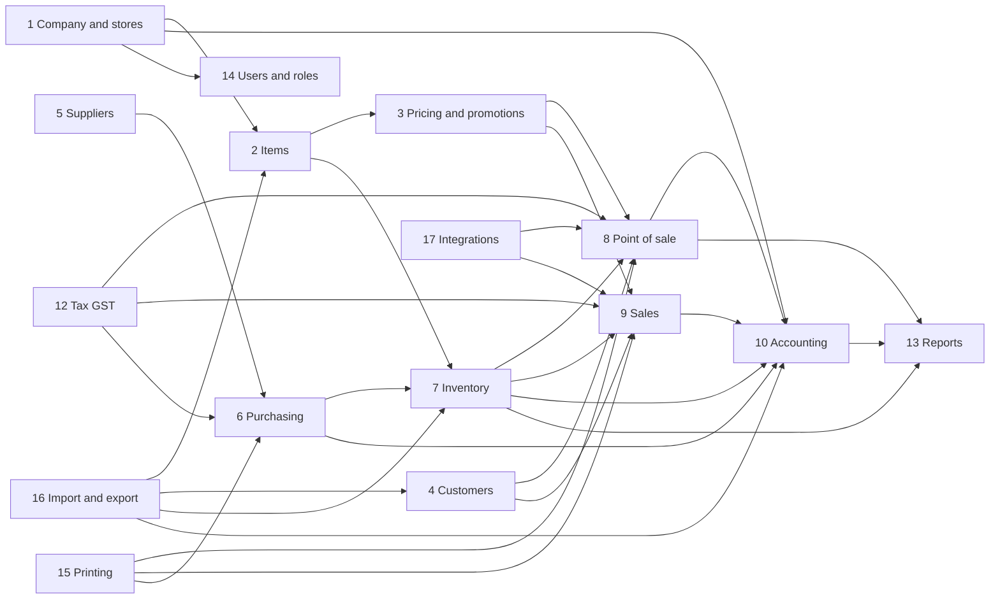
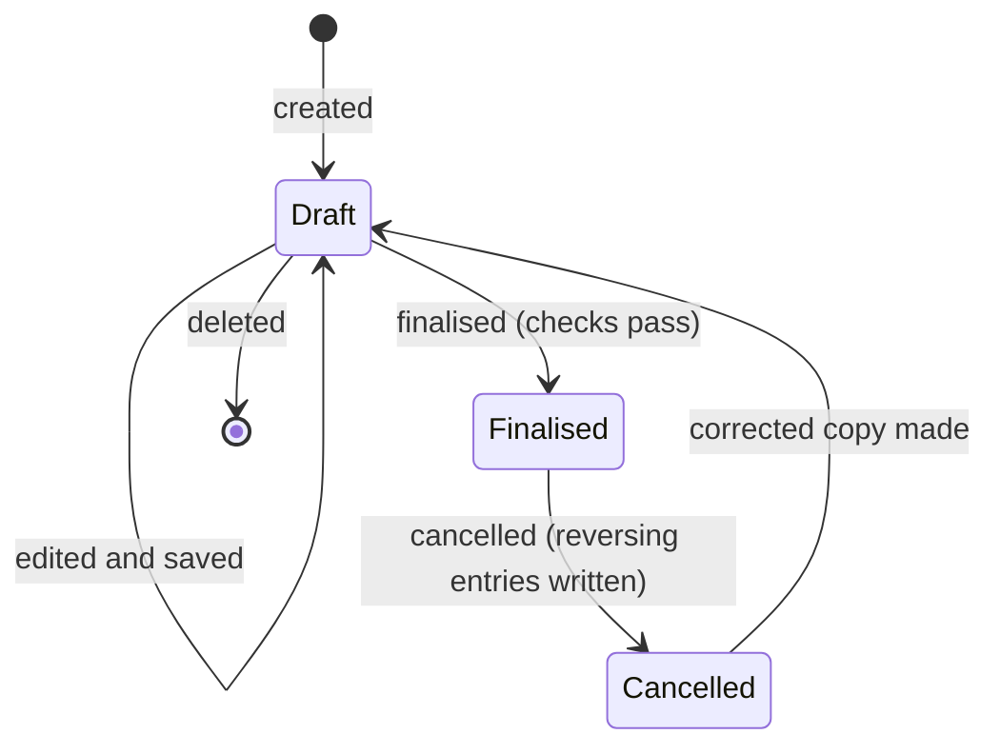
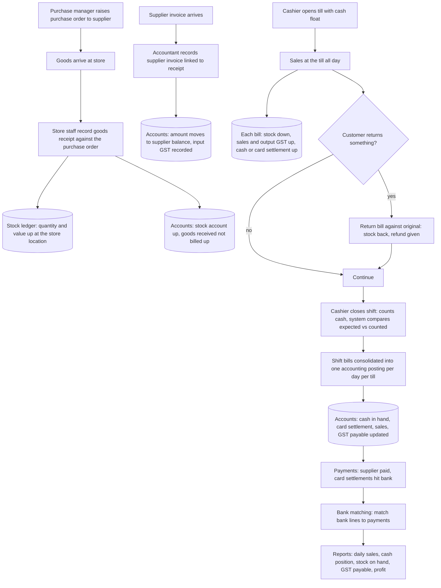

# Overview: Retail ERP blueprint

## What this blueprint is

This folder describes, in plain language, every feature a retail business needs from its ERP: what each feature does, who uses it, what information it keeps, what rules it enforces, how it calculates, and how it affects the rest of the system. It was written by studying a mature open-source ERP as a reference. It contains **no code** and no implementation details; a developer who has never seen the reference system should be able to build each module from these descriptions.

## Scope

**Covered (one file per module, in build order):**

| # | Module | File | One-line summary |
|---|--------|------|------------------|
| 1 | Company and stores setup | 02-company-and-stores.md | Legal entity, stores/branches, fiscal year, currencies, document numbering |
| 2 | Items | 03-items.md | Products, variants, units, barcodes, groups, brands, batch and serial tracking |
| 3 | Pricing and promotions | 04-pricing-and-promotions.md | Price lists, discount rules, schemes, coupons, loyalty |
| 4 | Customers | 05-customers.md | Customer master, groups, credit limits, addresses, GST details |
| 5 | Suppliers | 06-suppliers.md | Supplier master, groups, payment terms |
| 6 | Purchasing | 07-purchasing.md | Purchase orders, goods receipt, supplier invoices, returns, landed cost |
| 7 | Inventory | 08-inventory.md | Stock locations, stock movements, transfers, counts, reorder, valuation, stock ledger |
| 8 | Point of sale | 09-point-of-sale.md | Tills, shifts, billing, payments, returns, receipts, closing, offline |
| 9 | Sales (non-POS) | 10-sales.md | Sales orders, deliveries, invoices, credit notes for wholesale/B2B |
| 10 | Accounting | 11-accounting.md | Chart of accounts, double entry, journals, payments, bank reconciliation, period closing |
| 11 | Accounting effects map | 12-accounting-effects-map.md | One table: which accounts each transaction debits and credits |
| 12 | Tax (GST) | 13-tax-gst.md | Tax rates, intra/inter-state, HSN, inclusive/exclusive pricing, returns data, e-invoice, e-way bill (from official sources) |
| 13 | Reports and dashboards | 14-reports-and-dashboards.md | Daily, weekly, monthly reports a retailer needs |
| 14 | Users, roles and permissions | 15-users-roles-permissions.md | Roles, store-level restrictions, approvals, audit trail |
| 15 | Printing and documents | 16-printing-and-documents.md | Invoice and receipt layouts, numbering |
| 16 | Data import and export | 17-data-import-export.md | Bulk loading of items, customers, opening stock, opening balances |
| 17 | Integrations | 18-integrations.md | E-commerce, payment gateways, printers, messaging, webhooks |

Supporting files: 01-glossary.md (business terms), 99-open-questions.md (decisions needed), PROGRESS.md (status).

**Not covered** (present in the reference system, out of scope for a retail product): manufacturing (bills of materials, work orders, production), HR and payroll, projects and timesheets, CRM sales pipeline (leads, opportunities), support tickets, asset management, quality management, subcontracting, healthcare, education, agriculture, non-profit, website builder, subscriptions, telephony, shareholder registers, invoice discounting, dunning letters.

**Retail-relevant features found that were not in the original list** (noted here; each is described inside the most related module):

- Product bundles (one sellable item that is actually a kit of several stock items). Described in Items and Inventory.
- Stock reservation against a confirmed sales order so other sales cannot consume it. Described in Inventory and Sales.
- Pick lists and packing slips for order fulfilment. Described in Sales.
- Delivery trips (grouping deliveries for a driver with stops). Described in Sales.
- Alternative items (substitute when out of stock). Described in Items.
- Supplier scorecards (rating suppliers on delivery and quality). Described in Suppliers.
- Budgets per account and cost centre with warnings or blocks. Described in Accounting.
- Statements of account sent to customers on a schedule. Described in Customers.
- Bank statement import and auto-matching rules. Described in Accounting.
- Tax deducted/collected at source (TDS/TCS) for purchases and sales above thresholds. Described in Tax.
- Bulk deletion of transactions for wiping a trial period. Described in Users/permissions.

## How the modules connect

Reading the arrows: an arrow from A to B means B needs A to exist first, or A feeds information into B. Build order follows the numbering.

## Three ledgers that everything feeds

The reference system is built around one idea: transactions never change balances directly. Every finalised transaction writes **ledger entries**, and balances are always sums of ledger entries. There are three ledgers a retailer must understand:

1. **Stock ledger.** One line per item, per stock location, per movement: date, quantity in or out, rate, running quantity, running value. Every receipt, sale, transfer, adjustment or return writes here. Stock balance and stock value reports are sums of this ledger.
2. **General ledger (accounting).** One line per account per transaction, with a debit or a credit amount, always balanced within one transaction. Profit and loss, balance sheet and trial balance are sums of this ledger.
3. **Settlement records (customer and supplier balances).** A view of the general ledger filtered by customer or supplier, used to know who owes what, to match invoices with payments, and to age outstanding balances.

A transaction that is **cancelled** does not delete its ledger lines; it writes equal and opposite lines so history is never lost. A cancelled transaction can be **corrected** (a new numbered version is made from it) but the original stays visible.

## Document lifecycle used everywhere

Every transactional record (purchase order, goods receipt, invoice, stock movement, payment, journal) follows the same lifecycle:

- **Draft** can be edited or deleted freely and has no effect on stock or accounts.
- **Finalised** is frozen: no edits (except a few harmless fields such as remarks), and ledger entries exist.
- **Cancelled** keeps the record and its reversing entries; only some records can have a corrected copy.

Master records (item, customer, supplier, stock location, account) do not have this lifecycle; they are simply in use or switched off.

## A typical retail day

## Conventions used in every module file

- Each module file uses the same headings: Purpose, Who uses it, Main records, Processes, Business rules, Calculations, Effects on other modules, Reports, Edge cases, Settings.
- Neutral names are used throughout. Where the reference system has a product-specific name for a concept, the glossary records the neutral name chosen.
- Currency examples use Indian rupees. Tax examples use Indian GST, sourced from official government portals, not from the reference system.
- A **store** is a physical shop. A **stock location** (warehouse) is any place stock is counted. A store has at least one location, and its sales floor and back room may be separate locations.
