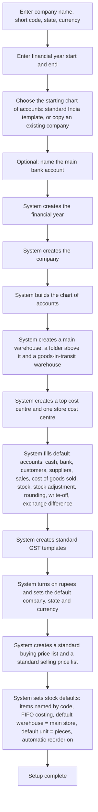
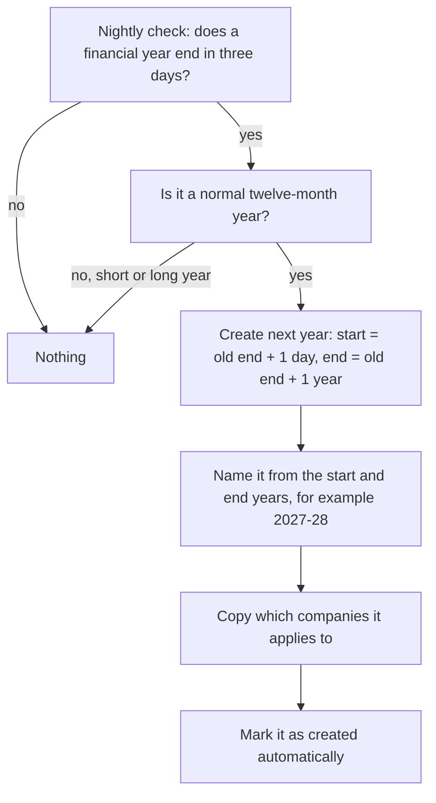
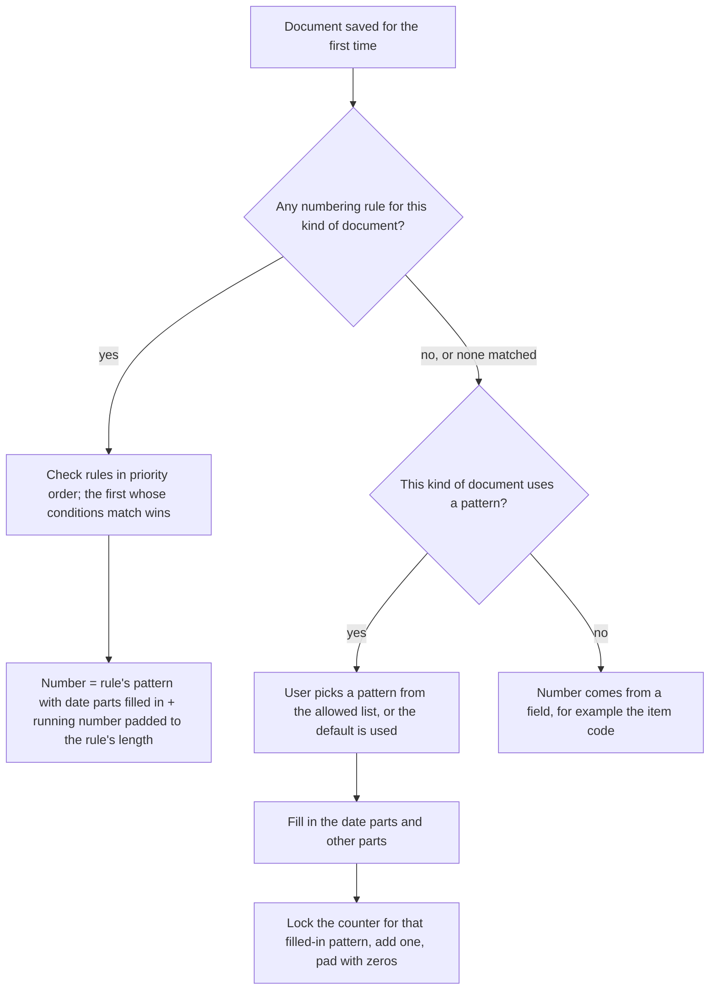
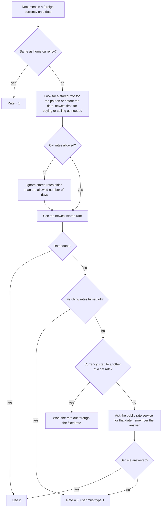

# Company and stores setup

## Purpose

Sets up the business itself: the legal company that owns the books, the shops it runs, the financial year it reports in, the money it deals in, and how every bill and document gets its number. Everything else depends on this, so it is done first and changed rarely.

## Who uses it

| Role | What they do here |
|------|-------------------|
| Owner / implementer | First-time setup: company name, state, currency, financial year, starting chart of accounts. |
| Accountant | Financial years, default accounts, exchange rates, store cost centres, locking past months. |
| Store manager | Adds a new shop with its stock locations and tills. |
| System administrator | Date and number formats, rounding, document numbering. |

## Main records

### The company

The business needs to know who it is, legally and for tax:

- **Who we are:** legal name, a short code (used to keep names unique if there is ever more than one company), state, GSTIN, registered address, phone, email, logo. The logo and address print on bills.
- **What money we keep books in:** the home currency (rupees). Every ledger is kept in it; it cannot change once trading starts.
- **Where things post by default:** one default account each for cash, bank, sales, cost of goods sold, stock, stock adjustments, goods received but not yet billed, customer balances, supplier balances, rounding, write-offs and exchange differences. These are the fall-backs whenever an item, customer or warehouse does not name its own account. Setup fills them in automatically from the starting chart of accounts.
- **How stock is costed:** whether stock movements update the accounts immediately (recommended: yes), and the costing method (FIFO or moving average, explained in Inventory).
- **Locking the past:** a date up to which nobody (except one trusted role) may add or change entries, so closed months stay closed.
- **Defaults for new customers and suppliers:** a starting credit limit, payment terms and terms-and-conditions text.

### The store

A store is a physical shop. The business needs, per store:

- **Name and short code**, address, and the store's GSTIN if the store has its own registration.
- **Where its stock is counted:** one or more warehouses (shop floor, back room, damaged goods).
- **How its profit is reported:** a cost centre, so sales and expenses can be reported per store.
- **Its tills**, each with its own cash drawer and payment methods (Point of sale module).

Proposed design: one Store record that holds all of the above, instead of asking the user to keep a warehouse, a cost centre and tills in step by hand.

### Warehouse

Any place stock is counted. A warehouse needs a name, the company, and its place in a simple tree (a store can be a folder holding shop floor and back room). It may be marked as a transit location (goods on the road between stores) or a rejected-goods location. It can name its own stock account; if it does not, its parent's account or the company default is used. Full behaviour is in Inventory.

### Cost centre

A label for where income and costs belong, normally one per store (and optionally per department). Arranged as a tree; only the bottom-level labels can be used on bills.

### Extra reporting tag (optional, larger businesses)

An additional label stamped on every accounting line, such as sales channel (shop, online, wholesale), when the cost centre alone is not enough for reporting.

### Financial year

The twelve-month period the books are kept in (1 April to 31 March in India), named for example 2026-27. The first year may be shorter if the business starts mid-year.

### Currency and exchange rates

Rupees are always on. Other currencies are needed only by businesses that import or export: each currency needs its symbol, its smaller unit (like paise), and the smallest coin in use (used for rounding cash bills). Exchange rates are stored per day and per currency pair, separately for buying and selling if needed, or fetched from a public rate service when missing.

### Document numbering

Every kind of document (till bill, invoice, purchase order, stock transfer) needs its own numbering pattern, for example a prefix, the store code, the year, and a running number. The business may want a separate sequence per store; this is done with a numbering rule that picks the pattern by condition.

### System-wide preferences

Date format (for example day-month-year), number format (Indian grouping 1,00,000), decimal places for money and for quantities, rounding method, time zone and language.

## Processes

### 1. First-time setup

The reference system also creates manufacturing warehouses here; a retail product should not.

### 2. Adding a store

1. Create the store's warehouse (or a folder with shop floor and back room inside it).
2. Create the store's cost centre.
3. If the extra reporting tag is used, add the store as a value.
4. Create the store's tills, each linked to the warehouse, cost centre, cash account and payment methods (Point of sale).
5. Limit staff to their store (Users and permissions).

### 3. Moving to the next financial year

The accountant can also create years by hand. Closing a year (moving profit to retained earnings and locking it) is in Accounting.

### 4. Numbering a document

A document gets its number when it is first saved, and the number never changes, even if the document is cancelled.

A pattern can contain: two- or four-digit year, month, day, day of the year, week number, the company's short code, any value from the document (such as the store code), and the running number with a chosen length. Example: a pattern of prefix, year and a five-digit counter gives SINV-2026-00001. Because the year is part of the pattern, the counter starts again at 1 each year. Date parts normally come from today's date; a preference can make them come from the document's own date instead.

### 5. Correcting a cancelled document

When a cancelled document is copied to make a corrected version, the new one takes the old number plus a revision number (first correction -1, next -2). The business can choose instead to give corrections a fresh number.

### 6. Getting an exchange rate

## Business rules

- Company name and short code are required; if the short code is left blank it is made from the initials of the name. Short codes must be unique.
- Home currency and state (country) are required.
- The home currency cannot be changed once any sale or purchase has been finalised for the company; those would all have to be cancelled first.
- Every default account must belong to the same company, must be a bottom-level account (not a folder), must be active, and must be in the home currency.
- A parent company must be marked as a group; a child company copies its parent's chart of accounts and reporting currency (only for businesses with several legal companies).
- Changing the company's country re-installs that country's tax templates and defaults.
- The company's costing method cannot be changed once stock movements exist for items that do not have their own method.
- Updating accounts from stock movements cannot be switched off, and the choice of stock account per item or per warehouse cannot be changed, once any stock has moved; those movements would have to be cancelled first.
- If stock updates the accounts, the company should have a default stock account; the system warns if it is missing.
- The locking date cannot be set while stock re-costing is still pending for dates up to that date.
- No accounting entry may be dated on or before the locking date unless the user holds the one role allowed to post into locked periods.
- Individual accounts can also be locked. Posting to a locked account is refused unless the user holds that same role, and only that role can lock or unlock an account.
- A company cannot be deleted while it has child companies. Deleting a company with no accounting entries also deletes its accounts, cost centres, budgets, warehouses, payment-method account links and item defaults. A company with accounting entries cannot be removed this way; a separate wipe tool exists (Users and permissions).
- Renaming a company renames it wherever it was saved as a user's default.
- A financial year must end after it starts; unless marked as a short or long year, it must end exactly one year minus one day after it starts.
- Financial years of the same company may not overlap. Two overlapping years are allowed only if they belong to different companies; a year that names no company overlaps with everything.
- Every document's date must fall in an active financial year for its company; otherwise it is refused, naming the date.
- An exchange rate must be above zero, the two currencies must differ, and it must be marked for buying, selling or both. There is at most one rate per pair per day per purpose.
- Only currencies that are switched on can be used.
- A cost centre must sit under a parent unless it is the top one. A folder cost centre with children cannot become a bottom-level one; a cost centre with entries cannot change between folder and bottom-level; a cost centre used in a cost-sharing rule cannot become a folder.
- An extra reporting tag cannot be based on the company, accounts, cost centres or another tag; each base can be used once; each company may have one default value per tag.
- A numbering pattern may belong to only one kind of document. A pattern can be set so that the user must pick it every time.
- Only a system administrator may change a running counter, and the change (old and new value) is kept in the history.
- Numbering rules may only test fields that exist on that kind of document.

## Calculations

- **Default short code** = first letter of each word of the company name, in capitals.
- **Financial year name** = start year, or start year and end year when they differ.
- **Next financial year** = (old end + 1 day) to (old end + 1 year).
- **Document number** = filled-in pattern + running number padded with zeros to the chosen length (five by default for numbering rules). The counter belongs to the filled-in pattern and goes up by one under a lock, so two users never get the same number.
- **Corrected document number** = original number + dash + (previous revision + 1).
- **Exchange rate used** = newest stored rate dated on or before the document date for that pair and purpose; if old rates are not allowed, it must also be newer than (document date − allowed days).
- **Rounding** (applies to every money and quantity figure):
  - *Banker's rounding*: an exact half goes to the even neighbour (2.5 → 2, 3.5 → 4). The reference system uses this by default.
  - *Normal (commercial) rounding*: an exact half goes up, away from zero (2.5 → 3, −2.5 → −3).
  - Use normal rounding; it is what customers and tax officers expect on bills.
- **Decimal places**: money to 2 places; quantities to 3 places unless the preference says otherwise.
- **Cash rounding at the till** uses the smallest coin in use (for example the nearest rupee); the rule is in Point of sale.

## Effects on other modules

- Creating the company builds the chart of accounts (Accounting), the first warehouses (Inventory), the first cost centre, GST templates (Tax) and two price lists (Pricing).
- Company default accounts are used whenever an item, customer, supplier or warehouse does not name its own account.
- The company's costing method is used for items that do not have their own (Inventory).
- The locking date and locked accounts block entries in every module.
- Financial years limit every document date and define the period for year-end closing and yearly reports.
- Exchange rates convert foreign-currency documents into rupees on every ledger line.
- Rounding and decimal places affect every total, tax and ledger amount.
- Document numbers identify everything that is printed, exported or referred to (Printing, Data export).
- Stores (warehouse + cost centre) are what store-level access limits and store reports use (Users and permissions, Reports).

## Reports

- **Companies** — which companies exist and how they are grouped.
- **Financial years** — start, end, active or not, created automatically or by hand.
- **Exchange rates** — by date and currency pair.
- **Numbering preview** — for a pattern, what the next numbers will look like and the current counter.
- **Store structure** — the tree of cost centres and warehouses.
- **Counter change history** — who changed which counter, from what to what, when.

## Edge cases

- **Starting mid-year:** the first financial year can be short, starting on the go-live date and ending at the normal year end. Opening balances are dated the day before go-live (Data import).
- **Several stores, one company:** the usual Indian retail case. One GSTIN, one set of books, one currency; stores differ only by warehouse, cost centre and tills. Reports filter by store.
- **Stores with separate GST registrations:** the reference system handles this through the store's address rather than separate companies. Keep one company and record each store's GSTIN on its address (open question).
- **Several companies (franchise, separate legal entities):** each has its own books; stock moving between them must be sold and bought, not transferred. Not needed in the first version unless the owner decides otherwise.
- **Importing from abroad:** supplier bill in foreign currency, converted at the stored or fetched rate; differences when paying go to the exchange difference account (Accounting).
- **Rate service unreachable:** the rate comes back as zero and must be typed by hand; the document cannot be finalised with a zero rate.
- **Changing the year end (for example from calendar year to April–March):** create one short or long bridging year; the year after a short year is not created automatically, so create it by hand.
- **Counter lowered by mistake:** a document whose number already exists will not save; the administrator must raise the counter again. This is why counter changes are restricted.
- **Year in the number around 1 April:** a bill typed on 1 April but dated 31 March would get the new year in its number unless numbering uses the document date. Businesses that back-date entries should use the document date.
- **Deleting a company by mistake:** cannot be undone; ask the user to type the company name to confirm.

## Settings

**How stock is costed and accounted**
- Whether stock movements update the accounts immediately. Keep this on; then stock value in the books always matches the shelves.
- Costing method: FIFO or moving average (each item may override it). Decides the cost of goods sold and stock value.
- Whether each warehouse or each item carries its own stock account. Per warehouse is simplest.

**Protecting closed periods**
- A locking date up to which nothing may be added or changed, and the one trusted role (usually the chief accountant) allowed to bypass it and to lock individual accounts.

**Defaults that save typing**
- Default accounts, default cost centre, the warehouse that receives customer returns, and the transit warehouse for store-to-store moves.
- Default credit limit, payment terms and terms-and-conditions text, copied onto new customers, suppliers and documents.
- Default company, state and currency, filled into new records.

**Foreign currency (only if importing or exporting)**
- Whether an older stored exchange rate may be reused, and for how many days.
- Which public service supplies missing rates, or none.

**How amounts look**
- Whether bills show a rounded total (to the rupee) and the amount in words.
- Date format, number format (Indian grouping), decimal places, rounding method, time zone and language.

**Document numbers**
- The numbering patterns allowed for each kind of document, and whether the user must pick one each time.
- Numbering rules for a separate sequence per store or per type of customer.
- Whether date parts in numbers come from today or from the document's own date.
- Whether corrected documents keep the old number with a revision suffix or get a fresh number.
