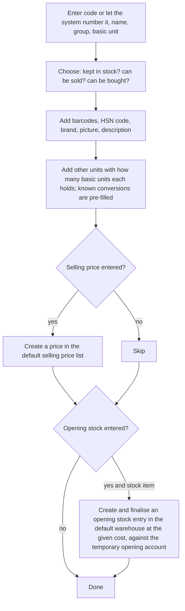
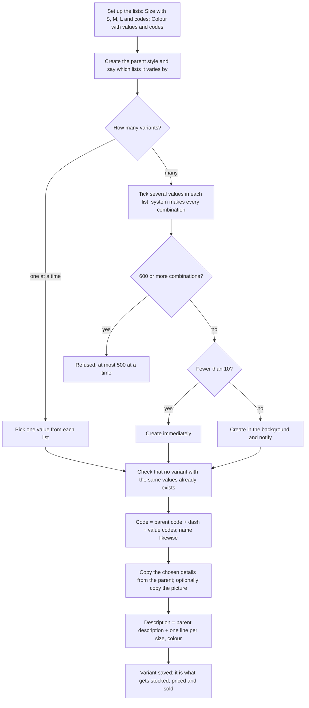
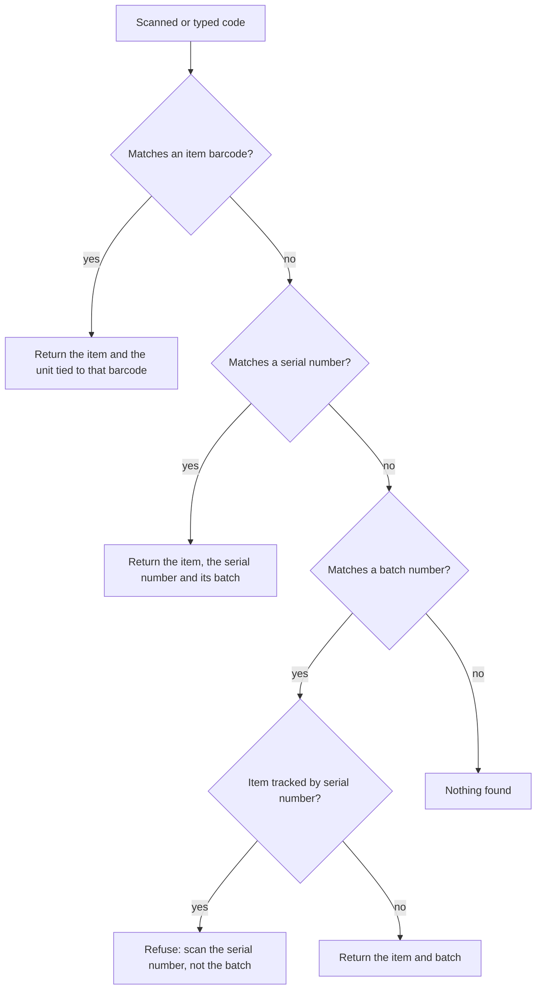

# Items

## Purpose

Keeps the product catalogue: everything the shop buys, stocks or sells, its sizes and colours, the units it is counted in, the barcodes scanned at the till, how it is grouped for reports and tax, and whether individual pieces (serial numbers) or lots (batches with expiry dates) are tracked.

## Who uses it

| Role | What they do here |
|------|-------------------|
| Catalogue manager | Creates products, sizes and colours, groups, brands, units, barcodes, HSN codes, pictures. |
| Purchase manager | Supplier codes, preferred supplier, minimum order, delivery time, reorder levels. |
| Store manager | Scans an item to check stock and price; sets reorder levels for the store. |
| Accountant | Which accounts and tax rates an item uses. |
| Cashier | Only scans or searches items at the till. |

## Main records

### Item

One record for every product (or service) that can appear on a bill. The shop needs to know:

- **What it is:** an item code (typed, or numbered automatically), a name that fits on a receipt, a longer description, a picture, the brand, and the item group it belongs to (for example Dairy > Milk).
- **How it is counted:** the basic unit stock is kept in (piece, gram, millilitre), plus other units it is bought or sold in, each with how many basic units it contains (a box of 12, a kilogram = 1000 grams). The basic unit always equals 1.
- **How it is scanned:** one or more barcodes, each optionally tied to a unit, so scanning the single-piece barcode adds one piece and scanning the carton barcode adds one carton.
- **What kind of item it is:** whether stock is kept for it (goods) or not (services, carry-bag charge, gift-wrap, kit headers); whether it can be bought; whether it can be sold; whether it is switched off; a date after which it can no longer be sold or bought.
- **Sizes and colours:** whether the item is a parent style that has variants, which characteristics the variants differ by (size, colour), and for a variant, which parent it belongs to and its size and colour.
- **Lots and pieces:** whether it is tracked by batch (for expiry dates, as in food and medicine), whether new batches are numbered automatically on receipt, its shelf life in days; whether it is tracked by serial number (for warranty, as in phones and appliances) and the warranty period.
- **Tax:** the HSN code and the GST rate that applies (through a tax template; see Tax).
- **Buying information:** preferred supplier, the supplier's own code for the item, minimum order quantity, usual delivery time in days, last purchase price (filled automatically), whether a supplier ships it straight to the customer.
- **Selling limits:** the largest discount a cashier may give on it.
- **Reordering:** for each store, the stock level at which more should be ordered, how much to order, and whether to buy it from a supplier or transfer it from another store (see Inventory).
- **Costing:** normally the company's costing method; an item may override it. Whether this item may be sold beyond stock even when that is generally not allowed.
- **Account and store defaults:** usually inherited from the item group; an item can override its default warehouse, supplier, sales account, cost of goods sold account and store cost centre.
- **Opening stock:** quantity and cost to load once when the item is first created (for single-store setups; multi-store opening stock is loaded through Data import).

The reference system also carries manufacturing, fixed-asset, subcontracting, sample-retention, quality-inspection, commission and deferred-revenue details on items. A small retailer does not need them.

### Size and colour lists (variant attributes)

Each characteristic (Size, Colour, Pack) has a list of allowed values, each with a short code that goes into the variant's item code (S, M, L; RED, BLU). Numeric characteristics such as shoe size can instead be a range with a step (6 to 11 in steps of 0.5).

### Units

A list of units (piece, box, kg, g, litre, ml, metre), each saying whether fractions are allowed (pieces: no; kg: yes). Standard conversions between units of the same kind (1 kg = 1000 g) are stored once and pre-filled on items.

### Item groups

A tree of categories (Grocery > Staples > Rice). Groups carry defaults that new items copy: tax rate, accounts, default warehouse. Only the lowest-level groups are given to items.

### Brands

Brand names, used for search, reports and promotions; a brand can also carry defaults.

### HSN codes

The list of HSN codes with descriptions, needed on GST invoices (Tax).

### Batches

A lot of one item received together. The shop needs: the batch number, the item, the manufacturing and expiry dates, which supplier and receipt it came from, and how much of it is in stock.

### Serial numbers

One physical piece. The shop needs: the serial number, the item, where it is now (which warehouse, or sold to which customer), what it cost, when it came in, and when its warranty ends.

### Kits (bundles)

A product sold as one line but made of several stocked items (a gift hamper, a school kit). The shop needs the kit item (which is not stocked itself) and the list of contents with quantities. When the kit is sold, each content item leaves stock; the kit line carries the price.

### Substitutes

Pairs of items that may replace each other when one is out of stock, and whether the swap works both ways.

### Stock position per item per warehouse

Kept by the system, never typed: quantity on hand, quantity promised to customer orders, quantity on order from suppliers, quantity requested internally, the expected position after all of these, and the current cost and value.

## Processes

### 1. Creating a simple item

If the item has no defaults of its own, the group's defaults and tax rate are copied in; if the group has none, the system's default warehouse is used.

### 2. Creating a style with sizes and colours

The parent style is never stocked or sold. Changing the parent later copies the shared details to all its variants (straight away for up to 30, in the background beyond that) unless this copying is turned off.

Variants can also be defined by manufacturer and part number instead of size and colour (code = parent code, manufacturer, part number); rarely needed in retail.

### 3. Scanning a code

Used on every screen with a scan box, including the till.

A scan result is remembered for two minutes so repeated scans are fast. On a bill, scanning an item (and batch) already on a line adds one to that line instead of starting a new line.

### 4. Changing an item's basic unit

Allowed only while the item (and its variants) has never had stock. The other-unit list is then cleared and must be entered again.

### 5. Merging two items

Allowed only when both have the same basic unit, are both stock items or both not, and have the same batch and serial tracking, and not when both are kits. Stock and last purchase price are recalculated afterwards; stock values may take a little time to settle.

### 6. Retiring an item

Switch it off (blocks it everywhere at once) or set an end date (blocks it from that date). Deleting an item also deletes its stock positions, prices and variants, and is only possible if it has never been used on a document.

## Business rules

Identity and kind

- Item code is required and unique; the name defaults to the code.
- Item group and basic unit are required. Only a lowest-level group may be used.
- An item that is switched off, past its end date, or cancelled cannot be used on any document.
- An item not kept in stock cannot be used on stock documents.
- Serial tracking is only allowed on stock items.
- Batch tracking, serial tracking, stock or non-stock, and costing method cannot be changed once any finalised document uses the item (switching to moving average is tolerated). The message names an example document.
- Serial tracking cannot be turned off while serial numbers are still recorded against the item.
- Costing each serial number separately cannot be turned on once serial numbers exist, because their individual costs were never recorded.
- If serial numbers exist and they are not costed separately, the item is costed at moving average; FIFO cannot be chosen.

Units

- The basic unit always equals 1 in the item's unit list; any other factor for it is refused.
- A unit may appear only once in an item's unit list.
- A missing factor is filled from the standard conversions if a direct, reverse or one-step indirect conversion exists.
- A variant must use its parent's basic unit unless the business allows otherwise.
- A unit that does not allow fractions refuses fractional quantities on documents (kit contents included).

Barcodes

- A barcode may belong to only one item in the whole catalogue.
- If the barcode type is given (EAN-13, EAN-8, UPC-A, Code 39 and others), the code must pass that type's check-digit test, otherwise it is refused.

Sizes and colours

- A variant must point at a parent that has variants.
- Each characteristic on a variant must be one of the parent's, must be in use, and its value must be in the list (or within the numeric range and on the step).
- Parents and variants must have their characteristics filled in; a characteristic may not appear twice.
- Two variants of one parent cannot have the same values.
- A numeric range needs a start below its end and a step that is not zero.
- Values and their short codes must be unique within a list, ignoring capital letters.
- A value cannot be renamed while variants use it, unless the business allows renames; then the new name is copied to all variants, and a changed short code renames the variants' codes.
- A parent cannot stop being a parent while it has variants.
- Once any stock has moved, a variant's parent and characteristics cannot be changed; make a new item instead.
- Whether variants are by characteristics or by manufacturer cannot be changed once variants exist.
- Prices can be set only on variants, not on the parent style.

Batches and serial numbers

- A batch can be created only for a batch-tracked item.
- A batch number is required unless the item numbers batches automatically; then it comes from the item's pattern, else the shop-wide pattern, else a random code. A generated number that already exists is generated again.
- For items with expiry dates and a shelf life, a batch without an expiry date gets manufacturing date + shelf life; if no expiry date can be set, the batch is refused.
- An item with automatically numbered, expiring batches must have a shelf life above zero.
- A serial number cannot be placed in a warehouse by hand; only a stock receipt can do that, and its item and warehouse cannot be edited afterwards.
- A serial number used in any stock movement cannot be deleted.
- Warranty status: under warranty while the end date is today or later, out of warranty after.

Defaults and taxes

- Only one set of defaults per company on an item, group or brand; every account, warehouse and cost centre in it must belong to that company.
- A tax template may be listed once per tax category on an item or group; a price band for a tax rate must have its minimum not above its maximum.
- Reorder settings: one per store warehouse and type of request; a reorder level needs a reorder quantity; the warehouse to supply must sit inside the warehouse group being checked.
- Reorder settings only act if automatic reordering is switched on (a warning is shown otherwise).
- Batch or serial tracking can only be ticked if tracking is switched on for the business.

Kits and substitutes

- A kit item must not be kept in stock; its contents must not themselves be kits; content quantities must be above zero.
- A kit cannot be deleted while any finalised document uses it.
- Substitutes must be allowed on the item (and on the other item too for two-way swaps); the two items must differ; each pair is recorded once. Both must be stock items; different batch or serial tracking only produces a warning.

Opening stock

- Opening stock needs a cost (zero is accepted with a warning). It is refused for non-stock items, for serial-tracked items without automatic serial numbering, and for batch items without automatic batch numbering. Quantity must be above zero; the warehouse must belong to the company; a temporary opening account must exist.
- Opening stock of more than ten thousand serial-numbered pieces is created in the background.

## Calculations

- **Quantity in basic units** = quantity entered × units per entered unit. All stock records are kept in basic units.
- **Price per basic unit** = price entered ÷ units per entered unit.
- **Indirect conversion** (when no direct one is stored) = factor(from → middle unit) ÷ factor(to → middle unit). Example: grams to milligrams is 1000 and grams to kilograms is 0.001, so kilograms to milligrams is 1000 ÷ 0.001 = 1,000,000.
- **Reverse conversion** = 1 ÷ stored factor, rounded.
- **Variant code** = parent code + dash + short code of each value, in list order (numeric values use the number itself).
- **Numeric value check:** valid if start ≤ value ≤ end and (value − start) is a whole number of steps.
- **Number of variant combinations** = number of values ticked in each list, multiplied together.
- **Batch expiry** = manufacturing date + shelf life days (when not typed).
- **Last purchase price** = net price on the most recent finalised supplier bill for the item, in rupees per basic unit.
- **Expected position** = on hand + on order + requested − promised to customers (see Inventory).
- **Which account a bill line uses:** the item's own default for that company → its group's → its brand's → the company's. The store cost centre is found the same way (selling cost centre when a customer is on the document, buying cost centre otherwise); a cost centre of another company is ignored. Cost of goods sold on sales follows the same order.

## Effects on other modules

- Items are what Pricing prices, Inventory counts, the till and Sales sell, Purchasing buys and Tax classifies (HSN and rate).
- Saving an item with a selling price creates a price (Pricing).
- Saving an item with opening stock creates and finalises an opening stock entry (Inventory): stock quantity and value go up; accounts: stock up, temporary opening account down.
- Changing an item's name, description or brand updates all its prices.
- Item, group and brand defaults decide which sales, cost, stock and discount accounts and which store cost centre every bill line uses (Accounting).
- Switching off a size or colour list switches it off on every variant.

## Reports

- **Item list and group tree** — browse the catalogue by group, brand, stock or not, switched off, styles with variants.
- **Variant details** — for a style, every variant with its size and colour, stock and price.
- **Item prices** — every price by price list and item (Pricing).
- **Prices with stock** — price lists next to current stock per warehouse.
- **Stock by item** — see Inventory.
- **Quick stock lookup** — scan a barcode, pick a warehouse and date, see quantity, value and picture. For the shop floor.
- **Batch expiry** — batches with expiry dates, days left and quantity in stock.
- **Serial numbers** — where each piece is, its status and warranty end date.
- **Kit availability** — how many complete kits can be made from stock in each warehouse.
- **Where an item is used** — which kits and documents use it (check before switching it off).
- **Items to reorder** — see Inventory.

## Edge cases

- **Single-piece and carton barcodes:** two barcodes on one item, each tied to its unit; scanning the carton barcode adds one carton (converted to pieces for stock).
- **Supplier changes the barcode:** add the new one and keep the old one so returns of old stock still scan.
- **Loose and packed sales (kg and packet):** basic unit is the smallest (gram or piece); the selling unit may be kilogram or packet; prices may be set per unit.
- **Weighed items at the till** (fruit, sweets): quantity comes from a scale or a price-embedded barcode; the unit must allow fractions (open question on price-embedded barcodes).
- **Expired batch at the till:** the sale is refused or warned according to the business's choice (Inventory, Point of sale).
- **A variant never sold needs a different size or colour:** allowed only while it has no stock movement; otherwise make a new variant.
- **Re-tagging prices:** done in Pricing; item changes do not change prices except name and description.
- **Item deleted by mistake:** impossible once used on documents; switching it off is the safe way.
- **Kit sold at the till:** one line with one price; each content item leaves stock and must be available.
- **Several stores:** items are shared by all stores; store differences come from reorder settings per store and prices per price list.
- **Several companies:** each company can have its own item defaults, so one catalogue serves all.

## Settings

**Creating items quickly**
- Whether item codes are typed by staff or numbered automatically.
- Default item group, basic unit and warehouse for new items.
- Which details a variant copies from its parent style, whether the copying continues after the variant is created, whether a variant may use a different unit, and whether size and colour values may be renamed after use.

**Tracking lots and pieces**
- Whether batch and serial tracking is used at all.
- The shop-wide batch numbering pattern for items that do not have their own.

**Stock control**
- Default costing method (FIFO or moving average); each item may override.
- Whether items may be sold beyond the stock on hand; each item may override.

**Prices from purchasing and selling**
- Whether a purchase or sale should automatically save its price as the item's price when none exists, and whether it should overwrite an existing price.
- Whether only units listed on the item may be used on documents.

**Per item**
- Whether substitutes may be offered when the item is out of stock.
- The largest discount allowed on the item at the till or on an invoice.
- How much more than ordered may be received or billed for this item (overrides the general allowance).

**Search speed**
- A search index for very large catalogues, so the till finds items quickly.
