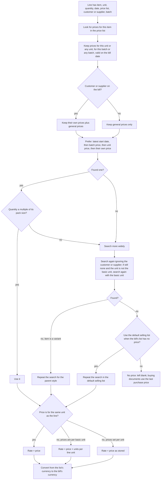
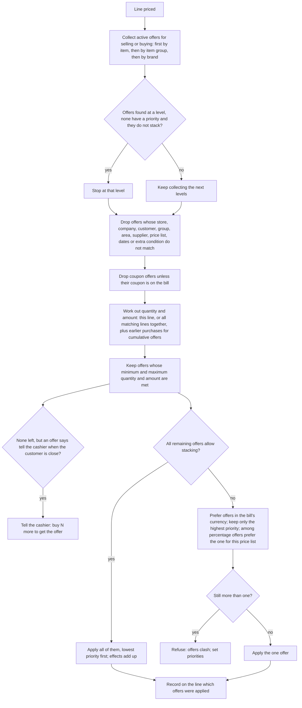
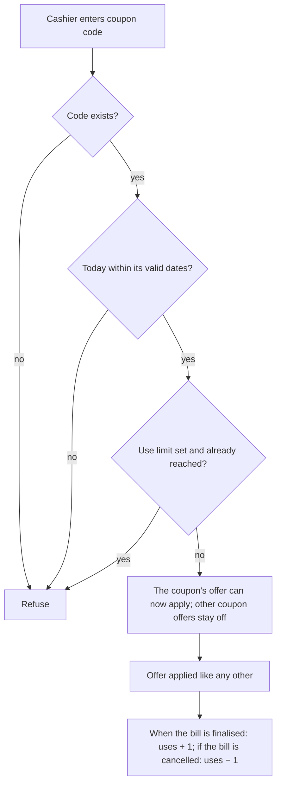

# Pricing and promotions

## Purpose

Decides the price on every bill line, which discounts or free goods apply automatically, which coupons are accepted, and how loyalty points are earned and spent. The cashier scans an item and the system works out the price and any offer, so nobody has to remember the offers.

## Who uses it

| Role | What they do here |
|------|-------------------|
| Owner / catalogue manager | Selling prices, offers, coupons, loyalty scheme. |
| Purchase manager | Buying prices and supplier-specific prices. |
| Store manager | Checks which offers applied on a bill; approves discounts within limits. |
| Cashier | Sees prices and automatic offers; enters coupon codes; redeems points; gives a manual discount up to the item's limit. |
| Accountant | The accounts that discounts and loyalty redemptions go to. |

## Main records

### Price lists

A shop usually needs a few named sets of prices: a standard retail list, perhaps a wholesale list, a staff list, and a buying list for supplier prices. For each list the shop needs to know whether it is for selling or buying, its currency (rupees), and whether it is in use. It also needs to say whether a price is per basic unit (so a box price is worked out by multiplying) or set separately for each unit. Setup creates one standard selling list and one standard buying list.

### Prices

One price for one item in one list. The shop needs: the item, the unit the price is for, the price, and when it starts and ends (so a price change can be loaded in advance). Optionally a price can be only for one customer (a contract price), only for one supplier, only for one batch (a clearance price on a near-expiry lot), or only when bought in multiples of a pack size.

### Offers (discount rules)

An offer says: when these conditions are met, change the price or give something free. The shop needs to describe:

- **What it is on:** chosen items, item groups (and their sub-groups), brands, or the whole bill. Optionally only in certain stores.
- **Who gets it:** everyone, or one customer, a customer group or an area; for buying offers, a supplier or supplier group.
- **When:** start and end dates, and a priority (1 to 20, higher wins) for when offers overlap. An optional extra condition on the bill can narrow it further.
- **How much must be bought:** a minimum and maximum quantity and/or amount. This can be tested per line, across all matching lines on the bill together (for example any three items from a group), or including the customer's earlier purchases during the offer period (cumulative offers).
- **What the customer gets:** a special price, a percentage off, a fixed amount off, or free goods (the same item or another one, at zero or a token price). Free goods can repeat (buy 2 get 1, buy 4 get 2…) and can be rounded down to whole blocks.
- **Offer on a different item:** buying the listed items gives the discount on another item.
- **How it combines:** whether it may stack with other offers, whether a percentage stacks on an already discounted price, whether it only works with a coupon, and whether the cashier should be told when the customer is close to qualifying (for example within 10%).

### Slab promotions

A quicker way to set up offers with several levels (buy 5 get 5% off, buy 10 get 10% off, buy 20 get one free). The shop enters the levels once; the system creates and maintains one offer per level.

### Coupons

A code that switches on one offer. The shop needs: the code, the offer it unlocks, valid dates, how many times it may be used and how many times it has been used. A personal coupon for one customer can be made single-use. A coupon holds no money balance (see open questions for real gift cards).

### Loyalty scheme

The shop needs: the scheme's name and dates, which customers join (all, or a customer group or area), the tiers (for example Silver and Gold, each with the total spend needed to reach it and how many rupees of spend earn one point), what one point is worth in rupees when spent, how many days points last, and which expense account pays for redeemed points.

### Points history

Every time points are earned or spent the system records: the customer, the scheme and tier, the points (plus for earned, minus for spent), the bill, the date and the expiry date. A customer's balance is the sum of unexpired entries.

## Processes

### 1. Finding the price for a line

If no price was found and the business allows it, the price the user types is saved as the item's new price (basic unit, same currency); the business can also choose to overwrite an existing price this way.

### 2. Applying offers to a line

What an offer does to a line: a special price replaces the list price (multiplied by the units per line unit if the offer has no unit); a percentage becomes a rupee discount on the price; a fixed discount is added as it is; a mark-up is recorded; a check-only offer changes nothing but complains when the bill is saved if the discount given is smaller than the offer. Free goods add a free line with the free quantity (repeating offers: free quantity × (quantity bought − starting quantity) ÷ N, optionally rounded down to whole blocks), at the free price, marked as free so no other offer applies to it.

When an offer no longer applies (the cashier switches offers off for the bill, or the conditions stop being met), the discount and mark-up it gave are removed and its free line is deleted, unless the offer says the free line may stay.

### 3. Whole-bill offers

Once the line totals are known, whole-bill offers are tested against the bill's total quantity and amount. A price offer sets the bill discount (percentage or amount, before or after tax); a free-goods offer adds the free item. If a whole-bill offer applied earlier no longer qualifies, its discount is removed and the cashier is told. A discount typed by hand is not overwritten.

### 4. Spreading a bill discount over the lines

A discount on the whole bill is shared across the lines in proportion to each line's amount, so GST is still worked out correctly per line. Any rounding difference goes to the last line so the shares add up exactly. When the discount is on the total including tax, the base includes tax worked out so far (except fixed-amount charges).

### 5. Using a coupon

### 6. Earning loyalty points

When a bill or invoice is finalised for a scheme member (not a return, and not marked to skip points):

1. Amount that earns points = bill total − amount paid with points − amount already returned from this bill.
2. Find the customer's tier: list tiers by spend needed; the customer's total spend so far (including expired points) plus this bill picks the highest tier reached. The lowest tier must start at zero.
3. Points earned = whole number of (amount ÷ the tier's rupees per point).
4. Record the points with expiry = bill date + days points last, and update the customer's tier.
5. If the bill is cancelled, the points are removed, unless some were already spent (then the bill that spent them must be cancelled first).
6. A return recalculates the original bill's points so they match what the customer actually kept.

### 7. Spending loyalty points

1. Cashier chooses to redeem and enters the number of points.
2. Checks: the scheme belongs to this company; the customer has that many unexpired points on the bill date; the value (points × value per point) is not more than the bill total (rounded total if rounding is used).
3. The value is shown on the bill and reduces what the customer pays.
4. When the bill is finalised, the points are taken from the earliest-expiring earned points first, never from the same bill, and only from points earned on the same kind of document (till bills from till bills, invoices from invoices).
5. Accounting: the value is treated as paid by the customer and charged to the loyalty expense account and the store's cost centre.

## Business rules

Price lists and prices

- A price list must be for selling, buying or both; a price's unit must be one of the item's units; prices cannot be set on a parent style, only on its variants; the price list must exist and be in use.
- Two prices with the same item, list, unit, pack size, customer, supplier, batch and dates are duplicates; the second is refused.
- A price's end date cannot be before its start date.
- A selling price may name a customer; a buying price may name a supplier; not the other way round.
- Staff may change the fetched price on a bill only if the business allows it.
- If the business blocks selling below cost, a sale line's net price (per basic unit, in rupees) may not be below the item's last purchase price, nor below its current cost for stock items; returns and free lines are exempt.

Offers

- An offer must be for selling, buying or both; customer conditions need selling; supplier conditions need buying.
- An offer must list at least one item, group or brand (unless it is for the whole bill); no duplicates; a variant and its parent style cannot both be listed.
- If the offer is for a particular customer, group, area or supplier, that party must be named; an offer on a different item must name that item.
- A price offer must say special price, percentage or amount; a special price cannot be negative.
- Minimum quantity cannot be above maximum quantity; minimum amount cannot be above maximum amount.
- A percentage offer on listed items cannot exceed any listed item's maximum discount.
- An offer tied to a price list must be in that list's currency.
- Cumulative offers need both start and end dates; the end cannot be before the start.
- Repeating free-goods offers: the starting quantity cannot be negative or above the minimum quantity; repeating offers cannot be combined with whole-group conditions.
- A free-goods offer with no free item gives the same item; a whole-group free-goods offer must name the free item.
- A percentage that stacks on an already discounted price needs a priority above 1.
- If an offer has a priority, the priority must be filled in.
- The extra condition may only test the bill; it may not change it.
- On a sale, each line's discount is capped at the item's maximum discount; a higher discount is refused when the bill is saved (manual discounts included).
- Free lines get no further discount and are not checked against cost.

Slab promotions

- Must be for selling or buying, have at least one level, and name the customers, groups, areas or suppliers when limited to them.
- Changing who the promotion is for is refused once its offers have been used on bills; otherwise the offers that no longer fit are deleted.

Coupons

- Coupon codes are unique; the end date cannot be before the start date; a personal coupon needs a customer and can be used once; the offer it unlocks must be in use.
- A coupon works only with its own offer; a bill can carry one coupon.
- A coupon used beyond its limit is refused when the bill is finalised.

Loyalty

- The lowest tier must start at zero spend.
- Points can be spent only within the scheme's company and dates, only unexpired points, and only up to the bill total.
- Points are whole numbers; fractions are dropped.
- The end-of-day combined invoice made from till bills neither earns nor spends points; the individual bills already did.

## Calculations

Order on every line: list price → mark-up → discount → price → line amount; then bill discount → net amounts → GST (Tax) → totals → rounding.

- **List price in the bill's currency** = stored price × (list currency rate to rupees) ÷ (bill currency rate to rupees).
- **Price with mark-up** = list price × (1 + percentage ÷ 100), or list price + amount.
- **Discount in rupees** (when a percentage is given) = price with mark-up × percentage ÷ 100.
- **Price** = price with mark-up − discount. If the cashier types a price directly: a price above the list price is recorded as a mark-up with no discount; a price below is recorded as a rupee discount.
- **Line amount** = price × quantity (for a return line with no quantity, amount = −price).
- **Stacked percentage** = old percentage + (100 − old percentage) × offer percentage ÷ 100.
- **Special price with no unit on the offer** = offer price × units per line unit.
- **Quantity limits when the offer names a unit:** the offer's minimum and maximum are multiplied by that unit's size before comparing, unless the line is already in that unit.
- **Cumulative offers:** this line's quantity and amount + matching finalised purchases within the offer dates (and store).
- **Close-to-qualifying message:** shown when the quantity or amount is below the minimum but within the chosen percentage of it, or above the maximum but within that percentage.
- **Repeating free quantity** = free quantity × (quantity bought − starting quantity) ÷ N; with rounding, = whole number of ((quantity bought − starting quantity) ÷ N) × free quantity.
- **Bill discount from a percentage** = percentage × (total before or after tax, as chosen) ÷ 100.
- **Each line's share of the bill discount** = bill discount × line amount ÷ total of line amounts; rounding remainder to the last line; new net price = new line amount ÷ quantity.
- **Discount limit on returns:** the return's discount plus discounts already returned may not exceed the total being returned.
- **Points earned** = whole number of ((bill total − points value used − amount returned) ÷ rupees per point for the tier).
- **Points value** = points × value per point.
- **Tier** = highest tier whose spend needed ≤ total spend so far (including expired) + this bill.

## Effects on other modules

- Prices and offers decide every line amount at the till, in Sales and in Purchasing, and therefore every GST and ledger amount.
- Discounts reduce the sales income posted; if the business wants discounts shown separately, they are posted to a discount account so both gross sales and discounts are visible (Accounting).
- Free goods leave stock like any sold line at zero or the token price; their cost still counts in cost of goods sold (Inventory, Accounting).
- Spending points is treated as a customer payment charged to the loyalty expense account; whether earning points posts anything is an open question.
- Coupon use counts go up and down as bills are finalised and cancelled.
- Saving prices automatically from purchases or sales creates price records.
- The customer record shows their scheme and current tier (Customers).

## Reports

- **Item prices** — every price by list, item, unit, dates and customer or supplier; filter by list, group, brand.
- **Price comparison** — items against price lists side by side.
- **Prices with stock** — selling and buying prices next to stock and cost.
- **Offers in force** — which offers are active today, on what and for whom, with priorities.
- **Offers applied on a bill** — which offers changed which lines.
- **Coupon use** — uses against limit for each coupon.
- **Points ledger** — per customer: earned, spent, expiring soon, balance.
- **Offer results** (recommended) — sales under each offer, free goods given, effect on margin.

## Edge cases

- **Two offers clash with the same priority:** refused with a message naming them; the owner must set priorities. At the till this stops the sale, so offers must be tested before going live.
- **Whole-group offer and a line removed:** rechecked when the bill is saved; the discount may disappear and the free line is removed unless the offer lets it stay.
- **Return of a bill with a free item:** the free line comes back like any line at its zero price; stock comes back.
- **Return of a bill paid partly with points:** points earned are recalculated on what was kept; points spent are not given back automatically (open question).
- **Coupon used and bill cancelled:** the use is taken back so the coupon can be used again.
- **Points expiring on the day of sale:** excluded; the balance is checked on the bill date.
- **Price with a future start date:** ignored until then, so price changes can be loaded early.
- **Batch price** (clearing a near-expiry lot): used when the line carries that batch; otherwise the normal price.
- **Customer contract price:** wins over the general price for that customer; walk-in sales never see it.
- **Price list in a foreign currency:** converted using the exchange rate rules in Company and stores; an offer in another currency is ignored when one in the bill's currency exists.
- **Offline till:** prices and offers must be kept on the till; cumulative and whole-group offers need sales history and should be switched off while offline (Point of sale).
- **Several stores:** offers can be limited to stores; a till can use a store-specific price list.

## Settings

**Which prices are used**
- The default selling and buying price lists, used on new documents.
- Whether to look in the default selling list when the bill's list has no price for an item.
- Whether prices are per basic unit (worked out for other units) or set for each unit separately.
- Whether a kit's price is its own price or the sum of its contents' prices.

**Protecting margins**
- Whether staff may change the fetched price on a bill.
- Whether selling below last purchase price or current cost is blocked.
- The largest discount allowed per item.
- Whether negative prices are allowed on bill lines (for adjustments).

**Keeping prices up to date**
- Whether a price typed on a purchase or sale is saved as the item's price when none exists, and whether it overwrites an existing price.

**Showing discounts in the accounts**
- Whether discounts are posted to their own account, so reports show gross sales and discounts separately.

**Loyalty**
- Whether the loyalty scheme is used at all.
