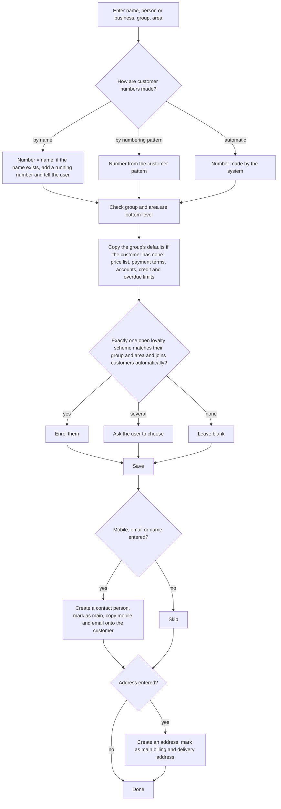
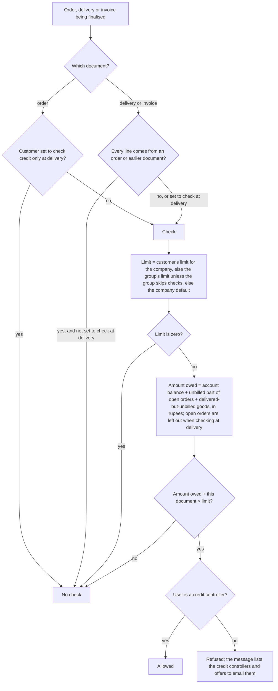
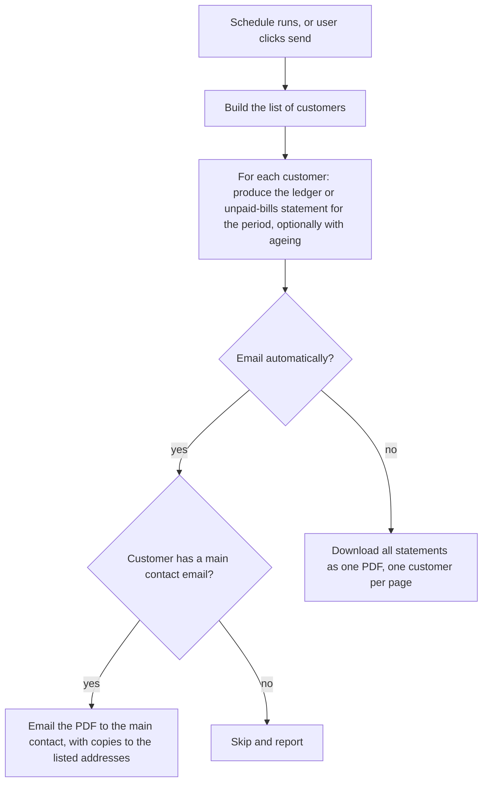

# Customers

## Purpose

Keeps the people and businesses the shop sells to: walk-in buyers, regular customers and wholesale or business (B2B) accounts. It holds their contact details, GSTIN, prices, credit terms and loyalty membership, and tells the system how much each customer owes and whether they may buy on credit.

## Who uses it

| Role | What they do here |
|------|-------------------|
| Cashier | Finds a customer by name or mobile at the till, or adds a new one quickly; sees loyalty points. |
| Store manager | Adds and edits customers, addresses and contacts. |
| Wholesale / B2B sales | Business accounts: GSTIN, billing and delivery addresses, price list, payment terms, credit limit. |
| Accountant | Credit and overdue limits, blocking customers who do not pay, sending statements. |
| Credit controller | The one role allowed to sell beyond a credit limit or extend payment terms. |

## Main records

### Customer

For each customer the shop needs:

- **Who they are:** name, whether they are a person or a business, mobile number and email (the mobile number is the quickest way to find them at the till), notes.
- **Which group they belong to:** a customer group (Retail, Wholesale, Staff, Institutional) and optionally an area. Groups decide default prices, payment terms, offers and reports.
- **GST details:** GSTIN (for business customers), and whether they are in the shop's state or another state. This decides whether CGST + SGST or IGST is charged (Tax).
- **Addresses and contact people:** a billing address, one or more delivery addresses, and contact people. One of each is marked as the main one.
- **Trading terms:** which price list they get, payment terms (cash, 15 days, 30 days), their currency if not rupees, the language to print their documents in.
- **Credit control:** a credit limit (how much they may owe in total), an overdue limit (how much may be past due before new invoices are blocked), and whether the credit check should wait until delivery instead of happening at order time.
- **Status:** active, blocked (in dispute: only a trusted role may still post for them), or switched off (no new documents at all).
- **Loyalty:** the scheme they belong to and their current tier (worked out automatically).
- **For business customers only:** whether they must order before being invoiced, and whether goods must be delivered before invoicing; the items they are allowed to buy (if restricted); the account codes they use for us.
- **Offline till reference:** a temporary number given when a customer is added at a till without connection, so the record can be matched when it syncs.

The system shows on each customer: billing this year, amount unpaid, and loyalty points.

Sales teams with commission splits, sales partners, market segment, industry, account manager and portal logins are not kept; a small retailer does not need them.

### Addresses

Shared by customers, suppliers and stores. An address needs: the lines of the address, city, state, PIN code, country, phone and email, the GSTIN registered at that address, whether it is the main billing or delivery address, and who it belongs to (one address can belong to more than one party).

### Contact people

Shared by customers and suppliers: name, job title, email addresses and phone numbers (one main of each), whether they are the main contact, and whether they have asked not to receive promotional messages.

### Customer groups

A tree of groups. Each group can carry defaults that new customers copy: price list, payment terms, accounts and credit limits. Only bottom-level groups are given to customers.

### Areas

An optional tree of areas (city, locality), used by offers, loyalty schemes, tax rules and sales reports.

### Payment terms

Named templates such as Cash, Net 15 or 50% advance + 50% on delivery. Each part of a template says what share of the bill is due, by which payment method, and when: so many days after the bill date, so many days after the end of the bill's month, or at the end of a month so many months later. A part may offer an early-payment discount (percentage or amount) valid for a number of days.

### Account statements

A saved set-up for sending customers their statements: which customers (listed, or by group or area), which kind of statement (full ledger or unpaid bills only), the period (fixed dates or the last few months), whether to include ageing, the email wording, and how often to send (daily to quarterly).

## Processes

### 1. Adding a customer

At the till the same happens with a short form: name and mobile (optionally email, group, area). Sales to unnamed buyers use one standing walk-in customer set on the till.

### 2. Filling in details when a customer is chosen on a document

The first value found, in this order, is used:

- **Customer balance account:** the customer's own for the company → their group's → the company default.
- **Price list:** if the user may use only one price list, that one; at a till: the customer's price list if in use, else the till's; elsewhere: the customer's → their group's → the one already on the document. A price list not in use is skipped; a price list the user may not use is replaced by one they may.
- **Payment terms:** the customer's → their group's → the company's.
- **Due date:** the bill date moved forward by each part of the payment terms (days after date; days after month end; months then month end); the latest date wins; never earlier than the bill date. Without payment terms, the due date is the bill date.
- **GST treatment:** taken from the billing address (or the delivery address, if the business chooses) → the customer; the GST template then follows the tax rules (Tax).
- **Currency:** the customer's currency, which must be the company's currency or the currency of the customer's balance account.
- **Addresses and contact:** the main billing and delivery addresses and the main contact.

### 3. Credit check on a sale

A separate **overdue check** runs on invoices if the business switches it on: if the customer's overdue amount (unpaid amounts past their due dates, part by part when there is a payment schedule) is more than their overdue limit (the customer's, else the group's), the invoice is refused unless the user holds the role allowed to bypass it.

### 4. Blocking or switching off a customer

- **Switched off:** no new document of any kind may name the customer.
- **Blocked:** the same, except the trusted role allowed to post into locked periods may still post (for example to write off a bad debt). Used for customers in dispute or legal recovery.

### 5. Sending statements

### 6. Merging duplicate customers

Renaming one customer into another merges them, as long as both have balance accounts in the same currency. Contacts, addresses and all documents move across.

## Business rules

- Customer name is required; a customer cannot have the same name as a customer group.
- Customer group and area must be bottom-level.
- At most one balance account and one advance account per company on a customer or group; each must belong to that company; the customer's currency must equal the company currency or the account's currency.
- At most one credit limit per company. A new credit limit lower than what the customer already owes is refused.
- If sales commission is split between salespeople, the shares must add up to exactly 100%.
- The shop bank account printed for the customer must be one of the company's own accounts.
- Only one internal customer may stand for a given company of our own (for businesses with several companies).
- Changing a customer's group updates the group on their open documents (but not on till set-ups, tax rules or offers).
- Deleting a customer deletes contacts and addresses that belong only to them.
- A switched-off customer is refused everywhere; a blocked customer is refused except for the trusted role.
- A credit limit of zero means no limit. Limits are per company.
- A due date may not be before the bill date; a due date later than the payment terms allow is refused unless the user is a credit controller (then only a note is shown).
- If a customer is restricted to certain items, only those items can be picked on their documents.
- Statements are sent only to customers with a main contact email when the business chooses that.

## Calculations

- **Amount owed for the credit check** = (debits − credits on the customer's account for the company, ignoring cancelled entries) + Σ over open orders of order total × (100 − % billed) ÷ 100 (skipped when checking only at delivery) + Σ over delivered lines not linked to an order or invoice of ((line amount − amount invoiced) ÷ delivery net total) × delivery total.
- **Overdue amount** = Σ over unpaid invoices of: with a payment schedule, the smaller of (past-due scheduled amount − amount already paid, not below zero) and the amount still unpaid; without one, the whole unpaid amount if the due date has passed, else zero.
- **Due date from payment terms** = for each part, the later of the running date and (date + days), or (last day of the month + days), or (last day of the month N months later); starting from the bill date (for suppliers, their bill date if given); never earlier than the bill date.
- **Credit limit used** = customer's limit → group's limit (unless the group skips checks) → company default.
- **Billing this year** = Σ totals of finalised invoices (not returns) in the current financial year. **Amount unpaid** = debits − credits on the customer's account.
- **Statement period** = the chosen number of months back from today, or fixed dates.

## Effects on other modules

- The customer chosen sets the price list, currency, GST, payment terms and balance account on every sale and till bill (Pricing, Tax, Sales, Point of sale, Accounting).
- Invoices and payments change the customer's balance; the customer record stores nothing except the tier, which is worked out.
- Loyalty points are recorded per customer (Pricing); the tier updates after each invoice.
- Changing a group updates open documents; the address's GSTIN and state decide which GST applies (Tax).
- Credit limits allow or block orders, deliveries and invoices (Sales; Point of sale when selling on credit).

## Reports

- **Unpaid bills by customer** — every unpaid invoice with due date, days overdue and amount, split into age bands (default 30, 60, 90, 120 days); filter by customer, group, area, payment terms, store, and whether age is counted from due date or bill date.
- **Unpaid summary** — one line per customer: invoiced, paid, unpaid, age bands.
- **Customer ledger summary** — opening, invoiced, paid, returns and closing per customer for a period.
- **Customer balances** — opening, debit, credit and closing per customer.
- **Credit position** — credit limit, amount owed and remaining room per customer.
- **Customer prices** — the price each customer gets for each item.
- **Inactive customers** — no purchase in the last N days.
- **Customers who never bought** — added but never billed.
- **New and repeat customers** — per period.
- **Sales by customer, group or area** — over time (Reports).

## Edge cases

- **Walk-in customer:** one shared record per till or store; no credit, no loyalty, no GSTIN; the name on the receipt may be changed per bill (Point of sale).
- **Same name twice:** the second gets a number added; the mobile number should be the real duplicate check (open question).
- **Customer added at an offline till:** gets a temporary till number; on sync it is matched by that number or merged by mobile number (Point of sale).
- **Business customer with several delivery addresses:** several delivery addresses, one main; GST (same state or other state) follows the address used on the bill.
- **Customer with a GSTIN in another state:** the place of supply is in another state, so IGST applies (Tax).
- **Customer paying in a foreign currency:** their currency is set; their balance account is in that currency or rupees; payments convert at the day's rate; differences go to the exchange difference account (Accounting).
- **Credit customer at the till:** a till bill can be left unpaid only if the till allows credit sales; the credit check then applies (Point of sale).
- **Customer refuses to pay:** block rather than switch off, so the accountant can still post the write-off.
- **Merging duplicates in different currencies:** refused; one must be corrected first.
- **Several stores:** customers are shared by all stores; access limits can restrict which staff see which customers (Users and permissions).
- **Several companies:** credit limits, accounts and loyalty balances are per company.

## Settings

**Adding customers quickly**
- Whether customer numbers come from the name, a numbering pattern or the system.
- The default group and area for new customers, including those added at the till.

**Business customers**
- Whether an order is required before an invoice, and whether delivery is required before an invoice (each customer can be exempted).
- Whether the customer's GSTIN is printed on sales documents.
- Whether GST treatment is decided from the billing address or the delivery address.

**Credit control**
- A default credit limit and default payment terms for new customers.
- Who may sell beyond a credit limit or extend due dates (the credit controller role).
- Whether invoices are blocked when a customer has overdue bills, and who may bypass that.
- Per customer: whether the credit check waits until delivery.

**Reports and loyalty**
- The age bands used in unpaid-bill reports.
- Whether the loyalty scheme is used.

**Businesses with several companies**
- Which of our companies may sell to an internal customer.
