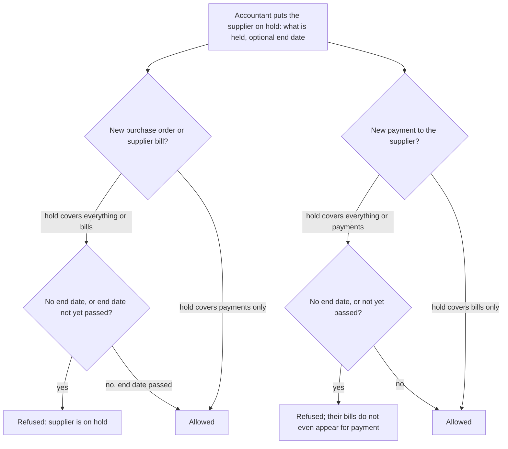
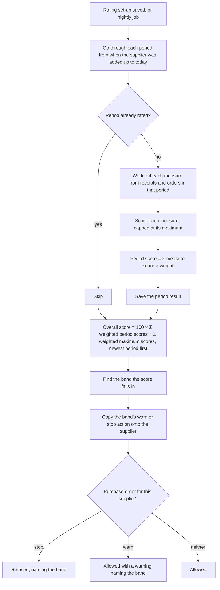

# Suppliers

## Purpose

Keeps the businesses the shop buys from: manufacturers, distributors, wholesalers, transporters and service providers. It holds their contact details, GSTIN, payment terms, buying prices and balance, lets the shop stop orders or payments to a supplier, and can rate suppliers on how well they deliver.

## Who uses it

| Role | What they do here |
|------|-------------------|
| Purchase manager | Adds suppliers, their item codes (Items), buying prices, payment terms, blocks and ratings. |
| Store manager | Looks up supplier details when goods arrive. |
| Accountant | Supplier balances, TDS, holding bills or payments, blocking suppliers. |
| Owner | Reviews supplier ratings and spending. |

## Main records

### Supplier

For each supplier the shop needs:

- **Who they are:** name, person or business, notes, the language for documents sent to them.
- **Which group they belong to:** a supplier group (Distributors, Local vendors, Services) used for defaults and reports; whether they are a transporter (so they can be named as the carrier on deliveries and e-way bills).
- **Tax details:** GSTIN or PAN, whether they are in the shop's state or another state (decides CGST + SGST or IGST on purchases), and whether TDS must be deducted when paying them (Tax).
- **Addresses and contact people:** the same as for customers; one main address and one main contact.
- **Trading terms:** their buying price list, payment terms, their currency if not rupees, the shop bank account they are paid from, and the account number they have given us (printed on our orders so they recognise us).
- **Status:** active, blocked (only the trusted role may still post), or switched off.
- **Holding back:** a hold that stops new orders and bills, or only payments, or both, with an optional date when the hold ends by itself.
- **Exceptions to the buying steps:** whether we may record their bill without a purchase order, and without a goods receipt.

The system shows on each supplier: purchases this year and amount unpaid.

Not needed by a small retailer: supplier portal logins and quotation requests.

### Supplier groups

A tree of groups. Each group can carry default payment terms and accounts that new suppliers copy. Only bottom-level groups are given to suppliers.

### Supplier rating (optional, for chains with many suppliers)

A shop with many suppliers may want to rate them automatically. It needs to decide:

- **How often** to rate (weekly, monthly or yearly).
- **What counts:** a few measures with weights adding up to 100, such as share of deliveries on time, days late, share of goods rejected, and price compared with the order.
- **What the rating means:** score bands from 0 to 100 (for example Excellent, Good, Watch, Stop), each with an action: warn when ordering, or stop new orders.
- **How much older periods count:** recent periods count more; very old periods do not count.

The measures the system can work out from receipts and orders: number of deliveries, deliveries on time and late, total days late, value of on-time and late deliveries, quantity and value received, accepted and rejected, quantity ordered and billed, and working days in the period.

### Rating results

One result per supplier per period: the dates, the value of each measure, each measure's score and the period score.

## Processes

### 1. Adding a supplier

The same as adding a customer: name and type; number from the name, a numbering pattern or the system; group must be bottom-level; the group's payment terms and accounts are copied in; a main contact is created from mobile or email; a main address from the address entered.

### 2. Filling in details when a supplier is chosen on a document

- **Supplier balance account:** the supplier's own for the company → their group's → the company default.
- **Price list:** the supplier's → the one on the document; it must be a buying list and in use.
- **Payment terms:** the supplier's → their group's → the company's. The **due date** counts from the supplier's bill date when given, else our posting date, using the same rules as for customers, never earlier than the posting date.
- **GST treatment:** from the address (billing or delivery, as the business chooses) → the supplier; purchase tax rules then pick the template (Tax).
- **Currency:** the supplier's currency, which must be rupees or the currency of their balance account.
- **Last purchase price:** used when no price exists, unless the business turns this off.

### 3. Holding a supplier

Single supplier bills can also be held with a reason and end date (Purchasing); a held bill cannot be paid until released.

### 4. Rating suppliers (optional)

### 5. Merging duplicate suppliers

Renaming one supplier into another merges them, as long as both have balance accounts in the same currency.

## Business rules

- Supplier name is required; when numbers come from a pattern, the pattern must be chosen.
- Supplier group must be bottom-level.
- At most one balance account and one advance account per company; each must belong to that company; the supplier's currency must equal the company currency or the account's currency.
- Only one internal supplier may stand for a given company of our own.
- A switched-off supplier is refused everywhere; a blocked supplier is refused except for the trusted role.
- A held supplier: purchase orders and supplier bills are refused when the hold covers bills; payments are refused, and their bills are hidden from payment, when the hold covers payments; an end date in the past lifts the hold by itself; removing the hold clears the end date; a hold that does not say what it covers holds everything.
- Deleting a supplier deletes contacts and addresses that belong only to them.
- Rating: measure weights must add up to 100; bands may not overlap and must cover 0 to 100 without gaps; an order to a supplier whose band says stop is refused; one whose band says warn shows a warning.
- A supplier bill's due date may not be before the posting date; a due date beyond the payment terms is refused unless the user is a credit controller.

## Calculations

- **Due date from supplier terms** = same as customers, counting from the supplier's bill date when given.
- **Period score** = Σ over measures of (measure result, capped at its maximum, as a percentage of that maximum) × weight ÷ 100.
- **Overall score** = 100 × Σ(period score × period weight) ÷ Σ(100 × period weight), with period 0 the newest. Default period weight = max(0, min(1, (12 − period number) ÷ 12)), so periods older than twelve do not count. A supplier with no periods scores 100.
- **Band** = the band whose minimum ≤ score < maximum.
- **On-time delivery** = goods received on or before the date expected on the order line; **days late** = date received − date expected, when positive.
- **Purchases this year** = Σ totals of finalised supplier bills (not returns) in the current financial year; **amount unpaid** = credits − debits on the supplier's account.

## Effects on other modules

- The supplier chosen sets the price list, currency, GST, TDS, payment terms and balance account on every purchase document (Pricing, Tax, Purchasing, Accounting).
- Supplier bills and payments change the supplier's balance.
- Holds and ratings stop or warn on orders, bills and payments (Purchasing, Accounting).
- Transporters can be named on deliveries and e-way bills (Sales, Tax).

## Reports

- **Unpaid supplier bills** (detailed and summary) — due dates and age bands, with the same filters as for customers.
- **Supplier ledger summary** — opening, billed, paid, returns, closing per supplier.
- **Supplier balances** — opening, debit, credit, closing.
- **Purchases by supplier, group or item** — over time (Reports).
- **Supplier ratings** — score, band and trend per supplier.
- **Goods ordered not received / received not billed** — per supplier (Purchasing).
- **Customer who is also a supplier** — both balances side by side.

## Edge cases

- **Same business is both customer and supplier:** two records linked so their balances can be set off against each other (Accounting; open question).
- **Bill in a foreign currency:** currency set on the supplier; conversion and exchange differences as in Accounting.
- **Supplier held for payments while bills still arrive:** holding only payments lets bills be recorded but stops money going out.
- **Supplier in dispute:** block rather than switch off, so the accountant can still post adjustments.
- **Transporter only:** mark as transporter; no price list needed.
- **Cash purchases from unregistered sellers:** one general cash-purchase supplier; GST reverse-charge rules may apply (Tax).
- **Several companies:** holds belong to the supplier, but balance accounts are per company.

## Settings

**Adding suppliers quickly**
- Whether supplier numbers come from the name, a numbering pattern or the system.
- The default supplier group and buying price list.

**How strict buying is**
- Whether a purchase order is required before goods are received and billed, and whether a goods receipt is required before a bill (each supplier can be exempted).
- Whether prices on the receipt and bill must match the order (stop, or just warn), and who may override.
- Whether the last purchase price is filled in when no price exists.
- Whether the same item may appear on several lines of one document.
- How much more than ordered may be ordered, received or transferred (Purchasing).
- Whether rejected goods are billed and carry a cost (Purchasing).

**Payments and GST**
- Who may extend due dates beyond the payment terms (the credit controller role).
- Whether GST treatment is decided from the billing address or the delivery address.

**Per supplier**
- Holds on bills, payments or both, with an end date.
- Exceptions allowing bills without an order or without a receipt.
