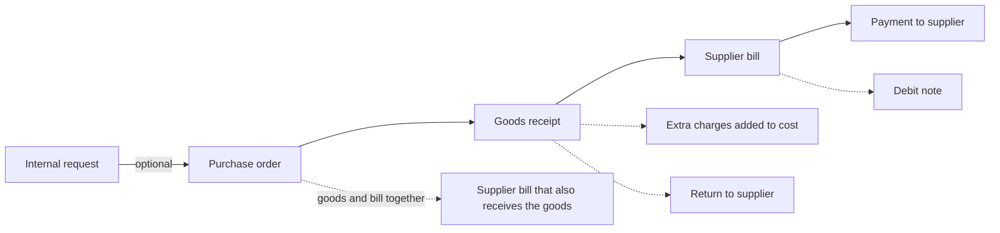
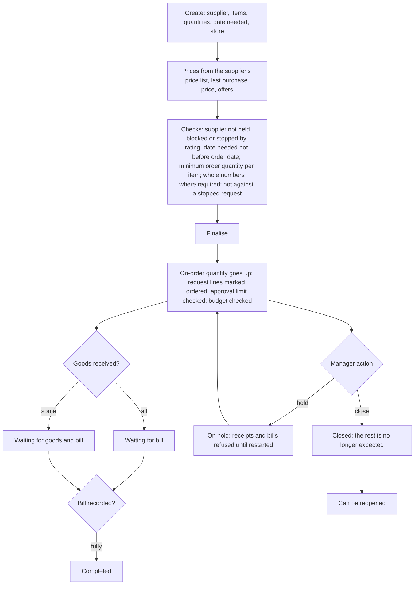
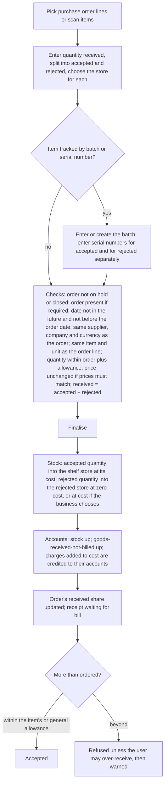
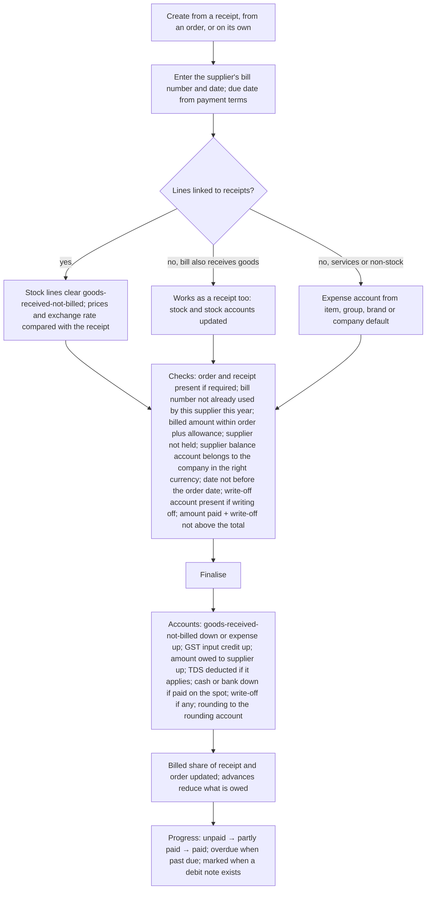
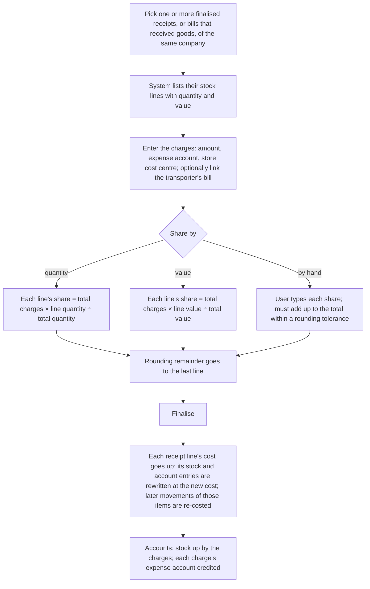

# Purchasing

## Purpose

Covers buying stock from suppliers: asking for goods, ordering, receiving and checking goods into a store, recording the supplier's bill, sending goods back, and adding freight and other charges to what the goods cost. This is where stock gets its value and where the shop's debts to suppliers are created.

## Who uses it

| Role | What they do here |
|------|-------------------|
| Store staff | Ask for items running low; receive goods, count and check them, set aside damaged goods. |
| Purchase manager | Turns requests into purchase orders, agrees prices, chases late deliveries, sends goods back. |
| Accountant | Records supplier bills, holds or releases bills, adds freight costs, pays suppliers (Accounting). |
| Owner | Approves large orders (Users and permissions), reviews purchase reports. |

## Main records

### Internal request

A note from a store asking for items, typed by staff or made automatically when stock falls below the reorder level. The shop needs: what kind of request it is (buy from a supplier, move from another store, or use internally), the items and quantities, which store needs them and by when, for moves the store they come from, and an estimated price. The system tracks how much has been ordered and received against it and whether it was made automatically.

### Purchase order

The order sent to a supplier. The shop needs:

- **Who and when:** the supplier, the order date, when the goods are needed, the supplier's confirmation number if they send one, and where to deliver.
- **What and how much:** items, quantities and units, the price (from the supplier's price list, the last purchase price, or offers), discounts, and the store each line goes to.
- **Money:** GST, any order discount, the total, any advance already paid, and the payment terms with due dates.
- **Progress:** how much has been received and billed so far.

A line can be marked to be delivered by the supplier straight to a customer; such goods never enter the shop's stock.

### Goods receipt

The record of goods arriving. The shop needs:

- **Who and when:** the supplier, the supplier's delivery note number, the date and time received, and the transporter and vehicle number if known.
- **What arrived:** for each item the quantity received, split into **accepted** (good, goes on the shelf) and **rejected** (damaged or wrong, set aside), the store for each, batch and expiry, serial numbers, and the order line it fulfils.
- **What it cost:** prices, discounts and GST (normally copied from the order), and any charges that should be added to the goods' cost.

The system works out each line's cost per unit (see Calculations).

### Supplier bill

The supplier's invoice. The shop needs:

- **The supplier's details:** their bill number and date, which must be unique for that supplier within the year.
- **Our details:** the date we record it, its due date from the payment terms.
- **What is billed:** the items or services, quantities, prices, GST, linked to the order and goods receipt lines they bill.
- **Payment:** whether it was paid on the spot (and from which cash or bank account), any small amount written off, advances already paid that reduce it, and TDS to deduct if it applies.
- **Holding:** whether it is held back from payment, why, and until when.

A bill can also bring goods into stock directly when there is no separate goods receipt (common for small cash purchases).

### Extra charges on goods received (landed cost)

Freight, loading, customs or insurance paid separately, often to a different party, which should be added to the cost of goods already received. The shop needs: the receipts it applies to, the charges (amount and the expense account they were booked to), and how to share them across the items: by quantity, by value, or by hand. Optionally, the transporter's bill that charged them.

Not needed by a small retailer: requests for quotation and supplier quotation comparison, quality inspection and sample retention.

## Processes

### 1. From request to payment



Short cuts allowed: order → bill that also receives the goods (no separate receipt); receipt and bill without an order (unless the business requires orders); bill without a receipt for services, or for suppliers allowed to skip it.

### 2. Internal request

1. Store staff choose items, quantities, the store that needs them and the date needed; or the nightly reorder job makes the request (Inventory).
2. When finalised, the requested quantity is added to each item's stock position for that store.
3. Progress: draft → waiting to be ordered → partly ordered → ordered → partly received → received. Moves between stores end as transferred; internal use ends as issued. A request can be stopped (no more ordering) and restarted; a cancelled request cannot change.
4. The purchase manager turns waiting lines into one or more purchase orders, choosing a supplier for each item (an item may appear only once in one conversion; every item needs a supplier).

### 3. Purchase order



Order progress: draft, waiting for goods and bill, waiting for goods, waiting for bill, completed, on hold, closed, cancelled.

A finalised order can still have its quantities, prices, dates and stores changed; the checks run again and everything is recalculated. Cancelling an order takes back the on-order quantity and frees the request lines.

### 4. Receiving goods



Receipt progress: draft → waiting for bill → partly billed → completed; returns are shown as returned; a receipt can also be closed or cancelled. A receipt with zero value is completed at once.

### 5. Recording the supplier's bill



A bill can be **held** after finalising (not a return, and only if something is still owed) with a reason and a future end date; while held it cannot be paid and does not appear for payment; it is released by hand or automatically on the end date. A whole supplier can also be held (Suppliers).

### 6. Returning goods to a supplier

```mermaid
flowchart TD
    A[Open the original receipt or bill and choose return] --> B[System copies the lines as minus quantities at the original prices]
    B --> C[User reduces to what is actually going back; may return from the rejected store]
    C --> D[Checks: same supplier, company and exchange rate as the original; return not dated before the original; not more than received minus already returned per line; every line a minus quantity; at least one line; batches and serial numbers must be ones that came in on the original]
    D --> E[Finalise]
    E --> F[Stock: goods leave at their original cost, not today's cost]
    F --> G[Accounts: return of a receipt: stock down, goods-received-not-billed down; return of a bill (debit note): amount owed down, GST input credit reversed]
    G --> H[Original's returned share updated; order's received quantity reduced so it can be supplied again]
```

A debit note can also reduce the billed amount on the receipt (normally yes) and the order (normally no). A debit note without an original is allowed and uses the current cost.

### 7. Adding extra charges to goods received



Cancelling removes the charges and rewrites the receipt entries again.

## Business rules

Internal requests

- The date needed is required on the request and on every line; a line's date cannot be before the request date.
- The kind of request must be buy, move or internal use; only bottom-level stores may be named.
- A stopped or cancelled request cannot be ordered against; a draft can only move to waiting.
- Quantities must be whole numbers where the unit requires it.

Purchase orders

- A supplier is required and must not be switched off, blocked, held for bills, or stopped by its rating; a rating warning shows a caution.
- The date needed is required; a line's date cannot be before the order date.
- The total quantity of an item on the order (in basic units) cannot be below its minimum order quantity; a tiny excess caused by unit rounding is accepted with a note.
- Items must be buyable, in use and not past their end date; stock items need a store.
- An order against a request may not exceed the requested quantity beyond the over-order allowance.
- Finalising checks the user's approval limit for the total and the budget for the expense account and store (Accounting).
- An order cannot be cancelled while a finalised receipt or bill refers to it.
- Orders on hold or closed refuse new receipts and bills; an order with an advance paid cannot be deleted.
- If prices must match through the buying steps, receipt and bill prices must equal the order price (stop or warn, as chosen; a trusted role may override).

Goods receipts

- The date cannot be in the future or before the order date.
- An order is required if the business says so (except moves between our own companies). Supplier, company and currency must match the order; item and unit must match the order line.
- Quantity received must equal accepted + rejected; none may be negative except on returns.
- Rejected goods need a rejected store; accepted goods go to the shelf store; both must belong to the company.
- Accepted quantity (over all receipts) may not exceed the ordered quantity by more than the allowance (the item's, else the general one), except for users allowed to over-receive, who get a warning.
- Whole numbers where the unit requires it (received and accepted).
- If the business uses quality checks, items that need one cannot be received until the check is passed (stop or warn, as chosen).
- Serial numbers must be unique and not already in stock unless re-receiving them is allowed; batch items need a batch (created automatically if the item says so).
- Charges added to cost must name a cost centre.
- A receipt cannot be cancelled while a bill or extra-charge entry refers to it.

Supplier bills

- Order and receipt requirements apply as set by the business and the supplier (the receipt requirement applies to stock items only).
- The supplier's bill number must be unique for that supplier within the financial year, if the business checks this.
- The supplier balance account must belong to the company, be a supplier account, and be in the supplier's currency.
- Billed amount per order line may not exceed the ordered amount beyond the over-billing allowance (the item's, else the general one), except for users allowed to over-bill.
- A bill linked to a receipt must use the receipt's exchange rate unless the business chooses the bill date's rate; any difference goes to exchange difference.
- A bill paid on the spot needs a cash or bank account; amount paid + write-off may not exceed the (rounded) total.
- A write-off needs a write-off account and cost centre of the company.
- A return cannot be held; a hold is only possible after finalising, while something is still owed, with a future end date.
- The due date cannot be before the posting date; beyond the payment terms only for a credit controller.
- The bill date cannot be before the order date.
- The supplier must not be held for bills (unless the hold has ended), switched off or blocked.

Returns

- A return must have the same supplier, company and exchange rate as the original, and cannot be dated before it.
- Every line must be a minus quantity and must exist on the original; per original line, the amounts returned (received, accepted, rejected and basic-unit quantity separately) cannot exceed the original minus earlier returns.
- Returns from the rejected store are limited by the original rejected quantity.
- Batches and serial numbers returned must be among those received on the original and still in the store.

Extra charges

- At least one receipt, each finalised and of the same company; bills must have received the goods.
- Every line must come from a listed receipt and name a cost centre; expense accounts must belong to the company.
- The shares must add up to the total charges (automatic sharing puts the rounding remainder on the last line; shares typed by hand must match within two units of the last decimal place).

## Calculations

Line and bill totals follow Pricing (prices, discounts) and Tax (GST). Purchasing adds:

- **Quantity in basic units** = accepted quantity × units per line unit.
- **Charges added to cost, per line** (taxes and charges marked as part of the goods' cost): percentage charges are worked out from each line's own amount and rate; fixed charges are shared by line value across all lines, or across stock lines only if the charge should fall wholly on stock; the last line takes any rounding. Non-stock lines get no share.
- **Cost per basic unit** = (line net amount in rupees + its share of charges + its extra charges + any price difference carried from a linked bill) ÷ quantity in basic units. If nothing was accepted and rejected goods carry a cost, the rejected quantity and its amount are used.
- **Rejected goods** come in at zero cost unless the business chooses to cost them.
- **Extra-charge share per line** = total charges × (line quantity ÷ total quantity) or × (line value ÷ total value).
- **Over-receipt check:** refused when (received − ordered) ÷ ordered × 100 is more than the allowance by over 0.01; most allowed = ordered × (100 + allowance) ÷ 100.
- **Over-billing check:** the same, on amounts.
- **Share received** on an order = Σ received (not above ordered) ÷ Σ ordered × 100; **share billed** the same on amounts. A fully returned receipt shows 100% returned.
- **Return cost** = the original line's cost per unit (not today's cost).
- **Rounding loss on receipt** = difference between the value stock actually recorded (after per-unit rounding) and the line amount plus charges; posted to cost of goods sold so stock and the supplier debt balance.
- **Exchange difference** on a bill against a receipt = receipt quantity × receipt net price × (receipt rate − bill rate), posted between the expense or goods-received account and exchange difference.
- **Stock adjustment on a stock-receiving debit note without an original** = (net amount + charges + extra charges) − value actually recorded in stock, posted to cost of goods sold.
- **Due date** = posting date (or the supplier's bill date) moved forward by the payment terms.
- **Amount still owed** = total (rounded if used) − advances used − payments − write-off.

## Effects on other modules

| Event | Stock | Accounts (debit ↑ / credit ↑) | Other |
|-------|-------|-------------------------------|-------|
| Request finalised | Requested quantity up | none | Reorder job skips items already requested |
| Order finalised | On-order quantity up | none (budget and approval checked) | Request marked ordered |
| Receipt finalised | Accepted quantity and value into the shelf store at cost; rejected into the rejected store at zero or cost | Stock ↑ / Goods-received-not-billed ↑; charges added to cost: Stock ↑ / charge accounts ↑ | Order received share; on-order quantity down; batches and serial numbers created; stock reserved for linked customer orders if used |
| Bill finalised (against a receipt) | none | Goods-received-not-billed ↓ (debit) and GST input credit ↑ (debit) / Amount owed to supplier ↑ (credit); TDS payable ↑ if it applies | Receipt and order billed share; supplier balance ↑ |
| Bill finalised (also receives goods) | Same as a receipt | Stock ↑, GST input credit ↑ / Amount owed to supplier ↑ | Order received and billed share |
| Bill finalised (services, non-stock) | none | Expense ↑, GST input credit ↑ / Amount owed to supplier ↑ | |
| Bill paid on the spot | none | Amount owed to supplier ↓ / Cash or bank ↓ | Nothing left owing |
| Return of a receipt | Goods out at original cost | Goods-received-not-billed ↓ (debit) / Stock ↓ (credit) | Order received share down |
| Debit note | Goods out if it moves stock | Amount owed to supplier ↓ (debit) / Stock or expense ↓, GST input credit ↓ (credit) | Supplier balance ↓ |
| Extra charges finalised | Value of received goods up; later sales re-costed | Stock ↑ / Charge expense accounts (credit) | Receipt costs rewritten |
| Any cancellation | Opposite entries | Opposite entries | Shares and quantities rolled back |

GST details (when input credit is allowed, reverse charge, TDS limits) are in Tax.

## Reports

- **Purchases** — by supplier, supplier group, item or item group over time (amount or quantity), from orders, receipts or bills.
- **Purchase order follow-up** — per order line: ordered, received, billed, pending and days late.
- **Requests to order and receive** — open request lines with ordered and received progress.
- **Request-to-receipt tracker** — request → order → receipt with dates, delivery times and costs.
- **Purchase history / purchase register** — every purchase line with supplier, price, quantity and GST.
- **Goods received not billed** — receipt lines without a bill, by supplier, with age.
- **Goods billed not received** — billed but not yet received.
- **Monthly purchase trends** — orders, receipts and bills by supplier or item group.
- **Extra charges** — charges added per receipt and item.
- **Unpaid supplier bills** — see Suppliers.

## Edge cases

- **Goods arrive before the order is made:** receive without an order (if allowed) and make the order later, or require orders and refuse; most retailers allow it for fresh produce.
- **Part deliveries:** several receipts against one order; the order keeps waiting until the quantity (with allowance) arrives; the manager can close it to stop expecting the rest.
- **Short delivery, full bill:** the bill is more than received, so the over-billing check fails; record the bill for what was received and a debit note or later bill for the rest.
- **Free goods from a scheme:** come in at zero price and zero cost unless charges are shared onto them (open question on whether free goods should share the cost of paid goods).
- **Damaged goods on arrival:** record as rejected into the rejected store (zero cost) and return them from there.
- **Bill price differs from the receipt:** if prices need not match, the difference changes the cost of goods still in stock; if they must match, the bill is refused or warned.
- **Freight billed by a transporter:** add it as extra charges with the transporter's bill linked, so freight goes into stock cost instead of expenses.
- **Foreign-currency bill paid later at another rate:** exchange difference at payment (Accounting).
- **Last month's bill arriving now:** our posting date and the supplier's bill date differ; the due date counts from their bill date; the locking date applies to our posting date.
- **Batch expiry on arrival:** typed or worked out from shelf life; expired batches can be received but cannot be sold (Inventory, Point of sale).
- **Several stores:** each store receives into its own store; a central warehouse may receive and then transfer (Inventory). An order can send different lines to different stores.
- **Several companies:** an internal supplier mirrors a sales order in the other company; prices are set at cost unless the business allows its own price.

## Settings

**How strict the buying steps are**
- Whether a purchase order is required before receipt and bill, and whether a receipt is required before a bill (suppliers can be exempted).
- Whether prices must stay the same from order to receipt to bill, whether a difference stops the document or only warns, and who may override.
- Whether supplier bill numbers are checked for duplicates.
- Whether orders with zero quantity (price-only) and negative prices (adjustments) are allowed.

**How much over is acceptable**
- How much more than requested may be ordered.
- How much more than ordered may be received, and who may go beyond it (items can override).
- How much more than ordered may be billed, and who may go beyond it (items can override).

**Costing goods**
- Whether rejected goods are billed and carry a cost.
- Whether the last purchase price fills in missing prices.
- Whether a bill uses the receipt's exchange rate or its own date's rate, and whether bill-price differences change the stock cost.
- Whether services received before the bill are booked as expenses straight away.
- Whether stock movements update the accounts (Company and stores).

**Protecting dates**
- Who may record receipts dated before the latest stock movement, and the stock locking date (Inventory).

**Quality (optional)**
- Whether a missing or failed quality check stops a receipt or only warns.
