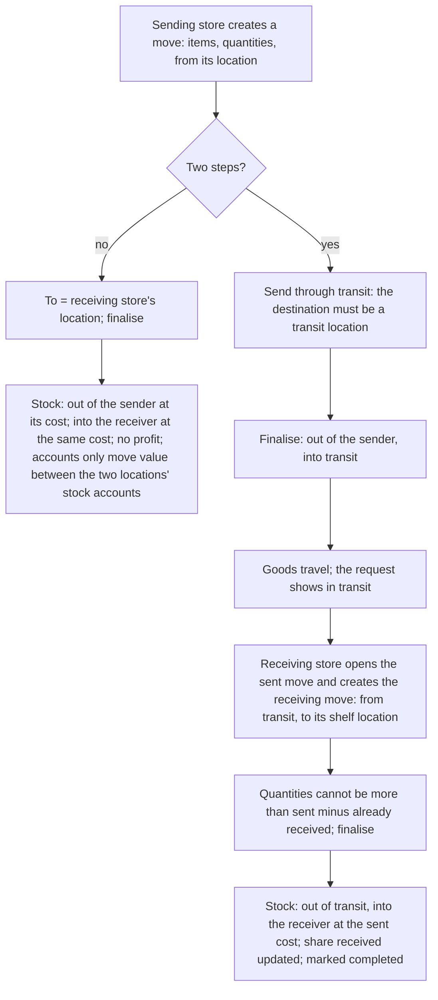
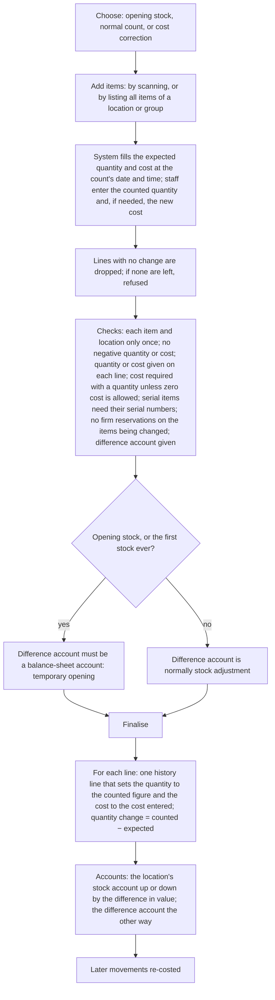
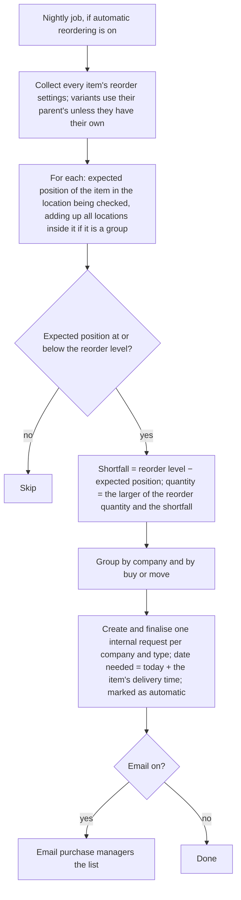

# Inventory

## Purpose

Keeps track of how much of every item is in every store, what it is worth, and every movement in or out: goods received, sales, moves between stores, stock counts, corrections and write-offs. Buying, selling and the accounts all rely on it, and it keeps the stock value in the books equal to the stock on the shelves.

## Who uses it

| Role | What they do here |
|------|-------------------|
| Store staff | Move goods between back room and shop floor or between stores, count stock, write off damaged or expired goods, look up quantities. |
| Store manager | Approves moves and corrections, sets reorder levels, checks stock and slow-moving goods. |
| Purchase manager | Reads expected stock positions and the automatic reorder requests. |
| Accountant | Stock accounts, value corrections, locking past months, checking stock value against the books. |
| Owner | Stock value, dead stock, losses. |

## Main records

### Stock locations (warehouses)

Set up in Company and stores. What matters here: only bottom-level locations can be used on documents; each belongs to one company; its stock account is its own, else its parent's, else the company's; a location that is switched off cannot be used; a location that has ever had stock movements cannot be deleted or turned into a folder (or back); a location with stock cannot be deleted. Special locations: transit (goods on the road between stores) and rejected goods.

### Stock movement

One document for every movement that is not a purchase or a sale. The shop needs:

- **Why the stock is moving:**
  - *Stock in:* goods appearing without a supplier bill (opening stock, stock found, free promotional goods, a customer's item left for repair).
  - *Stock out:* goods leaving without a sale (damage, expiry, theft or loss, samples, use in the shop).
  - *Move:* goods going from one location to another, directly or in two steps through a transit location (sent today, received when they arrive).
  - *Repack:* several items go out and a different item comes in (making a gift hamper; breaking a carton into singles when they have different item codes).
- **When:** the date and time.
- **What:** items, quantities and units, the location they leave from and the location they go to, batches and serial numbers.
- **Where the cost goes:** for stock in and stock out, the account the value goes to (for example damages, or temporary opening for opening stock) and the store cost centre.
- **Extra costs:** freight or labour added to the goods coming in (for moves and repacks).

The system works out the value of each line and the total value in and out.

### Stock count

Sets the quantity (and if needed the cost) of items to what was counted. The shop needs: whether it is an opening stock load, a normal count, or a cost correction; the date and time; the location; for each item the counted quantity, the cost if it changes, and batches or serial numbers; and the account any difference goes to (normally stock adjustment). The system shows the quantity and value it expected and the difference. A blind-count option hides the expected quantity from the counter.

### Stock history (stock ledger)

Written by the system for every document that moves stock, never typed. For each movement: item, location, date and time, the document, quantity in or out, the cost per unit, the quantity, cost per unit and value after the movement, the change in value, the batch and serial numbers, and (for FIFO) the list of lots still on hand with their costs.

### Stock position per item per location

Kept by the system: on hand, promised to customer orders, on order from suppliers, requested by stores, firmly reserved, the expected position after all of these, and the current cost and value.

### Which batches and serial numbers moved

For batch- or serial-tracked items, each stock line records exactly which batches (and how much of each) or which serial numbers moved, with their cost. This is how the system knows which exact lot or piece was sold, returned or written off.

### Firm reservation

Stock set aside for a particular customer order so nobody else can sell it. The shop needs: the item, location, order line, quantity reserved and quantity already delivered; optionally the exact batches or serial numbers.

### Reorder levels

Set on each item, per store: the location to check (one store, or a group of stores added together), the location that should receive the stock, the level at which to reorder, how much to reorder, and whether to buy from a supplier or move from another store.

### Locking past stock

A date up to which stock movements may no longer be added or changed, so counts and month-end values stay fixed.

### Re-costing after back-dated entries

When a movement is entered or cancelled with a date earlier than later movements, the system re-works the costs of all later movements for that item and location and corrects their accounting, in the background. Until it finishes, stock reports may be slightly out of date.

Not needed by a small retailer: storage capacity rules per rack, extra tracking axes (such as rack or bin location), and stock snapshots for very large data.

## Processes

### 1. How every stock movement is recorded

```mermaid
flowchart TD
    A[Document finalised: receipt, sale, move, count, return] --> B[For each line: prepare a history line with item, location, date-time, quantity change]
    B --> C{Stock locked on or before this date?}
    C -->|yes| D[Refused]
    C -->|no| E{Locking date or locking-days rule applies and user lacks the stock authority role?}
    E -->|yes| D
    E -->|no| F{Dated before the last movement of this item in this location, and user may not back-date?}
    F -->|yes| D
    F -->|no| G{Location is a folder, switched off, or of another company?}
    G -->|yes| D
    G -->|no| H{Item is a stock item, not a parent style, in use, not past its end date; batch or serial present if required and absent if not?}
    H -->|no| D
    H -->|yes| I{Batch expired on this date, on a sale out or a purchase in?}
    I -->|yes| D
    I -->|no| J[Find the cost: the incoming cost for receipts; for goods going out, the costing method gives the cost]
    J --> K[Apply the costing method to get the new quantity, value and cost per unit; write the history line]
    K --> L{Quantity after is below zero (allowing for rounding), after taking off firm reservations?}
    L -->|yes, and selling beyond stock is not allowed for the business or the item| M[Refused: shows how many more are needed]
    L -->|no| N[Update the stock position]
    N --> O{Any later movements for this item and location?}
    O -->|yes| P[Queue re-costing of the later movements and their accounts]
    O -->|no| Q[Done]
    P --> Q
    Q --> R[Write accounting entries: the location's stock account against the line's expense or other account, for the change in value]
```

Cancelling writes opposite history lines (same quantities, opposite sign, marked as cancelling the originals) and triggers the same re-costing of later movements.

### 2. Costing methods in plain words

- **FIFO (first in, first out).** Each location keeps its stock as lots in the order they arrived, each with its quantity and cost. New goods are added as a new lot. Goods going out are taken from the oldest lot first, then the next, and their cost is the cost of the lots used. Stock value is the value of the lots left; cost per unit is value ÷ quantity. If there are no lots left (selling beyond stock), the fallback cost is used and a minus lot is recorded.
- **Moving average.** Each location keeps one cost per unit. When goods arrive: new cost = (old quantity × old cost + quantity received × cost received) ÷ new quantity (if the old quantity was zero or below, the new cost is simply the cost received). Goods going out do not change the cost; their cost is quantity × current cost. If a return or correction brings its own cost, the average is recalculated with it.
- **Last in, first out** is not accepted for Indian accounts and is not offered.
- **Costing each batch separately** (normal for batch items unless the business turns it off): each batch keeps its own value; goods going out of a batch cost that batch's average cost.
- **Costing each serial number separately** (optional per item): each piece keeps its own cost; selling it costs exactly that. If off, serial-numbered items use moving average.
- **Fallback cost** when no lot or cost exists (selling beyond stock, or the first ever sale): the item's last cost in that location → its last cost in any location of the company → the cost typed on the item → the item's standard selling price → a buying price in rupees → otherwise refused with a missing-cost message (or zero, if zero cost is allowed on that line).
- **Rounding:** values are rounded to paise; tiny differences from per-unit rounding on moves between our own companies go to cost of goods sold so the stock accounts still balance.

### 3. Moving stock between stores



Rules: the two locations must differ on a one-step move (the same location is allowed only on transit legs); if the business chooses, the two must be different physical stores; the cost leaving the sender becomes the cost arriving at the receiver.

### 4. Counting stock and correcting it



For batch or serial items the count works per batch or serial number: missing serial numbers are written off, extra ones are taken in; a reset option makes the item's stock in that location exactly the listed set. A count line with zero quantity and no cost for an item that still has value but no quantity clears that leftover value.

### 5. Writing off damaged, expired or lost stock

Record a stock-out movement from the store's location, sending the value to a write-off or damages account and the store's cost centre. Stock leaves at its current cost and the loss is recorded. For expiry, choose the exact batch so the right lot is removed.

### 6. Automatic reordering



The requested quantity then counts in the expected position, so the same shortage is not requested twice.

### 7. Setting stock aside for a customer order

If firm reservations are used, finalising a customer order (or asking to reserve) sets aside, per line in the order's location, the smaller of the order quantity and the available quantity (on hand minus already reserved). The business can refuse part reservations, in which case a line is reserved only if all of it is available. Reserved stock cannot be used by other documents (the stock check subtracts it) and is skipped when batches are picked automatically. Delivering the order uses up the reservation; a count or correction of reserved items is refused until the reservation is released.

### 8. Picking batches and serial numbers automatically

If staff do not choose batches or serial numbers, the system picks them: batches with stock in the location at the time, in use, not expired (expiry today or later), not reserved for other documents, not held by open till bills, not on pick lists; in order of arrival (oldest first), newest first, or earliest expiry first, as the business chooses; quantities are taken from the first batch onwards until enough. If there is not enough in total, the line is refused with the available quantity. Serial numbers are picked in the same order.

### 9. Locking and re-costing

- A **stock locking date** blocks movements dated on or before it, except for the stock authority role; a **locking-days rule** does the same for movements older than a number of days.
- A **stock closing** freezes balances at a date and blocks movements on or before it for everyone; it must be cancelled to reopen.
- Any back-dated movement with later movements after it starts **re-costing**, which re-works later movements item by item and location by location and rewrites their accounts. Accounts cannot be locked while re-costing is still running.

## Business rules

Locations and documents

- Only bottom-level locations in use, belonging to the document's company, may appear on lines.
- Receipts and counts cannot be dated in the future; every movement must be in an active financial year.
- Quantities must be whole numbers where the unit requires it; units per line unit must be given when the line unit is not the basic unit.
- Items on stock lines must be stock items, not parent styles, in use and not past their end date.
- Batch or serial details are required for tracked items and refused for untracked ones; a document cannot use the same batch-and-serial record twice.
- Locations by type of movement: stock in needs a destination only; stock out needs a source only; a move needs both, normally different; a repack has items going out (with a source) and items coming in (with a destination).
- Sending through transit requires every destination to be a transit location; the receiving move cannot exceed what was sent minus what was already received.
- When stock updates the accounts, the difference account is required; it must not be a stock account; for opening stock it must be a balance-sheet account; using cost of goods sold is warned against except for stock out.
- Extra costs on a movement are shared over the incoming lines by value (or by quantity if values are zero); a movement with nothing coming in cannot carry extra costs.

Selling beyond stock

- Refused unless allowed for the business, for the item, or (for batches) for the batch; checked at the movement's time and against every later movement, so a back-dated sale that would make a later balance negative is refused too.
- Firm reservations reduce what other documents may use.

Costing

- A receipt line with zero cost is accepted only if zero cost is allowed on the line; otherwise the user is warned (and refused when no fallback cost exists).
- The company's costing method cannot change once stock has moved for items without their own method; an item's method cannot change once used (except to moving average).
- Costing each serial number separately cannot be turned on after serial numbers exist.
- Moves between our own companies are costed at current cost unless the business allows its own price.

Counts

- Each item, location (and batch) only once per count; no negative quantity or cost; a quantity or cost on each line; serial numbers without a quantity are refused.
- A count cannot change items that are firmly reserved.
- Lines that match the current position are removed; if nothing is left, refused.
- Counts dated in a locked stock period are refused.

Reservations

- Only against finalised orders of the same company; not in a folder location; not more than ordered minus delivered minus other reservations; not more than available; reserved must stay above delivered; a delivered reservation, or one made from a pick list, cannot be edited.

Reordering

- A reorder level needs a reorder quantity; the receiving location must sit inside the location being checked; the job runs only when switched on and skips locations without a company.

Locks

- No movement on or before a stock closing date, on or before the stock locking date (unless the authority role), or older than the locking-days window (unless the authority role); no back-dating before the item's last movement in that location without the back-dating role.
- Stock closings go in date order; a later one must be cancelled before an earlier one; a stock closing cannot be dated after a finalised year-end accounting closing.

## Calculations

- **Quantity after** = previous quantity after + quantity change.
- **FIFO cost of goods going out** = Σ over the lots used of (quantity taken × lot cost), oldest first.
- **Moving average cost after a receipt** = (Q₀ × C₀ + q × c) ÷ (Q₀ + q); if Q₀ ≤ 0, then c.
- **Stock value** = value of lots left (FIFO) or quantity × cost (moving average); **change in value** = new value − old value; **cost per unit** = value ÷ quantity when quantity is not zero.
- **Moves:** cost arriving = cost leaving; total value difference on a document = Σ in − Σ out (zero for plain moves, equal to extra costs for repacks).
- **Repack cost of the new item** = (Σ value going out + extra costs) ÷ quantity coming in (shared by value when several items come in).
- **Count quantity change** = counted − expected; **value difference** = counted × new cost − expected × current cost.
- **Expected position** = on hand + on order + requested − promised to orders − firmly reserved.
- **Available to reserve** = on hand − Σ (reserved − delivered − moved − used) over other reservations.
- **Reorder quantity** = the larger of the reorder quantity and (reorder level − expected position).
- **Rounding tolerance for the stock check** = 0.0001 (or one unit of the last decimal place when quantities have more than four decimals).
- **Age of stock** = days since each remaining lot arrived; average age weighted by quantity.

## Effects on other modules

| Movement | Stock | Accounts (debit ↑ / credit ↑) |
|----------|-------|-------------------------------|
| Stock in (opening or found stock) | Quantity and value in at the cost entered | Stock ↑ / Difference account (temporary opening for opening stock, otherwise stock adjustment or the account chosen) |
| Stock out (write-off, use in the shop) | Quantity and value out at cost | Difference account (expense) ↑ / Stock ↓ |
| Move | Out of the sender, into the receiver, same value | Receiver's stock account ↑ / Sender's stock account ↓ (nothing if both share one account) |
| Repack | Contents out, new item in | New item's stock ↑ / contents' stock ↓; extra costs: stock ↑ / expense accounts ↓ |
| Count up | Quantity in | Stock ↑ / Difference account |
| Count down | Quantity out | Difference account ↑ / Stock ↓ |
| Cost correction | Value change only | Stock ↑ or ↓ / Difference account |
| Re-costing | Rewrites later values | Rewrites later documents' stock entries |

Purchases and sales write their own stock and accounting entries (Purchasing, Sales, Point of sale). The reorder job creates internal requests (Purchasing). Reservations stop the till and sales from using reserved stock.

## Reports

- **Stock balance** — per item and location for a period: opening, in, out and closing quantity and value, cost per unit, reserved stock, average age; filter by company, dates, location (with sub-locations), item, group, brand.
- **Stock history** — every movement in date order with quantity in and out, running balance, cost, value and document; filter by dates, location, item, batch, type of document.
- **Expected stock position** — per item and location: on hand, requested, on order, reserved (orders, firm, till), expected, reorder level and quantity, shortfall.
- **Stock ageing** — per item and location: quantity, average age in days, and quantity and value by age band (0–30, 30–60, 60–90, over 90 days).
- **Stock by store** — one line per store per item.
- **Total stock** — stock per item across all stores.
- **Stock trends** — quantity or value by item, group or brand over time.
- **Batches** — balances, expiry dates and days left.
- **Serial numbers** — where each piece is and its status.
- **Stock health checks** — negative batches, and stock values that do not match the history.
- **Stock value against accounts** — stock value per location against the stock account balance; the key check for accountants.
- **Suggested reorder levels** — from past sales.
- **Shortages** — items with an expected position below zero or below the reorder level.
- **Reserved stock** — open reservations by order.
- **Quick stock lookup** — scan an item, choose a location and date: quantity, value, picture.

## Edge cases

- **Sold before the purchase is entered** (selling beyond stock): allowed only when the business permits it; the sale is costed at the fallback cost and corrected when the receipt is back-dated and re-costing runs. Retail tills usually need this allowed, with a daily report of negative balances.
- **Back-dated receipt after sales:** allowed for the back-dating role; re-costs the cost of goods sold of every later sale.
- **Counting during trading hours:** the count compares with the expected quantity at its own time; sales after that are added on top. Use the blind count and set the time.
- **Expired batch on the shelf:** the sale is refused; write it off with a stock-out naming the batch; the business can also choose to give expired batches zero cost on returns without an original bill.
- **Goods lost in transit:** they stay in the transit location; write them off from there.
- **Part of a move arrives:** receive what arrived; the rest stays in transit until received or written off.
- **Mixed units:** cartons in, pieces out; the units per carton keep the history in basic units.
- **Two tills selling the last piece at once:** the history is locked per item and location while writing; the second sale fails the stock check unless selling beyond stock is allowed (an offline till cannot check at all; see Point of sale).
- **Opening stock by import:** a stock count of the opening type against the temporary opening account, dated the day before go-live (Data import).
- **Several stores:** each store has its own locations; reports add up through the location tree; reorder settings can check a group of stores and order for one.
- **Several companies:** locations belong to one company; stock cannot be moved between companies; it must be sold and bought (internal customer and supplier).

## Settings

**Costing**
- FIFO or moving average for the business (each item may differ).
- Whether batch items are costed per batch or at moving average.
- Whether stock movements update the accounts, and whether stock accounts are per location or per item (Company and stores).

**Selling beyond stock**
- Whether sales may take stock below zero (each item, and each batch, may override).

**Protecting the past**
- The stock locking date, the locking-days rule, and the role that may still post.
- Who may enter movements dated before the latest movement of an item.

**Reordering**
- Whether automatic reordering runs, and whether purchase managers are emailed.
- The default location for new items.

**Batches and serial numbers**
- Whether batch and serial tracking is used.
- The order batches are picked in: oldest first, newest first, or earliest expiry first.
- Whether batches and serial numbers are picked automatically when staff do not choose them.

**Reserving stock for orders**
- Whether firm reservations are used, whether part reservations are allowed, and whether reservation happens automatically when an order is finalised or when the goods for it arrive.

**Moves**
- Whether a move must go between two different stores.
- How much more than requested may be moved.
- The transit location used for two-step moves.
- Whether moves between our own companies use cost or a price we set.

**Quantities**
- Whether staff may adjust the basic-unit quantity worked out from another unit (to fix rounding).
- Whether zero cost is accepted on a given line.
