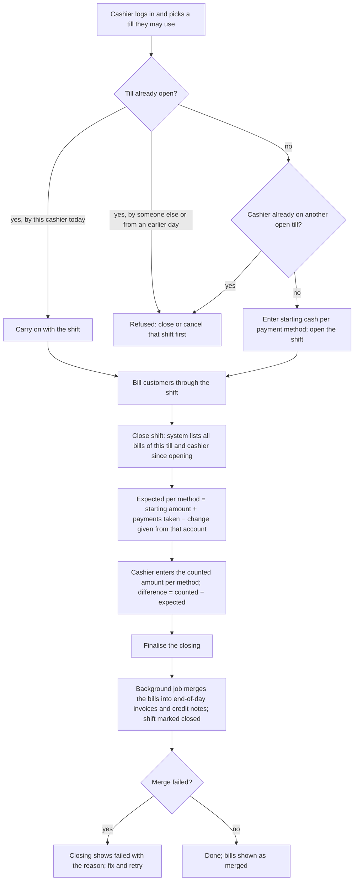
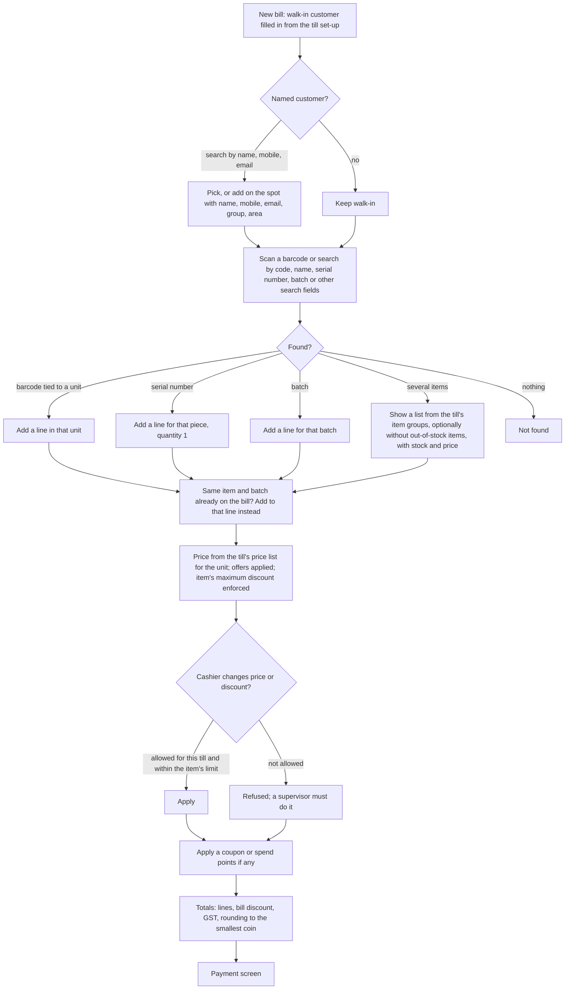
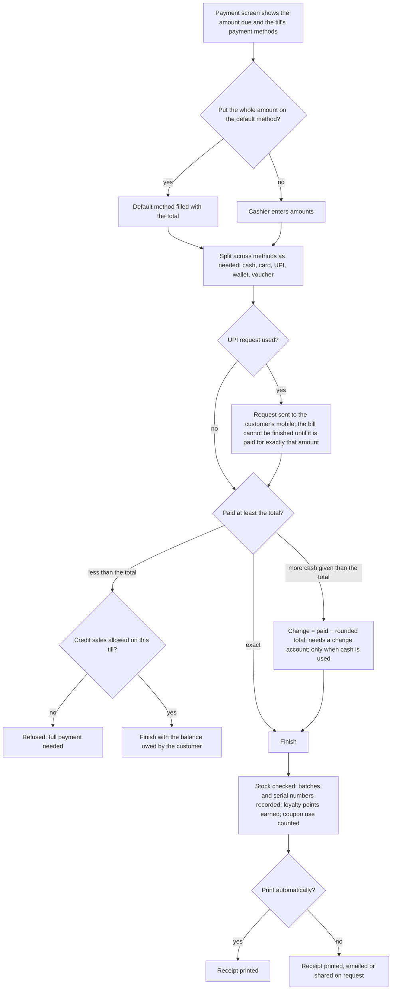
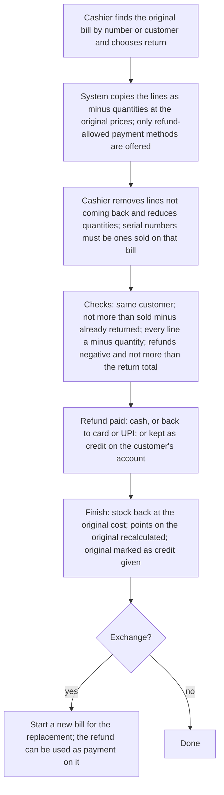
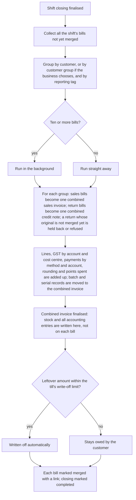

# Point of sale (POS)

## Purpose

The till: where a cashier scans items, takes money, prints a receipt and gives change, many times a day, as fast as possible. It must need very little typing, keep stock and loyalty points up to date, let a supervisor approve exceptions, and at the end of the shift tell the manager whether the cash in the drawer matches the bills.

## Who uses it

| Role | What they do here |
|------|-------------------|
| Cashier | Opens a shift with starting cash, bills customers, takes payment, gives change, parks and recalls bills, handles returns and exchanges, closes the shift with a cash count. |
| Supervisor / store manager | Approves price and discount changes beyond the cashier's limits, returns without a receipt, reviews cash differences, reopens or cancels shifts. |
| Accountant | Sets up tills (accounts, payment methods, small write-off limit), checks end-of-day postings and cash differences. |
| Owner | Reads till reports: sales by till, by cashier, by payment method. |

## Main records

### Till set-up

Each till needs to know:

- **Where it is and who may use it:** the store and the stock location it sells from, the company, the staff allowed to use it (each user has one main till).
- **How customers pay:** the payment methods it accepts (cash, card, UPI, wallet, credit to the customer's account), which one is the default, and which may be used for refunds.
- **What it shows:** which item groups appear (with their sub-groups), which customer groups can be chosen, whether out-of-stock items are hidden, whether pictures are shown, and whether an item is added straight to the bill when a search finds only one.
- **Which prices and tax apply:** the price list, the GST template and treatment, whether bill discounts are before or after tax, and whether offers are applied.
- **What the cashier may change:** whether the cashier may change a price, and whether the cashier may give a discount (always within the item's maximum discount).
- **Where money and stock post:** the sales account, cost of goods sold account, store cost centre, the cash account change is given from, the walk-in customer used when no customer is named, and the account and limit for writing off tiny differences (a few paise) at the end of the day.
- **How it behaves:** whether stock is checked as items are added or only when the bill is finished; whether a bill may be finished with part of the amount still owed (credit sale); whether the receipt prints automatically; what happens when New bill is pressed with an unfinished bill (ask, park it, or discard it); whether the full amount is put on the default payment method automatically.
- **What the receipt looks like:** the receipt layout and the terms printed at the bottom.

### Payment methods

Each payment method needs: a name, what kind it is (cash, card or bank, UPI or phone request, other), whether it is in use, and which account its money goes to (cash in till, card settlement account, UPI settlement account). A UPI request method sends a payment request to the customer's mobile; the bill cannot be finished until that request is confirmed as paid for exactly the amount.

### Shift opening

Who opened which till, when, and with how much starting cash (and any other starting balances per payment method). The shift is open until it is closed.

### Till bill

One sale at the till. It holds everything a sales invoice holds (customer, date and time, price list, location, items, GST, discounts, totals, rounding, points spent, coupon) and also:

- **Payments:** each payment method used with its amount and reference (card approval code, UPI transaction id), total paid, change given, and any tiny amount written off.
- **Returns:** whether it is a return, and the original bill it returns against.
- **Progress:** parked (unfinished, kept to be recalled), paid, part paid (credit sale), returned (a return bill), credit given (the original of a return), merged into the end-of-day invoice, cancelled.
- **Per line:** the barcode scanned, batch and serial numbers, and (for the cashier's information) the quantity in stock.

### Shift closing

The cashier's end-of-shift count. It needs: the shift's start and end, the till and cashier, the list of bills in the shift, the shift totals (sales, tax by GST head, quantity), and for each payment method the starting amount, the amount expected, the amount counted and the difference. It also shows whether the end-of-day merge has finished or failed (with the reason), and a failed merge can be retried.

### End-of-day merge record

For each customer (or customer group) in a closed shift: the bills merged and the combined sales invoice and combined credit note made from them.

### Shop-wide till choices

Whether the till creates bills that are merged into one invoice at the end of each shift, or a full sales invoice for every sale; and whether change given is recorded as its own accounting entry.

Not needed by a small retailer: campaign and source tags on bills, alternative printed headings, and extra custom fields on the till screen.

## Processes

### 1. A shift from start to end

Rules: a bill can only be made while the till has an open shift, and that shift must have been opened today (a shift left open from yesterday stops billing until it is closed). A shift with bills cannot be cancelled. A closing cannot be cancelled while a newer shift is open on the same till; cancelling a closing un-merges its bills.

### 2. Billing a customer

The bill shows per line: name, quantity, unit, price, discount, amount and stock available. A number pad changes the selected line's quantity, price or discount. A bill can be **parked** and recalled later from the list of parked bills; the till set-up decides what New bill does when a bill is unfinished.

### 3. Taking payment

Payment amounts must be positive on a sale and negative on a return; refunds on a return cannot be more than the return total.

### 4. Checking stock at the till

- When the bill is finished (and also as items are added, if the till is set up that way), each stock line is checked: available = stock in the till's location − quantity on other finished bills not yet merged (so two tills cannot sell the same piece before the end of the day). Nothing available is refused; less than needed is refused, unless selling beyond stock is allowed for the item or the business.
- Kits check every item inside them.
- Serial-numbered items need their serial numbers; the same serial number cannot be on two open bills.
- Expired batches are refused.
- Returns are not checked.

### 5. Returns and exchanges

A return without the original bill (no receipt) is a return with no original; it needs a supervisor and uses the current cost. A return must be against a bill of the same kind (till bill against till bill).

### 6. End-of-day merge

Important: in this design a till bill does **not** move stock or post to the accounts by itself; it only holds the stock (through the stock check), and the combined invoice posts everything at the end of the shift. The other shop-wide choice makes the till create a full sales invoice for every sale, posting at once; then nothing is merged and the closing only checks the cash.

### 7. Cancelling a till bill

Allowed only while the bill is not merged; once the shift is closed, the closing must be cancelled first. Cancelling takes back loyalty points, coupon use and batch and serial records.

## Business rules

Till set-up and payment methods

- A till needs at least one payment method, exactly one default method, and an account for every method for the till's company.
- The till's location, sales and cost accounts and cost centre must belong to the company.
- A user may have only one main till per company; a user with none is warned.
- A till with an open shift cannot be switched off.
- Item groups and customer groups on a till may not be listed twice.
- Any reporting tag the business makes compulsory must be set on the till.

Shifts

- One open shift per till and one per cashier; the till must be in use and of the same company; the cashier must be an active user; every starting-cash method needs an account.
- Billing needs exactly one open shift on the till, opened today.
- A shift with bills cannot be cancelled; a closing cannot be cancelled while a newer shift is open.
- A closing may include only finished, unmerged bills of this till made by this cashier; duplicates are refused.

Bills

- A customer is required (the walk-in customer counts); a till bill always includes payment; the company must be the till's company.
- At least one payment line; the change account must belong to the company; change needs an account when there is any.
- On a return, amount paid + write-off may not exceed the (rounded) total; on a sale, paying less than the total is refused unless credit sales are allowed.
- Payment lines: positive on sales, negative on returns; refunds not more than the return total.
- Whole numbers where the unit requires it.
- Stock is checked as described; batches and serial numbers are required for tracked items.
- Return lines must be minus quantities that exist on the original with enough not yet returned; returned serial numbers must have been sold on the original.
- Spending points follows the Pricing rules; a coupon must be valid at the time of billing.
- The date and time are set automatically unless a supervisor allows changing them.
- The item's maximum discount applies to cashier discounts.

End-of-day merge

- Only finished, unmerged bills; a return's original must be merged before or together with it.
- Bills with different compulsory reporting tags are merged separately; a missing compulsory tag stops the merge.
- Combined invoices follow the till's rounding choice; leftovers up to the write-off limit are written off.

## Calculations

Line and bill totals follow Pricing and Tax. Till-specific:

- **Amount paid** = Σ payment lines (+ value of points spent).
- **Change** = amount paid − (rounded total, or total when rounding is off) − write-off, only when more than the total was paid and cash was one of the methods; otherwise zero.
- **Still owed** = amount to pay − amount paid + change, where amount to pay = (rounded) total − advances − write-off.
- **Automatic write-off** (combined invoice only) = what is still owed, when it is within the till's write-off limit (plus or minus).
- **Cash rounding:** rounded total = total rounded to the smallest coin; the difference goes to the rounding account (Accounting).
- **Available to sell** = stock in the till's location − Σ quantities on other finished, unmerged till bills for that item and location.
- **Expected per method at closing** = starting amount + payments in that method − change given from that method's account. **Difference** = counted − expected.
- **Shift totals** = Σ totals, Σ net amounts, Σ quantities, GST per account across the bills (returns as minus).

## Effects on other modules

| Event | Stock | Accounts (debit ↑ / credit ↑) | Other |
|-------|-------|-------------------------------|-------|
| Till bill finished (merge at end of shift) | Nothing yet; the quantity is held for the till in availability and expected-stock reports | Nothing yet | Points earned or spent; coupon use counted; batches and serial numbers recorded on the bill |
| Combined invoice finalised (end of shift) | Stock out of the till's location at cost (cost of goods sold) | Cash in till, card and UPI settlement accounts ↑ (debit), and Customer balance ↑ for any unpaid part / Sales ↑ and Output GST ↑ (credit); Cost of goods sold ↑ / Stock ↓; Change given: customer balance ↑ / cash ↓ (or simply less cash debited when change is not recorded separately); Write-off ↑ for leftovers; Points spent: loyalty expense ↑ / customer balance ↓; rounding to the rounding account |
| Till bill when every sale is a full invoice | Stock out at once | The same entries, per bill | |
| Return bill | Stock back in at original cost (through the combined credit note) | The opposite of the above; the refund is credited to the payment account | Points on the original recalculated |
| Shift closing | None | None (the closing posts nothing; cash differences are checked and, if written off, posted by a journal in Accounting) | Shift marked closed |

Card and UPI settlements (from the settlement account to the bank) are recorded in Accounting when the bank pays out.

## Reports

- **Till register** — every bill: date, number, customer, till, cashier, total, amount paid, payment method, return or not; filter by dates, till, cashier, customer, payment method, returns.
- **Payments summary** — per day (or per bill): amount by payment method, totals; filter by dates, cashier, till, method.
- **Shift closing report** — per shift: starting amount, expected, counted and difference per method; sales, returns, GST. This is the closing itself, printed.
- **Sales register** — invoice and line level with GST (Reports).
- **Hourly sales and sales per cashier** (recommended) — from the bills' times.
- **Stock held by open till bills** — shown in the expected-stock report.

## Edge cases

- **Walk-in customer asks for a GST invoice with their GSTIN:** add the customer with the GSTIN before finishing; the receipt then prints as a tax invoice (Tax, Printing).
- **Price change at the till:** the cashier may change price or discount only if the till allows it and within the item's maximum; beyond that a supervisor must do it (open question on supervisor PIN).
- **Bill parked and never recalled:** stays parked; parked bills are left out of the closing and do not hold stock; a report of old parked bills lets the manager delete them.
- **Part cash, part card, part points:** several payment lines plus points; change only from cash.
- **Customer short of money:** credit sale only if the till allows it; otherwise remove items.
- **Card declined after the bill is finished:** cancel the bill (before closing) and bill again.
- **Return without a receipt:** a return with no original, supervisor only, refund by methods allowed for refunds.
- **Return on a later day:** the original is already merged; the return is merged into a credit note at its own shift closing.
- **Two tills, last piece:** the stock check counts other tills' unmerged bills, so the second till is refused unless selling beyond stock is allowed.
- **Shift running past midnight:** the shift is dated the day it was opened; next-day bills are refused until it is closed and a new one opened.
- **Cash difference at closing:** recorded on the closing; the accountant posts a cash short or over entry; big differences are reviewed.
- **Power cut or no internet mid-bill:** a till that is only a web page stops working; our product must decide on an offline till (open question).
- **Several tills in one store:** each has its own set-up, starting cash, shift and closing; they share the store's stock location.
- **Several stores:** each till belongs to one store; staff are limited to their store's tills.
- **Foreign currency:** a till has one currency; foreign notes would need their own method and a typed rate (not supported).

## Settings

**How sales are posted (shop-wide)**
- Whether each till bill is merged into one invoice at the end of the shift, or every sale is a full invoice posted at once.
- Whether change given is recorded as its own accounting entry or simply reduces the cash received.

**Payments (per till)**
- The payment methods accepted, the default method, and which may be used for refunds.
- Whether the full amount is put on the default method automatically.
- Whether credit sales (finishing with an amount still owed) are allowed.
- For each payment method: what kind it is and which account its money goes to.

**What the cashier may do (per till)**
- Whether the cashier may change prices, and whether the cashier may give discounts (always within each item's maximum).

**Speed and screen (per till)**
- Whether stock is checked as items are added or only at the end.
- Which item groups and customer groups appear; whether out-of-stock items and pictures are shown; whether a single search match is added automatically.
- What happens when New bill is pressed with an unfinished bill.

**Prices and GST (per till)**
- The price list, GST template and treatment, whether offers apply, and whether bill discounts come before or after tax.

**Accounts (per till)**
- Sales and cost accounts, store cost centre, the change account, the walk-in customer, and the account and limit for writing off tiny leftovers.
- Whether combined invoices are rounded to the rupee.

**Receipts (per till)**
- Whether the receipt prints automatically, its layout and the terms printed on it.

**Elsewhere**
- Whether selling beyond stock is allowed (Inventory).
- Loyalty, offers and coupons (Pricing).
