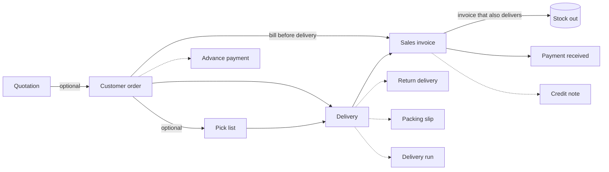
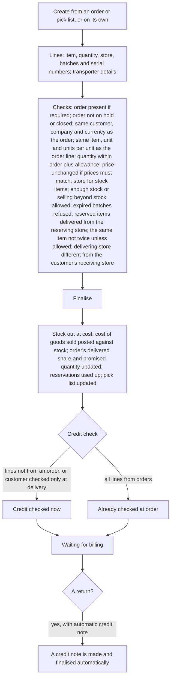
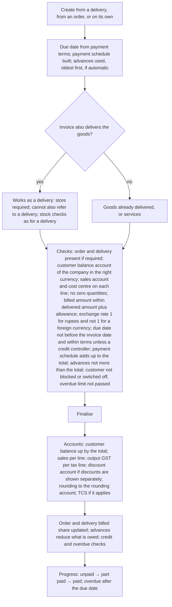

# Sales (non-POS)

## Purpose

Selling to wholesale, institutional and business (B2B) customers, where a sale is not finished at the counter: a quote is given, an order is confirmed, goods are picked, packed and delivered (sometimes in parts), an invoice follows, payment comes later on credit, and returns are settled with credit notes. It also covers home deliveries and phone orders from shop customers.

## Who uses it

| Role | What they do here |
|------|-------------------|
| Sales staff | Quotes, orders, delivery dates, following up what is pending. |
| Warehouse staff | Picking, packing, deliveries, delivery runs. |
| Accountant | Invoices from deliveries, advances, credit notes, chasing payment. |
| Store manager | Approves credit, holds or closes orders, approves returns. |
| Credit controller | Approves sales beyond credit limits or payment terms. |

## Main records

### Quotation

A priced offer to a customer or a prospective customer. The shop needs: who it is for, the date and how long the offer is valid, the items with quantities, prices and discounts, GST and totals, payment terms and terms text. Some lines can be alternatives for the customer to choose between. The shop also wants to know whether it was accepted (fully or partly turned into orders) or lost, and why it was lost.

### Customer order (sales order)

A confirmed order. The shop needs:

- **Who and when:** the customer, the order date, the delivery date (each line can have its own; the order shows the latest), the customer's own order number and date, billing and delivery addresses.
- **What and how much:** items, quantities and units, prices from the customer's price list, discounts and offers, the store each line ships from, and whether stock should be set aside for it.
- **Money:** GST, any delivery charge, bill discount, total, advance paid, payment terms with due dates.
- **Progress:** how much has been picked, delivered and billed. Overall: waiting for delivery and billing, waiting for billing, waiting for delivery, completed, on hold, closed or cancelled. When an advance is asked for: not asked, asked, part paid, fully paid.

For each line the salesperson can see current stock and the expected profit.

### Delivery

Goods leaving the shop for a customer. The shop needs: the customer, the date and time, the delivery address, the items, quantities and the store they leave from, batches and serial numbers, the order lines they fulfil, and the transporter, vehicle, driver and transport receipt if any. The system records the cost of the goods and how much has been billed. A delivery can be a return (goods coming back), in which case the shop can ask for a credit note to be made automatically. Progress: waiting for billing, part billed, completed, returned, closed or cancelled.

### Sales invoice

The customer's bill. The shop needs: the customer, the date, the due date, the customer's order number, billing and delivery addresses, the items with quantities, prices, discounts and GST (linked to the order and delivery lines being billed), any delivery charge, totals and rounding, advances being used, the payment schedule, and TCS if it applies. An invoice can also deliver the goods itself when there is no separate delivery. A **credit note** is an invoice for goods returned or an overcharge, linked to the original invoice; a **price-correction note** changes amounts without moving goods. Progress: unpaid, part paid, paid, overdue, credit given, returned, cancelled.

### Pick list

A list for warehouse staff of what to collect: the customer or orders, the store to pick from, and for each item the quantity to pick, the location and the batch or serial numbers suggested, and how much was actually picked. Staff can pick by scanning.

### Packing slip

What went into each carton of a delivery: carton numbers, items and quantities, net and gross weight.

### Delivery run

A driver's trip: driver, vehicle, departure time, and the stops in order (customer, address, contact, delivery, expected arrival, distance, whether visited). A maps service can work out arrival times and the best order of stops (Integrations).

### Delivery charge rule

How a delivery charge is worked out and added to a document: a fixed charge, or a charge by order value or weight in bands (for example free above ₹2,000), the income account it goes to, and optionally the places it applies to.

### Payment schedule and advances

The due dates and amounts the order or invoice is expected to be paid in (from the payment terms; see Customers), and payments already received in advance that will be used against the invoice (Accounting).

Not needed by a small retailer: sales team commissions, sales partners and targets.

## Processes

### 1. From quote to payment



Short cuts allowed: order → invoice (goods delivered later, or by the invoice itself); delivery → invoice; invoice on its own (if the business and the customer allow it). A quotation always becomes an order first.

### 2. Quotation

The valid-until date cannot be before the quotation date; an expired quotation cannot become an order unless the business allows it. A quotation moves from draft to open, then to partly ordered or ordered as orders are made from it; it can be marked lost with reasons (but not once an order exists). Only the alternatives the customer picks are carried into the order.

### 3. Customer order

```mermaid
flowchart TD
    A[Create from a quotation or from scratch: customer, items, quantities, delivery dates, store] --> B[Prices and offers; GST; payment schedule from payment terms]
    B --> C[Checks: delivery date given and not before the order date; store for stock items; customer order number not already used (warn or stop, as chosen); no zero quantities; whole numbers where required; coupon valid; quotation not cancelled]
    C --> D[Finalise]
    D --> E[Quantity promised to customers goes up; credit checked unless the customer is checked only at delivery; coupon use counted; quotation marked ordered]
    E --> F{Set stock aside, and firm reservations used?}
    F -->|yes| G[Available stock is reserved, partly if allowed]
    F -->|no| H
    G --> H{Advance asked for?}
    H -->|yes| I[Payment request sent; order waits for payment]
    H -->|no| J[Waiting for delivery and billing]
    I --> J
    J --> K{Deliveries and invoices}
    K --> L[Waiting for billing when all delivered; waiting for delivery when all billed; completed when both]
    E --> M{Manager action}
    M -->|hold| N[On hold: no deliveries or invoices until restarted]
    M -->|close| O[Closed: the rest is released from reservation; no more deliveries; can be reopened]
    M -->|change lines| P[Quantity, price, date or store changed after finalising; checks run again; cannot go below what was delivered]
```

Cancelling is refused while a draft invoice refers to the order or while it is closed; otherwise reservations and the quotation's status are rolled back and the coupon use is taken back.

### 4. Picking and packing

- A pick list collects open order lines for a customer or store, suggests locations, batches and serial numbers with stock, and records what was picked. Picked quantity may not be more than the stock in the location (or batch); when picking by scanning every line must be fully picked; otherwise a line with nothing picked is dropped. Orders with firm reservations are not picked this way (the reservation itself drives the delivery). Expired batches are refused.
- When finalised, the picked goods are held for the pick list until delivered; a delivery made from the pick list copies its batches and serial numbers.
- A packing slip splits an unfinished delivery into numbered cartons with weights; carton numbers must run in order and quantities must be within the delivery's.

### 5. Delivery



Delivery progress: waiting for billing → part billed → completed; returned; closed.

### 6. Sales invoice



A **credit note** is an invoice with minus quantities against an original invoice; it reverses sales and GST, brings stock back if the original moved stock, reduces what the customer owes (against the original or on its own, as chosen), and marks the original as credit given. A **price-correction note** has zero quantity and only changes amounts.

### 7. Delivery charges

When a delivery charge rule is on the document and there is a delivery address (in a place the rule covers), the charge is worked out: the fixed amount, or the band that contains the order value or weight (a band with no upper limit covers everything above it), converted to the document's currency, and added as a fixed charge line credited to the delivery income account. Changing the rule replaces that line.

### 8. Returns

The same rules as returns to suppliers (Purchasing, process 6), with the customer in place of the supplier: same customer, company and exchange rate; not dated before the original; minus quantities not more than the original less earlier returns; batches and serial numbers among those delivered. A returned delivery brings stock back at its original cost (or today's cost for a return without an original, or zero for an expired batch if the business chooses).

## Business rules

Orders

- A delivery date is required on the order and every line; a line's date cannot be before the order date; the order's delivery date is the latest line date.
- Stock items (and kits containing stock items) need a store unless the supplier delivers directly.
- A customer order number already used on another open order warns or stops, as the business chooses; the customer's order date cannot be after the delivery date.
- Quantities cannot be zero (unless the business allows price-only orders); whole numbers where required.
- Closed orders cannot be cancelled until reopened; orders with draft invoices cannot be cancelled.
- Lines cannot be reduced below what was delivered or billed when changed after finalising.
- Setting stock aside on a line needs firm reservations switched on and a stock item.
- Credit is checked at order time unless the customer is set to be checked only at delivery.

Deliveries and invoices

- An order is required before delivery and invoice, and a delivery before an invoice, if the business says so; customers can be exempted.
- Deliveries and invoices must match their order on customer, company, currency and type; lines must match on item, unit and units per unit; prices must match if the business requires it (stop or warn; a trusted role may override).
- Delivering more than ordered is allowed only within the over-delivery allowance (the item's, else the general one), except for users allowed to over-deliver.
- Billing more than ordered or delivered is allowed only within the over-billing allowance (the item's, else the general one), except for users allowed to over-bill.
- The same item twice on a document is refused unless the business allows it (stock and non-stock items checked separately; kits not counted).
- The delivering store and an internal customer's receiving store cannot be the same.
- An invoice that delivers goods cannot also refer to a delivery; a credit note that brings stock back without a delivery needs an original that moved stock.
- The customer balance account must belong to the company, be a customer account, and be in the customer's currency.
- The exchange rate must be 1 for rupees and not 1 for a foreign currency (warning).
- The due date cannot be before the invoice date; beyond the payment terms only for a credit controller.
- Payment schedule: due dates unique and (on orders and quotations) not before the document date; the scheduled amounts must add up to the invoice total less advances (within rounding); early-payment discount dates within their validity.
- Advances used cannot be more than the invoice total; they are used oldest first; advances paid against the order but not used on the invoice are pointed out.
- If the business blocks selling below cost, the floor (last purchase price, current cost) applies; each item's maximum discount applies.
- Credit is checked at delivery or invoice for lines not from an already-checked order; the overdue limit at invoice time if switched on.
- A delivery cannot be cancelled while a finalised invoice refers to it; cancelling an invoice rolls back billed shares, stock (if it moved stock), points and coupon use.

Picking, packing, delivery runs

- Picked quantity no more than available (and no more than the batch has); pick list stores must belong to the company; a pick list cannot be more than what is left on the order; serial numbers must be in the store; expired batches refused.
- Carton numbers on a packing slip must run in order; quantities above zero and within the delivery; the delivery must be unfinished.
- A delivery run needs a driver to finalise; its deliveries must be finalised; stops need addresses.

## Calculations

Line and document totals follow Pricing and Tax. Sales adds:

- **Expected profit per line** (orders, deliveries, invoices) = (price − current cost) × quantity, shown for information and in the profit report.
- **Cost of goods sold on a delivery or delivering invoice** = quantity × cost at that time (FIFO or moving average); returns use the original cost.
- **Order progress:** delivered share = Σ delivered (not above ordered) ÷ Σ ordered; billed share = Σ billed amount ÷ Σ order amount; picked share the same; completed when delivered and billed both reach 100% (or, for services, billed reaches 100%).
- **Over-delivery and over-billing checks:** as in Purchasing.
- **Delivery charge** = fixed amount, or the band amount for the order value or weight, ÷ exchange rate when the document is in a foreign currency.
- **Payment schedule:** per the customer's payment terms; each amount = invoice total × its share; discount lines get a discount date from the discount's validity.
- **Still owed** = (rounded) total − advances used − payments − credit notes against it (when they reduce the original) − write-off.
- **Advance status on an order:** not asked → asked (a payment request exists) → part paid → fully paid (advance at least the total).
- **Rounding** = rounded total − total, posted to the rounding account.

## Effects on other modules

| Event | Stock | Accounts (debit ↑ / credit ↑) | Other |
|-------|-------|-------------------------------|-------|
| Order finalised | Quantity promised up; firm reservation if chosen | none | Credit check; quotation marked ordered; coupon use counted |
| Delivery finalised | Goods out at cost | Cost of goods sold ↑ / Stock ↓ | Order delivered share; reservation used; pick list delivered |
| Invoice finalised | none (or goods out if it delivers) | Customer balance ↑ / Sales ↑, Output GST ↑; discount account ↑ / sales ↑ when discounts are shown separately; rounding; TCS payable | Order and delivery billed share; advances used; points; coupon |
| Return delivery | Goods in at original cost | Stock ↑ / Cost of goods sold ↓ | Credit note made automatically if chosen |
| Credit note | Goods in if it moves stock | Sales ↓, Output GST ↓ / Customer balance ↓ | Original marked credit given |
| Payment received | none | Bank or cash ↑ / Customer balance ↓ (Accounting) | Invoice progress |
| Delivery charge added | none | Delivery income ↑ (as a charge line) | |

## Reports

- **Order follow-up** — per order line: ordered, delivered, billed, pending, days late; filter by dates, customer and progress.
- **Sales over time** — by customer, group, area, item, item group or brand, by value or quantity, from orders, deliveries or invoices.
- **Sales register** — invoice and line level with GST, store and cost centre.
- **Profit on sales** — per invoice, item, item group, customer or area: sales value, cost, profit and margin %.
- **Delivered not billed** — deliveries without invoices, by customer, with age.
- **Order lines not covered by stock** — to raise purchase requests.
- **Payment schedule follow-up** — each scheduled amount with due date, paid and still owed.
- **Monthly trends** — quotations, orders, deliveries and invoices.
- **Lost quotations** — with reasons.
- **Kit availability** — how many kits can be made from stock.
- **Unpaid bills and ageing** — see Customers.

## Edge cases

- **Part deliveries and part invoices:** several deliveries per order and several invoices per delivery, tracked by shares; an order can be closed to stop the rest.
- **Bill first, deliver later:** invoice from the order without delivering; the later delivery refers to the invoice so stock and billing match.
- **Advance taken on an order:** payment request and payment against the order; the invoice uses the advance and reduces what is owed; exchange differences on foreign-currency advances go to exchange difference.
- **Customer pays a few rupees short:** written off on the payment (Accounting), not on the invoice (writing off on the invoice is only for till bills).
- **Part of a fully invoiced delivery comes back:** return delivery plus credit note (automatic if chosen); billed shares adjust.
- **Price changed between order and invoice:** stopped or warned if prices must match; otherwise the invoice price stands and the order's billed amount follows it.
- **Customer order number used twice:** warning or stop, as chosen.
- **Delivery to another state than the billing address:** GST treatment follows the delivery address when the business chooses that, changing same-state or other-state GST (Tax).
- **Home delivery for shop customers:** order (or delivery straight away) from the store, a delivery run for the driver, invoice from the delivery; or a till bill with a delivery address.
- **Several stores:** each document names its store; a central warehouse may deliver orders taken in stores.
- **Foreign currency:** the document is in the customer's currency, converted at the stored rate; the customer's balance account is in that currency.
- **Customer over the credit limit:** orders are stopped when finalised (unless checked only at delivery), and so are deliveries or invoices of lines not from an order; a credit controller can override.

## Settings

**How strict the selling steps are**
- Whether an order is required before delivery and invoice, and whether a delivery is required before an invoice (customers can be exempted).
- Whether prices must stay the same from order to delivery to invoice (stop or warn), and who may override.
- Whether the same item may appear on several lines.
- Whether a customer order number may be used on more than one order.
- Whether an expired quotation may still become an order.
- Whether zero-quantity (price-only) lines and negative prices are allowed.

**Margins and discounts**
- Whether selling below last purchase price or current cost is blocked.
- Whether discounts are posted to their own account.

**How much over is acceptable**
- How much more than ordered may be delivered, and who may go beyond it (items can override).
- How much more than ordered or delivered may be billed, and who may go beyond it (items can override).

**Stock for orders**
- Whether firm reservations are used, whether part reservations are allowed, and whether reservation happens automatically when an order is finalised.
- Whether a return gives the quantity back to the open order.
- Whether expired batches returned without an original bill come back at zero cost.

**Credit and payment**
- Whether invoices copy the payment terms from the order.
- The credit controller role; whether invoices are blocked for overdue customers, and who may bypass.
- Default payment terms and credit limit (Company and stores, Customers).

**GST**
- Whether GST treatment is decided from the billing address or the delivery address.
