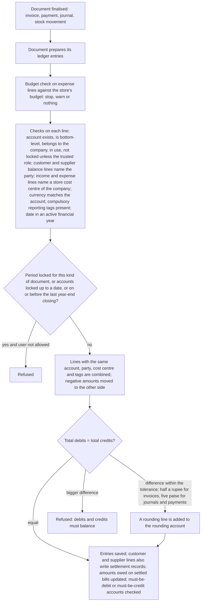
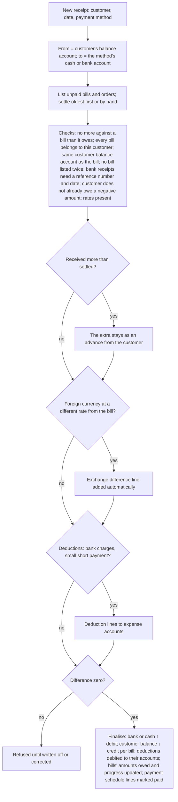

# Accounting

## Purpose

Keeps the books: the list of accounts, the double-entry records written automatically by every sale, purchase and stock movement and by hand through journals, money received and paid, bank and cash accounts matched against bank statements, opening balances when the system starts, and locking and closing each month and year. It produces the trial balance, profit and loss and balance sheet, and shows who owes the shop money and whom the shop owes.

## Who uses it

| Role | What they do here |
|------|-------------------|
| Accountant | Chart of accounts, journals, payments, bank matching, using advances, small write-offs, month and year closing. |
| Cashier / store manager | Cash deposits to the bank and petty-cash expenses; hands over the day's cash. |
| Owner | Reads the statements; approves budgets and write-offs. |
| Auditor | Reads ledgers and statements only. |

## Main records

### Chart of accounts

The list of accounts, arranged as a tree in five families: assets, liabilities, equity, income and expenses. For each account the business needs:

- **Its name and optional number**, and where it sits in the tree (folders group accounts; only bottom-level accounts receive entries).
- **Which family it belongs to** (inherited from its folder), which decides whether it appears in the balance sheet or the profit and loss.
- **What kind of account it is**, so the system knows how to use it: cash, bank, customer balances, supplier balances, stock, stock adjustment, goods received not billed, cost of goods sold, tax, rounding, temporary opening, sales, expense.
- **Its currency** (rupees unless it is a foreign-currency bank or party account).
- **Controls:** locked (only the trusted role may post to it), must always have a debit or a credit balance (for example cash can never go negative), switched off.

The standard India chart starts with: current assets (customer balances, bank, cash in hand, advances and deposits, stock in hand, tax receivable), fixed assets, investments, temporary opening; capital and reserves; current liabilities (supplier balances, goods received not billed, duties and taxes, loans and overdraft); direct income (sales, services) and indirect income; direct expenses (cost of goods sold, costs added to stock, stock adjustment) and indirect expenses (rent, salaries, electricity, marketing, freight, rounding, write-offs, exchange differences). A retailer should add: GST input and output accounts per head, card and UPI settlement accounts per provider, cash in till per store, discount allowed, cash short or over, gift-voucher liability and loyalty expense.

### Ledger entries

Written automatically, never typed. Each entry records: the date, the account, the customer or supplier (for their balance accounts), the store cost centre, the debit or credit amount in rupees (and in the account's currency and the document's currency if different, with the rate), the account(s) on the other side, the document that created it, the bill it settles (for customer and supplier balances), a remark, whether it is an opening entry, and whether it has been cancelled.

### Settlement records

A second, simpler record kept only for customer and supplier balances: who, which account, how much, which document, which bill it settles, the due date, and whether the link has been undone. Unpaid amounts, ageing and matching payments to bills are worked out from these, so that linking or unlinking a payment never rewrites the main ledger.

### Journal

A manual entry with any number of lines. The business needs: the kind of entry (general, bank, cash, contra between cash and bank, credit or debit note without goods, write-off, opening, exchange difference), the date, and for each line the account, cost centre, customer or supplier if any, the debit or credit, the bill or order it relates to, and a remark. For bank entries: the cheque or transfer number and date, and the date it cleared the bank. The system shows total debits, total credits and any difference.

### Payment

Money received from a customer, paid to a supplier, or moved between the shop's own accounts. The business needs:

- **What kind:** receipt, payment, or transfer between own accounts.
- **Who and how:** the customer or supplier, the payment method, the shop's bank account and theirs.
- **Where the money goes:** the account it comes from and the account it goes to, the amounts (and rates if a foreign currency is involved).
- **What it pays:** the bills or orders it settles, how much against each, and any exchange difference.
- **What is left over:** any amount not yet used (an advance), and small deductions such as bank charges, TDS or a short payment written off.
- **Proof:** cheque or transfer number and date, and the date it cleared the bank.

### Bank accounts

For each of the shop's bank accounts: the bank, account number, IFSC or branch, which ledger account it belongs to, whether it is the default, whether it is a credit card. Customers' and suppliers' bank accounts can be recorded too.

### Bank statement lines

Each line brought in from a bank statement: date, bank account, amount in or out, description, reference number, the bank's own transaction id, the other party's name and account if shown, bank charges included, and which payments or journals it has been matched to (and how much is still unmatched).

### Bank matching rules

Rules that sort statement lines automatically: words to look for in the description, an amount range, money in or out, and what to do (post to an account such as bank charges, treat as a payment from or to a party, or treat as a transfer), with a priority.

### Opening balances

- **Opening journal:** one entry dated the day before going live, bringing in every balance-sheet balance against the temporary opening account.
- **Opening bills:** one invoice per unpaid customer bill and one per unpaid supplier bill (party, original number, date, due date, amount owed), each against the temporary opening account, so ageing and payment matching work from day one.
- **Opening stock:** see Inventory.

### Locked periods

A date range during which chosen kinds of documents (for example invoices and journals) are locked, with one role allowed to bypass. Periods may not overlap.

### Year-end closing

For each company and financial year: the period, the account profit or loss moves to (a reserves or retained-earnings account), and a remark. Closing moves every income and expense balance into that account, per store cost centre, so the new year starts at zero. It also stores each account's closing balance so reports run fast.

### Budgets (optional)

Per store cost centre and year: an amount for each expense account, spread over months or quarters, and what to do when it is exceeded (stop, warn, or nothing), separately for internal requests, purchase orders and actual spending, both for the year and for the months so far.

### Payment matching tool

Matches unused payments, journals and credit notes with unpaid bills for a customer or supplier, lets the accountant decide how much goes against each (posting small differences to a chosen account), and records the links. It can also run automatically on a schedule.

Not needed by a small retailer: several sets of books, deferred income and expenses, foreign-exchange revaluation, extra reporting tags beyond the store, share registers.

## Processes

### 1. How every posting works



Cancelling writes equal and opposite entries marked as cancelled, on the same date. In the **unchangeable ledger** mode, the reversal is dated today instead and nothing is marked, so past figures never change.

### 2. Recording money received from a customer



Paying a supplier is the mirror image (from bank, to the supplier's balance account), with TDS deducted when it applies (Tax). A transfer between own accounts (cash deposited in the bank, bank to bank) needs two different accounts.

### 3. Journals

Used for cash expenses, rent and salaries, owner's drawings, corrections, write-offs, cash ↔ bank moves, opening balances, and credit or debit notes without goods. Lines must balance; one line cannot be both debit and credit; customer or supplier balance lines need the party; a line against a bill or order must be for the same party and not more than it owes; a line against a customer order must be a credit (advance received) and against a purchase order a debit (advance paid); bank entries need a reference number and date; foreign-currency lines need a rate; an opening entry must use the temporary opening account on the other side. A button balances the journal against an account the user chooses.

### 4. Matching the bank statement

```mermaid
flowchart TD
    A[Bring in the bank statement: upload a file or fetch from the bank] --> B[One statement line per row; lines already brought in are skipped]
    B --> C[Matching rules run on description, amount and direction; the highest-priority match sets the party or account]
    C --> D[Matching screen: for each unmatched line, suggested payments and journals, best first]
    D --> E[Score = 1 + (same reference number) + (same amount as unmatched) + (same party); an exact-amount option shows only equal amounts]
    E --> F{Match found?}
    F -->|yes| G[Link the payment or journal to the line; cleared date = statement date; line matched when nothing is left]
    F -->|no| H{Create from the line}
    H -->|payment| I[New payment for the party with amount, reference and date filled in]
    H -->|bank entry| J[New journal to an expense or income account: bank charges, interest]
    H -->|transfer| K[Transfer to the other bank account; its matching line is found by amount within a few days]
    I --> G
    J --> G
    K --> G
    G --> L[Bank matching statement: book balance against bank balance, listing items not yet cleared]
```

Automatic matching scores every line in a date range (in the background for more than ten lines) and links only exact matches.

### 5. Advances

An advance is a payment not yet used against a bill, or paid against an order. On the invoice, the shop can choose to use the party's advances automatically, oldest first, up to the invoice total; this reduces what is owed. The payment matching tool does the same later for any mix of payments, journals and credit notes against bills, with an account for small differences, and can run on a schedule.

### 6. Opening balances when going live

1. Set up the chart of accounts and decide the go-live date; lock nothing yet.
2. Opening journal dated the day before go-live: every asset at its book value as a debit and every liability and capital balance as a credit, with the temporary opening account taking the difference.
3. Opening bills for every unpaid customer and supplier bill, each against the temporary opening account, with their original dates and due dates.
4. Opening stock against the temporary opening account (Inventory).
5. After all three, the temporary opening account must be at zero; if not, something is missing.
6. Opening entries are refused once a year-end closing exists.

### 7. Month-end and year-end

- **Month-end:** match all bank accounts; post accruals and corrections; compare stock value with the stock accounts (Inventory) and fix differences; set the locking date to the month-end so store staff cannot post into it; optionally lock invoices and journals for the month as a locked period.
- **Year-end:** once the last month is locked, close the year (the previous year must be closed first; the start date must follow the previous closing; the end date must be within the year; the closing account must be a liability or equity account in rupees; stock accounts must equal the stock value; the stock closing must be up to date). Profit or loss moves to the closing account and closing balances are stored. A closing can be cancelled only if no later closing exists.

## Business rules

Accounts

- Top-level accounts cannot be edited or deleted and must be folders; an account cannot sit under itself; the parent must belong to the same company.
- Family and statement type are inherited from the folder and passed down to everything under it; balance sheet for assets, liabilities and equity, profit and loss for income and expenses.
- A folder with accounts under it cannot become a bottom-level account; an account with entries cannot change between folder and bottom-level, cannot be deleted, and cannot change currency; folders cannot have a kind.
- Customer and supplier balance kinds cannot be changed once used; the stock kind cannot be changed once stock has moved.
- Only the trusted role may lock or unlock an account, or post to a locked one.
- Must-be-debit and must-be-credit accounts are checked after every posting.
- Account numbers must be unique in the company; renaming or merging needs the same folder status, family, company and currency, and merging is refused if the ledger was written to in the last five minutes.
- Folders, switched-off accounts and other companies' accounts cannot receive entries.

Ledger entries

- Every entry needs an account, date, company, financial year and either a debit or a credit (not both zero; negative amounts are moved to the other side).
- Customer and supplier balance accounts need the party; income and expense accounts need a bottom-level store cost centre of the same company; the entry's currency must equal the account's.
- Entries are refused: on or before the locking date (unless the trusted role; the system administrator is never exempt), on or before the last year-end closing, inside a locked period for that kind of document (unless its bypass role), or outside active financial years.
- Debits and credits must balance within the tolerance; otherwise a rounding line is added or the posting is refused.
- Cancelled entries stay in the ledger with their reversals.

Journals and payments

- A journal line cannot be both debit and credit; the journal's difference must be zero; advances from customers must be credits and to suppliers debits; lines against bills must match the party and not exceed what is owed; bank entries need a reference number and date (a warning on the bank kind).
- A payment must be a receipt, payment or transfer; a transfer needs two different accounts; receipts and payments need a party; the bills listed must exist, be finalised, belong to the party and use the same balance account as the payment; no more against a bill than it owes (and the same in reverse for minus amounts); a bill may be listed once; a receipt is refused when the customer is already owed money overall; bank receipts and payments need a reference number and date; the difference must be zero when finalising; a supplier held for payments cannot be paid.
- Deductions are in rupees; exchange differences are worked out automatically as a deduction line to the exchange difference account.
- Held supplier bills cannot be paid until released.

Bank

- A statement line cannot be matched to more than its amount; a fully matched line takes no more matches; the same payment cannot be matched twice to one line; bank charges included cannot exceed the withdrawal; a shop bank account must be linked to a ledger account to be matched; the cleared date is set on the payment when matched and removed when unmatched.

Locking and closing

- Locked periods may not overlap; each lists the kinds of documents it locks; its bypass role may still post.
- Year-end closing: previous year closed first; starts the day after the previous closing (or at the year start); ends within the financial year; closing account is liability or equity in rupees; accounts not locked beyond the period; stock accounts equal stock value; no later closing exists when cancelling; opening entries refused once any closing exists.

Budgets (if used)

- A budget needs a store cost centre, a bottom-level account of the company, an amount above zero, a year range (start not after end), and must not duplicate another for the same account, cost centre and years; it says where it is checked; spending already above a new budget is pointed out.
- When posting, the year's budget and the months-so-far budget (sum of monthly shares up to this month) are each compared with actual spending (plus ordered and requested if the budget covers them); stop refuses, warn shows a message, nothing does nothing.

## Calculations

- **Account balance** = Σ debits − Σ credits of entries not cancelled (positive = debit balance). In statements, assets and expenses show debit balances as positive; liabilities, capital and income show credit balances as positive.
- **Rupee amount** = amount in the account's currency × exchange rate.
- **Rounding difference** = Σ debits − Σ credits after rounding each line to paise; posted to the rounding account and cost centre when within the tolerance.
- **Amount owed on a bill** = total (rounded) − Σ payments and advances used − Σ credit notes against it − write-off, from the settlement records.
- **Unused part of a payment** = amount received (or paid) − Σ settled against bills − Σ deductions other than exchange differences.
- **Difference** = party side (settled + unused, at the payment's rate) − bank side + taxes included; must be zero.
- **Exchange difference when settling** = amount settled × (bill's rate − payment's rate); a minus figure is a loss.
- **Bank match score** = 1 + [same reference] + [same amount as unmatched] + [same party]; highest first.
- **Bank matching statement:** book balance on a date = the bank account's ledger balance; bank balance = book balance + withdrawals not yet cleared − deposits not yet cleared (payments with no cleared date on or before the statement date).
- **Year-end closing entries:** for each income and expense account and cost centre, the opposite of its balance for the period; the net goes to the closing account per cost centre.
- **Months-so-far budget** = Σ monthly shares from the start of the year to the posting month; **budget used** = actual (± ordered and requested if covered) ÷ budget.
- **Age band** = days between the due date (or bill date) and the report date, placed in the chosen bands (default 30, 60, 90, 120).

## Effects on other modules

- Every module's postings pass through here; locks (locking date, locked periods, year-end closing, locked accounts, budgets) can refuse a sale, purchase or stock movement.
- Payments and credit notes change what is owed and the progress of bills in Sales, Purchasing and Point of sale.
- Bank matching sets cleared dates on payments and journals and can create them.
- Year-end closing resets income and expenses for the new year and locks the old year everywhere.
- Customer and supplier balances (Customers, Suppliers) come from the settlement records kept here.
- The accounting effects map (next module) lists which accounts each kind of transaction touches.

## Reports

- **General ledger** — every entry for an account, party, cost centre or document in a period, with running balance; filter by dates, account (with sub-accounts), party, document, cost centre; group by document or account; optionally show cancelled entries.
- **Trial balance** — per account: opening, debits and credits for the period, closing, with totals; optionally zero-balance accounts.
- **Profit and loss** — income, expenses and net profit by month, quarter or year, compared with last year, by store.
- **Balance sheet** — assets, liabilities and capital at period ends, with this year's profit so far.
- **Cash flow** — money in and out from trading, investing and financing.
- **Account balances** — by account and store.
- **Bank matching statement** — book against bank balance with uncleared items.
- **Cheque clearing** — cheques and transfers with cleared dates.
- **Settlement records** — per party and document.
- **Days to pay** — how long each invoice took to be paid.
- **Book health checks** — that the ledger and settlement records agree and every document balances.
- **Budget against actual** — per account, store and month.
- **Unpaid bills and ageing, party ledgers and balances** — see Customers and Suppliers.
- **Sales and purchase registers** — see Sales and Purchasing.
- **Profit summaries and ratios** — management views over the same ledger.

## Edge cases

- **Cash sales banked next day:** transfer from cash in till (or cash in hand) to bank; the bank statement line matches the transfer.
- **Card settlement arrives less commission:** a payment or bank entry splits the gross into bank (net) and card commission expense, clearing the card settlement account.
- **One cheque for two bills:** one receipt settling both bills.
- **Customer pays too much:** the extra stays as an advance; the next invoice uses it.
- **Cheque bounces:** cancel the receipt (if the bill is still open) or post a journal reversing bank against the customer balance, reopening the bill.
- **Small short payment (rounding, bank charges):** a deduction on the payment to bank charges or discount allowed; the difference must be zero before finalising.
- **Foreign supplier paid at a different rate:** exchange difference added automatically.
- **Posting into last month after it was locked:** refused for store staff; the accountant with the trusted role may post, and stock re-costing may follow.
- **Late bill for a year already closed:** cancel the closing (only if no later closing), post, and close again; or post it in the current year with a note.
- **Same bank statement brought in twice:** lines with the same bank transaction id are skipped.
- **Petty cash:** a cash account per store; expenses as journals or payments from it; top-ups as transfers.
- **Several stores:** one chart; a cost centre per store; separate cash-in-till and card settlement accounts per store if each drawer and terminal is checked separately.
- **Several companies:** separate charts, ledgers and closings; trade between them through internal customers and suppliers.

## Settings

**Protecting the books**
- The locking date and the one trusted role allowed to post before it and to lock accounts.
- Locked periods: which kinds of documents are locked and who may bypass.
- Whether cancellations post a reversal dated today (unchangeable ledger), so past figures never move. Recommended.
- Whether ledger entries are deleted when a draft or cancelled document is deleted. Keep off.

**Where things post by default**
- Default accounts for customer and supplier balances, cash, bank, rounding (and its cost centre), write-offs, exchange differences, discounts and advances (Company and stores).
- Whether advances go to separate advance accounts instead of the normal customer and supplier balance accounts.
- Whether entries on the same account are combined on the ledger.

**Payments and advances**
- Whether payments are unlinked from a bill when the bill is cancelled, and from an order when the order is cancelled.
- Whether payments are matched to bills automatically, and how often.
- Which date exchange differences are posted on: the bill's, the payment's or the matching date.
- Whether a customer or supplier may be billed in several currencies against one balance account.

**Bank**
- Whether the party on a statement line is guessed from the name (exactly or loosely).
- How many days apart two sides of a bank-to-bank transfer may be.
- Whether matching rules run automatically every hour.
- The matching rules themselves.

**Reports**
- The age bands for unpaid bills.
- Whether reports use the stored year-end balances or read the whole ledger.
- Whether balances show in the chart of accounts, and how long remarks may be in reports.

**Credit and budgets**
- The credit controller role and the overdue block (Customers).
- Budgets and what each does when exceeded.
