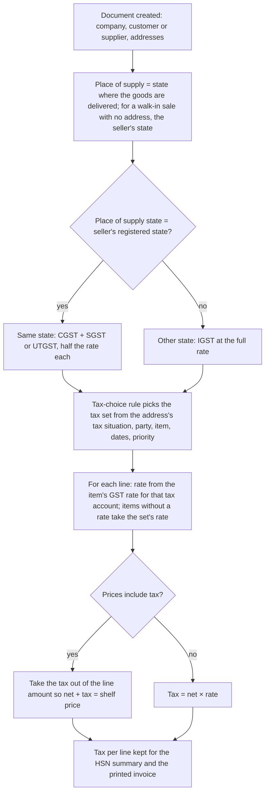
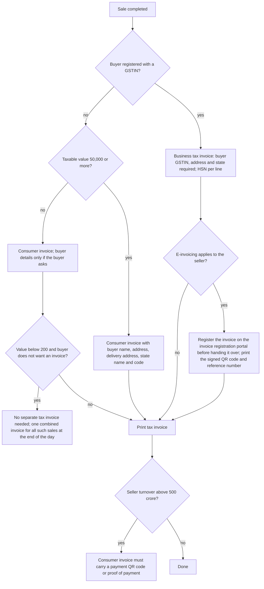
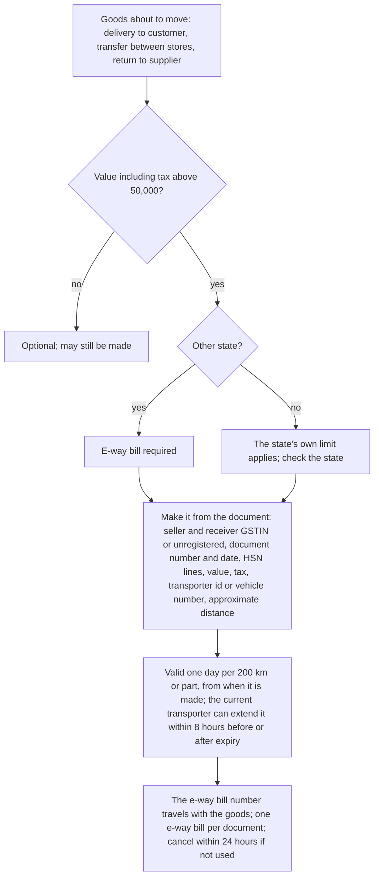
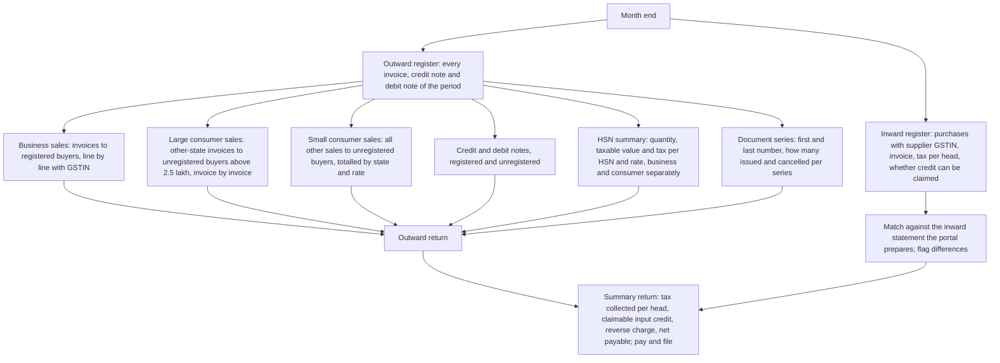

# Tax (GST)

## Purpose

Charges the right Goods and Services Tax on every sale and purchase, records input credit on purchases and output tax on sales, prints compliant invoices, produces the figures the monthly returns need, and registers invoices and goods movements with the government portals (e-invoice and e-way bill) where the law requires it.

**Source rule for this module.** Rates, limits and document rules below come from official government publications, cited inline. The tax engine is organised around tax sets, rules, tax-inclusive prices and rounding. Government rules change, so every figure carries its source and must be checked again before release.

## Who uses it

| Role | What they do here |
|------|-------------------|
| Accountant or tax consultant | Sets up tax accounts and tax sets, gives items their HSN codes and rates, checks return figures, files returns, matches input credit. |
| Merchandiser | Gives every item its HSN code and GST rate. |
| Cashier or sales staff | Nothing to set up. The system picks the tax from the item and customer. Takes the customer's GSTIN for a business bill. |
| Store manager | Makes e-way bills for transfers between stores and large deliveries. |
| Owner | Sees how much GST is payable and how much input credit is available. |

## Main records

### Tax accounts

The shop needs one account for each tax it collects and each tax it can claim back, so the return figures can be read straight from the books:

- **Tax collected on sales:** CGST, SGST (or UTGST in a union territory) and IGST.
- **Tax paid on purchases (input credit):** CGST, SGST and IGST.
- **Tax the shop pays itself under reverse charge.**
- **Compensation cess,** only if the shop sells goods that attract it.

### Tax sets for documents

A ready-made group of tax lines that a sale or purchase picks up, so staff never type tax lines by hand. A small retailer needs about five: sales in the same state (CGST and SGST), sales to another state (IGST), purchases in the same state, purchases from another state, and purchases under reverse charge. For each tax line the business needs:

- **Which tax account** and the rate.
- **What the tax is worked out on:** usually a percentage of the net amount; rarely a fixed amount, an amount per unit, or a percentage of an earlier tax line (for a cess on top of tax).
- **Whether the tax is already inside the shelf price.** Most retail prices include tax.
- **For purchases only:** whether the line adds to or reduces the bill, and whether the tax becomes part of the goods' cost (when credit cannot be claimed).

One set can be the default, and each set can be tied to a tax situation (below).

### GST rate per item

Each item, or its item group or brand, carries its GST rate. The rate is stored against every tax account so the same item works for both same-state and other-state bills: a 5% item carries 2.5% CGST, 2.5% SGST and 5% IGST. The business also needs:

- **Exempt or nil-rated:** whether a tax simply does not apply to the item, which is different from a zero rate in the return.
- **Effective dates:** so a rate change applies only from its date and old bills keep the old rate.
- **Price bands:** for goods whose rate depends on the selling price.

### Tax situation of a customer, supplier or address

A simple tag saying which kind of tax applies: same state, other state, special economic zone, exempt, or reverse charge. The tax rules use it to choose the tax set.

### Tax-choice rules

Rules that choose the tax set automatically from who the party is, where the goods go (state, city, PIN code, country), the item or item group, the tax situation, the dates and the company. The rule that matches the most details wins, and priority breaks ties.

### HSN code

See Items. Every goods item carries its HSN code and every service its SAC. How many digits are needed depends on the shop's turnover (Business rules).

### TDS and TCS (optional)

For larger businesses only. Rates per period, the limit per transaction and per year, which accounts to use, whether the tax is on the net or gross amount, rounding, and whether tax applies only above the limit or to the whole amount. This is income-tax withholding, not GST, and is kept here only as a capability. Whether version 1 needs it is an open question.

### Return figures

Not records anyone edits, but outputs the system must produce: the outward supplies register split the way the monthly return needs it (business sales, large consumer sales, small consumer sales, credit and debit notes, HSN summary, document series), the inward supplies register for matching input credit, and the summary return figures.

Not needed by a small retailer: special handling for export and import, deemed exports, and complex cess chains beyond those listed above.

## Processes

### 1. Setting up GST for a company

1. Record the company's GSTIN and state on the company and on every store address. A store in another state needs its own GSTIN, and in practice is a separate registration.
2. Create the tax accounts: tax collected under duties and taxes, input credit under current assets.
3. Set up the GST rates in use: nil, 5%, 18%, 40% and any special rates in force (see Business rules).
4. Create the sales and purchase tax sets for same-state and other-state, pointing at the tax accounts. Retail shelf prices normally use tax-inclusive lines.
5. Create the tax situations and tax-choice rules: same state when the goods stay in the store's state, other state otherwise, plus special cases for SEZ, exempt customers and reverse-charge suppliers.
6. Give every item its GST rate and HSN code, quickest through item group defaults.

### 2. Deciding which tax applies on a document



Official basis: place of supply for goods is where movement ends for delivery; for an unregistered buyer it is the address on the invoice, and with no address the seller's location; supply is inter-state when the seller's state and the place of supply differ, otherwise intra-state ([IGST Act section 10](https://taxinformation.cbic.gov.in/content/html/tax_repository/gst/acts/2017_IGST_Act/active/chapterv/section10_v1.00.html), [section 7](https://taxinformation.cbic.gov.in/content/html/tax_repository/gst/acts/2017_IGST_Act/active/chapteriv/section7_v1.00.html)).

### 3. How tax is worked out on a document

1. Line net amounts are fixed first: price, discounts, and the share of any bill discount (Pricing and promotions).
2. For each tax line in order:
   - Percentage lines: per line, net × rate, using the item's own rate for that tax account if it has one, otherwise the tax set's rate, or zero if the item is marked as not taxed under that account.
   - Fixed-amount lines: spread across the bill lines in proportion to their net amounts.
   - Per-unit lines: amount × quantity.
   - Lines based on an earlier tax line: use that line's amount or running total.
3. Each tax line keeps its total and the running total, and the tax per bill line is stored for reports.
4. Rounding: each tax line is rounded to paise. If per-line rounding is switched on, tax is rounded per bill line so the HSN summary adds up exactly. The bill total may then be rounded to the nearest rupee, with the difference posted to the rounding account.
5. When a discount is given on the whole bill, tax is worked out again on the reduced net amounts.

### 4. Tax-inclusive shelf prices

```mermaid
flowchart TD
    A[Line amount = shelf price × quantity; tax lines marked as inside the price] --> B[Work out each tax line's share of net: percentage lines r/100; lines on earlier lines multiply shares; fixed lines become a fixed part per unit]
    B --> C[Net amount = (line amount − fixed parts) ÷ (1 + sum of shares)]
    C --> D[Net price per unit = net amount ÷ quantity, rounded]
    D --> E[Tax per line = net × its share; net + taxes gives back the shelf price, apart from rounding]
    E --> F[Bill total adjusted so tax-inclusive totals do not drift through rounding]
```

Example: a shelf price of 118 with 18% GST split 9% + 9% gives net 100, CGST 9 and SGST 9.

### 5. Invoicing a sale



Official basis: invoice contents and the daily combined invoice for small consumer sales ([CBIC invoice rules](https://cbic-gst.gov.in/gst-invoice-rules.html), [CGST Act section 31](https://taxinformation.cbic.gov.in/content/html/tax_repository/gst/acts/2017_CGST_act/active/chapter7/section31_v1.00.html)); e-invoicing covers business and export invoices for taxpayers above the notified turnover, and consumer invoices need no registration ([e-invoice portal FAQ](https://einvoice1.gst.gov.in/Others/Faqs), [GST portal overview](https://tutorial.gst.gov.in/downloads/news/e_invoice_overview.pdf)); payment QR on consumer invoices above 500 crore turnover ([Circular 146/02/2021](https://cbic-gst.gov.in/pdf/Circular_Refund_146.pdf)).

### 6. Credit notes and returns

A return or price correction after invoicing is recorded by a credit note (reduces tax) or a debit note (increases tax) that names the original invoice. A credit note must be reported in the return of the month it is issued, and no later than 30 November after the end of the financial year of the sale (or the annual return date if earlier). After that the tax cannot be adjusted through the return ([CGST Act section 34](https://taxinformation.cbic.gov.in/content/html/tax_repository/gst/acts/2017_CGST_act/active/chapter7/section34_v1.00.html)). Its contents mirror the invoice, plus the original invoice number and date ([CBIC invoice rules](https://cbic-gst.gov.in/gst-invoice-rules.html)).

### 7. E-way bill for moving goods



Official basis: limit, value definition (invoice value including taxes, excluding exempt goods and freight), validity, extension and cancellation windows, one bill per invoice, service-only invoices excluded, 180-day document age limit, 250 lines at most ([e-way bill FAQ](https://docs.ewaybillgst.gov.in/html/faq.html), [GST portal e-way bill page](https://services.gst.gov.in/services/ewaybill/ewaybillsystem)).

### 8. Monthly return figures



Official basis: the table structure of the outward return and the quarterly scheme for turnover up to 5 crore ([GSTR-1 FAQ](https://tutorial.gst.gov.in/userguide/returns/GSTR_1.htm), [QRMP advisory](https://tutorial.gst.gov.in/offlineutilities/returns/QRMP_Advisory.pdf)); HSN summary split and digit rules ([HSN advisory April 2025](https://tutorial.gst.gov.in/downloads/news/updated_advisory_hsn_table12_25042025.pdf)).

## Business rules

Rates (as announced for 22 September 2025; check the notification before release)

- Two main rates: a standard rate of 18% and a merit rate of 5%, with a special 40% rate for a short list of luxury and harmful goods (for example aerated drinks, pan masala, tobacco, large cars), and nil for a set of essentials. Tobacco items keep the old regime until notified ([PIB, 56th Council recommendations](https://www.pib.gov.in/PressReleasePage.aspx?PRID=2163555&reg=48&lang=2), [PIB FAQ](https://www.pib.gov.in/PressReleasePage.aspx?PRID=2163560&reg=3&lang=2), [GST Council press release](https://gstcouncil.gov.in/sites/default/files/2025-09/press_release_press_information_bureau_0.pdf)).
- The system must therefore support any number of rates with effective dates, and keep old rates for documents dated before a change.
- Same-state tax splits the rate equally between the central and state heads. Other-state tax applies the full rate to the integrated head (IGST Act sections 7, 8 and 10, cited above).

HSN codes

- Sellers with turnover above 5 crore in the previous year must show 6-digit HSN or SAC on invoices. Sellers up to 5 crore must show 4 digits on business invoices. The HSN summary in the return follows the same split, with the consumer summary currently optional for smaller sellers ([PIB on HSN requirement](https://www.pib.gov.in/PressReleasePage.aspx?PRID=1708713&reg=48&lang=2), [Notification 78/2020 advisory](https://tutorial.gst.gov.in/downloads/news/hsn_advisory_table_12_2.pdf), [HSN validation advisory](https://tutorial.gst.gov.in/downloads/news/advisory_on_hsn_validation_08_01_25.pdf)).
- Design rule: store 8 digits where known and print the digits the seller's turnover band needs. The e-invoice portal has announced it will stop accepting 4-digit codes, so default to 6.

Invoice contents

- A tax invoice must carry: seller name, address and GSTIN; a serial number unique within the financial year (letters, numbers, hyphens and slashes allowed, one or more series); date; buyer name, address and GSTIN if registered; for unregistered buyers, the name, address, delivery address and state name and code when the taxable value is 50,000 or more (below that, only if the buyer asks); HSN or SAC and description per line; quantity and unit for goods; total value; taxable value after discount; tax rate and amount per head; place of supply with state name for other-state sales; delivery address if different from the place of supply; whether reverse charge applies; signature or digital signature ([CBIC invoice rules](https://cbic-gst.gov.in/gst-invoice-rules.html)).
- A sale below 200 to an unregistered buyer who does not ask for an invoice needs no separate tax invoice. One combined invoice for all such sales is issued at the close of the day ([section 31](https://taxinformation.cbic.gov.in/content/html/tax_repository/gst/acts/2017_CGST_act/active/chapter7/section31_v1.00.html), [CBIC invoice rules](https://cbic-gst.gov.in/gst-invoice-rules.html)). Design rule: the till must still record every bill. The combined invoice is a reporting view, not permission to skip bills.
- A composition dealer issues a bill of supply (no tax shown) instead of a tax invoice. It carries seller details, serial number, date, buyer details if registered, HSN and description, value and signature ([CBIC invoice rules](https://cbic-gst.gov.in/gst-invoice-rules.html)).
- Invoice numbers must be unique per financial year per series, with no unexplained gaps, so the return can report how many documents were issued and cancelled (GSTR-1 FAQ cited above).

E-invoicing

- Applies from 1 August 2023 to taxpayers whose total turnover exceeded 5 crore in any financial year since 2017-18. It covers business and export invoices, credit notes and debit notes. Consumer invoices are outside it ([e-invoice portal FAQ](https://einvoice1.gst.gov.in/Others/Faqs), [GST portal overview](https://tutorial.gst.gov.in/downloads/news/e_invoice_overview.pdf)).
- The invoice must be registered (reference number and signed QR code received) before it is given to the buyer. The QR code must be printed on the buyer's copy. Registration can be cancelled within 24 hours. From 1 April 2025, taxpayers with turnover of 10 crore and above must register within 30 days of the invoice date ([e-invoice portal FAQ](https://einvoice1.gst.gov.in/Others/Faqs), [IRP time-limit notice](https://einvoice6.gst.gov.in/content/revised-time-limit-for-e-invoice-reporting-for-businesses-with-aato-of-%E2%82%B910-crores-above/)).
- Design rule: for a company that must e-invoice, a business invoice is not final until registered. The print must show the reference number and QR code. A failed registration blocks printing and is queued to retry. After 24 hours, a credit note is needed instead of cancellation.

Payment QR on consumer invoices

- Sellers with total turnover above 500 crore must print a payment QR code (seller GSTIN, UPI id, bank account and IFSC, invoice number and date, total, tax breakup) on consumer invoices, or proof of the payment already made (mode, transaction id, date, amount). Cash payments recorded on the invoice satisfy the rule ([Circular 146/02/2021](https://cbic-gst.gov.in/pdf/Circular_Refund_146.pdf)). Small retailers are below this limit, so keep it as a switch.

E-way bill

- Required for other-state movement of goods worth more than 50,000 (invoice value including tax, excluding exempt goods and freight) in a motor vehicle. Same-state limits are set by each state. Optional below the limit. One e-way bill per document. Service-only documents cannot have one. Valid one day per 200 km or part. Only the current transporter can extend it, within 8 hours before or after expiry. Can be cancelled within 24 hours. Documents older than 180 days cannot be used. At most 250 lines ([e-way bill FAQ](https://docs.ewaybillgst.gov.in/html/faq.html), [GST portal e-way bill page](https://services.gst.gov.in/services/ewaybill/ewaybillsystem)).
- Design rule: transfers between stores above the limit also need an e-way bill, with the delivery challan as the document.

Credit and debit notes

- Must name the original invoice. A credit note adjusts tax only if reported by 30 November after the financial year (or the annual return date if earlier) ([section 34](https://taxinformation.cbic.gov.in/content/html/tax_repository/gst/acts/2017_CGST_act/active/chapter7/section34_v1.00.html)). Design rule: warn when a credit note is dated past that limit, but still allow the stock and money side.

Composition scheme

- Traders of goods with turnover up to 1.5 crore (75 lakh in some special-category states) may opt in and pay 1% on turnover. They cannot collect tax from customers and must issue bills of supply ([PIB, 32nd Council](https://www.pib.gov.in/Pressreleaseshare.aspx?PRID=1559414&reg=48&lang=2), [CBIC press release](https://cbic-gst.gov.in/pdf/press-release/Changes-recommended-Composition-Scheme.pdf), [CBIC invoice rules](https://cbic-gst.gov.in/gst-invoice-rules.html)). Design rule: a company-level composition switch that stops tax lines on sales, prints a bill of supply with the required declaration, and blocks input credit accounts.

Return filing frequency

- Outward return monthly, or quarterly with monthly payment for turnover up to 5 crore (per PAN), with an option to upload business invoices in the first two months of a quarter ([QRMP FAQ](https://tutorial.gst.gov.in/downloads/news/faq_on_qrmp_iff.pdf), [Circular 143/13/2020](https://cbic-gst.gov.in/pdf/Circular_Refund_143_11_2020.pdf)).
- Large consumer sales reported invoice by invoice: other-state invoices above 2.5 lakh to unregistered buyers ([GSTR-1 FAQ](https://tutorial.gst.gov.in/userguide/returns/GSTR_1.htm)).

Tax engine rules (general design, not tied to any product)

- A tax line must name an account. Percentage lines need a rate. Lines based on an earlier line need a valid earlier line, and cannot point to themselves or a later line.
- Tax-inclusive lines cannot be fixed amounts, and a fixed-amount line cannot sit between tax-inclusive lines in a chain.
- The rate per bill line comes from the item's GST rate first. An item marked as not taxed under an account gets zero even if the tax set has a rate.
- Tax sets belong to one company, and their accounts must belong to that company.
- Tax-choice rules with the same match are settled by priority. A tie is an error at setup.
- The tax situation is taken from the billing or the delivery address, as set. The delivery address is the correct basis for place of supply of goods.
- Tax on discounts: line discounts reduce the taxable value; a bill discount on the net total reduces the taxable value before tax; a bill discount on the grand total is spread back so tax is worked out again on the reduced net. Retail should apply discounts before tax so the invoice shows the correct taxable value.
- Rounding differences and the rounded total go to the rounding account, never to a tax account.

## Calculations

- **Same state:** CGST = taxable value × rate ÷ 2; SGST (or UTGST) = taxable value × rate ÷ 2.
- **Other state:** IGST = taxable value × rate.
- **Price without tax:** taxable value = net amount; tax = taxable value × rate.
- **Price including tax:** taxable value = (line amount − fixed parts) ÷ (1 + sum of rate shares); tax = taxable value × rate share; printed price per unit = taxable value ÷ quantity.
- **Taxable value after discount** = line amount − line discount − share of bill discount (when given on the net total).
- **Rounding per tax line:** each tax line's total rounded to paise; optional rounding per bill line so the line taxes add up to the total.
- **Rounded total** = bill total rounded to the nearest rupee; rounding adjustment = rounded − unrounded, posted to the rounding account.
- **HSN summary line** = total quantity, taxable value, CGST, SGST, IGST and cess per HSN, rate, and business or consumer, for the period, including minus figures from credit notes.
- **Small consumer sales summary** = taxable value and tax per place-of-supply state and rate for unregistered sales below the large-sale limit.
- **Net GST payable (summary return)** = tax collected per head − claimable input credit per head (set off in the legal order, integrated tax first) + reverse-charge tax. It cannot be below zero per head; extra credit carries forward.
- **E-way bill value** = invoice value including tax − exempt goods value − freight.
- **E-way bill validity in days** = distance ÷ 200, rounded up.
- **TDS or TCS (if used):** tax = (amount above the limit if tax applies only above the limit, otherwise the whole amount) × rate, with the yearly limit tracked per party.

## Effects on other modules

- Every sales line credits the tax-collected accounts. Every purchase line debits the input credit accounts, or adds the tax to the goods' cost when credit cannot be claimed. Reverse-charge purchases credit a reverse-charge liability and may debit input credit (Accounting effects map).
- The place-of-supply decision depends on the addresses kept in Customers, Suppliers and Company and stores.
- GST rates and HSN codes live on Items and item groups.
- E-invoice registration controls the printing of business invoices (Printing) and feeds e-way bill creation.
- Transfers between stores above the limit need an e-way bill (Inventory).
- Credit notes and returns (Sales, Point of sale) carry the tax reversal and the original invoice reference.
- Return figures are exported (Data import and export) or sent through an integration (Integrations).

## Reports

- **Sales tax register** — invoice by invoice: taxable value and tax per head. Filters: period, company, GSTIN, business or consumer, place of supply.
- **Purchase tax register** — supplier GSTIN, invoice, tax per head, whether credit can be claimed, whether reverse charge applies.
- **HSN summary** — per HSN and rate: quantity, taxable value, tax per head; business and consumer separately.
- **Small consumer sales by state and rate.**
- **Documents issued** — per series: first number, last number, total, cancelled.
- **Credit and debit note register** — with the original invoice and a flag when the reporting deadline is near or past.
- **GST payable position** — tax collected per head, input credit per head, reverse charge, net payable, credit carried forward.
- **Input credit matching** — purchases in the books against the portal's inward statement: matched, missing on either side, value differences.
- **E-invoice status** — invoices waiting, registered, failed, cancelled, and those near the 30-day limit.
- **E-way bill register** — bills made, about to expire, expired, cancelled, by document.
- **TDS and TCS details** (if used) — per party: progress towards the limit and tax deducted or collected.

## Edge cases

- **Walk-in customer from another state:** the place of supply is the store when no address is recorded, so same-state tax applies. If the customer gives an other-state address for goods delivered there, other-state tax applies (section 10, clause for unregistered buyers).
- **Home delivery across a state border:** other state, IGST, and an e-way bill if above the limit.
- **Mixed-rate basket with a bill discount:** spread the discount across lines before tax so each rate's taxable value is correct.
- **Rate change mid-month:** rates with effective dates; documents keep the rate in force on their date; one return period may show two rates for one HSN (two summary lines).
- **Tax-inclusive shelf tags during a rate change:** the shelf price stays and the net changes; the owner decides whether to re-tag.
- **Business customer without GSTIN at the till:** treated as a consumer. Changing it to a business bill later needs a credit note and a new business invoice.
- **E-invoice portal down:** queue registrations and do not hand over business invoices as final until registered. The 30-day window gives larger sellers some slack.
- **Credit note after the November cut-off:** stock and money still move, but tax cannot be adjusted in the return; show a warning.
- **Free items and samples:** taxable value zero on the line. Whether tax is due on a value for free supplies is a question for the tax consultant (open question).
- **Exempt and nil-rated items** (some unbranded foods): exempt and zero rate are reported differently in the return, so keep both.
- **Composition dealer:** no tax lines on sales, bill of supply, no input credit, quarterly statement; a company-level switch.
- **Several stores in one state:** one GSTIN, one return; stores add up.
- **Stores in several states:** separate registrations and separate return figures per GSTIN. Transfers between them are taxable supplies between registrations of the same business.

## Settings

**Registration**
- The company's GSTIN and state, and each store address's GSTIN. These decide the seller side of the place-of-supply test and which registration a document reports under.
- Whether the business is under the composition scheme: bills of supply, no tax collected, no input credit.
- Whether returns are monthly or quarterly, which decides how return figures are grouped.

**How tax is chosen and added**
- Whether the tax situation comes from the billing address or the delivery address. Delivery is correct for goods.
- Whether tax lines are added automatically from the item's rate and the tax set, without staff action.
- The tax sets, which of their lines are inside the shelf price, and the tax-choice rules with their priorities.
- Each item's GST rate, effective dates and exemptions, set on the item, item group or brand.

**Rounding and printing**
- Whether tax is rounded per bill line, so HSN summaries add up exactly.
- How tax appears on receipts: included-tax amounts shown or not, and tax shown as a table or as lines.
- How many HSN digits to print: 4, 6 or 8, by turnover band.

**E-invoice and e-way bill (proposed)**
- Whether e-invoicing applies, the turnover band, whether invoices register automatically when finalised, and whether printing waits until registration succeeds.
- The e-way bill limit per state, the usual transporter, and where distances come from.
- Whether consumer invoices carry a payment QR code (only for sellers above 500 crore).

**Withholding (if used)**
- TDS and TCS categories with their rates and limits.
