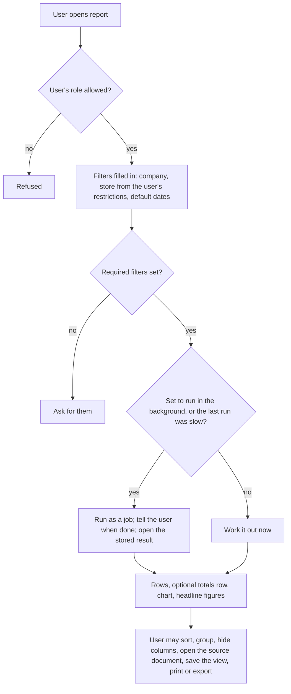
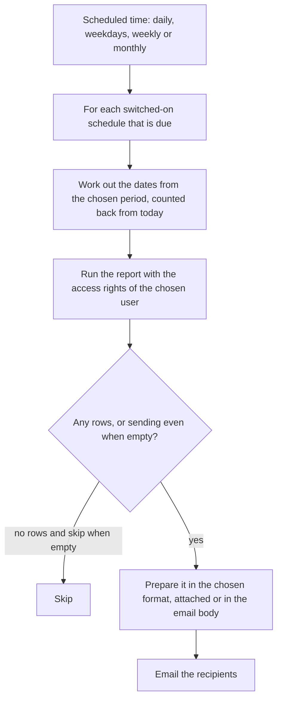

# Reports and dashboards

## Purpose

Turns the records into answers a retailer needs at a glance: how much each store sold today, how much cash should be in the drawer, what is running out, what is not selling, what customers owe, what GST is payable, and whether the business is making money. This module describes how reports work in general (filters, columns, export, scheduled emails, dashboards) and lists the reports by how often they are used. Detailed contents of module-specific reports are in each module's Reports section; this file is the master list.

## Who uses it

| Role | What they read |
|------|----------------|
| Cashier | Their own shift summary and till bills. |
| Store manager | Daily sales, payment mix, cash position, stock alerts, returns, discounts given and staff performance for their store. |
| Purchase manager | Reorder suggestions, open purchase orders, supplier performance, slow stock. |
| Accountant | Ledgers, amounts owed both ways, bank position, GST figures, trial balance, statements. |
| Owner | Dashboards across stores, profit, margin by category, trends, best and worst items. |

## Main records

### Reports

Each report needs a name, who may run it, the filters it asks for (with defaults and which ones are required), the columns it shows, and whether it adds a totals row. A small retailer needs three kinds:

- **Ready-made reports:** built into the product and worked out from the ledgers. They take filters and return rows, and can add a chart and headline figures.
- **Simple list views:** the user picks a kind of record, chooses columns, filters, sorting and grouping with subtotals, and saves it under a name. No programming. For one-off questions.
- **Slow reports run in the background:** the same as ready-made reports, but run as a job when they take long. The user is told when it is ready and opens the stored result. Each run records who asked, when it finished and any error.

### Saved views

A user's saved set of filters, columns and sorting for a report, kept private or shared with chosen roles.

### Scheduled report emails

So the owner and managers get figures without logging in. The business needs: which report, whose access rights it runs under, who receives it, how often (daily, weekdays, weekly on a chosen day, monthly), which period the dates cover (day, week, month, quarter, half-year, year), the format (in the email body, spreadsheet or PDF), a row limit, and whether to skip the email when there is nothing to report.

### Daily summary email for the owner

One email per company at a chosen frequency, with the figures the owner picks: income and expenses for the period and the year so far, bank balance, what customers owe, what the shop owes suppliers, new orders, orders waiting for delivery, billing or receipt, new invoices and overdue purchases.

### Charts

A chart shows a figure over time or split into groups. The business needs: what it counts or adds up (number of bills, sales value, average), over what time span and in what steps (daily to yearly), how to split it (by store, item group, payment method), filters, the chart style (line, bar, pie), and who may see it. Filters such as the viewer's own store are worked out per viewer.

### Headline figures

A single number on a tile, such as today's sales or items below reorder level, with its filters and an optional comparison with the previous day, week, month or year.

### Dashboards

A page per role that arranges headline figures, charts, shortcuts to lists and reports, and lists of recent records.

Not needed by a small retailer: custom chart data sources written by a developer, and public dashboards for outsiders.

## Processes

### 1. Running a report

Every report respects record-level access: a store manager restricted to one store sees only that store's locations, cost centre and documents (Users, roles and permissions).

### 2. Exporting and printing a report

Export to a spreadsheet or comma-separated text with the current filters and columns, optionally with totals and indentation for tree-shaped reports. Print or save as PDF with the company letterhead. Every export is logged (Users, roles and permissions).

### 3. Scheduled report email

### 4. Owner's summary email

At the chosen frequency, work out each chosen figure for the period just ended and its comparison, prepare one email per company, and send it to the recipients whose user accounts are active.

### 5. Dashboards

Charts and headline figures refresh when the page opens (kept for a short time to save work) or on a schedule for heavy ones. Each shows when it was last refreshed. Filters are worked out per viewer, so the same dashboard shows each store manager their own store.

## Business rules

- A report or chart is visible only to its allowed roles. If none are set, anyone who can read the underlying records may see it.
- Figures shown are always limited by the viewer's record-level access (company, store, location, customer group and so on).
- Required filters must be set before running. A date range cannot end before it starts.
- Background reports stop after a time limit (default 25 minutes). A failed run stores the error.
- Scheduled emails run with the chosen user's access rights, not each recipient's. Recipients must be valid email addresses. List views are capped at 500 rows per email.
- Summary emails are not sent to users who are switched off.
- Headline figures and charts that add up money must state the currency. Adding up different currencies is refused.
- Reports read finalised documents only, unless a report deliberately includes drafts (for example bills on hold).
- Cancelled documents are left out by default. Ledger reports can include them on request.
- Large reports should read stored period balances (year-end closing balances, stock closing) where available.
- The number of rows shown on screen is limited (default 100,000). Beyond that, export or background running is required.

## Calculations

The calculations of each report are described in its module. Those used across reports:

- **Period comparison:** change % = (this period − previous period) ÷ previous period × 100, using a period of the same length immediately before.
- **Average bill value** = net sales ÷ number of bills. Returns are not counted as bills but reduce the value.
- **Items per bill** = total quantity ÷ number of bills.
- **Gross margin %** = (net sales − cost of goods sold) ÷ net sales × 100, with cost taken from the stock records at the time of sale.
- **Sell-through %** = quantity sold in the period ÷ (opening stock + received in the period) × 100.
- **Days of stock left** = current stock ÷ average daily sales over the last N days.
- **Stock turnover** = cost of goods sold for the period ÷ average stock value, where average = (opening + closing) ÷ 2.
- **Shrinkage %** = value of write-offs and count shortfalls ÷ sales × 100.
- **Age bands** = days from the due date (or document date) to the report date, placed in the chosen bands.
- **Tree totals:** a folder row = the sum of everything under it (account tree, item group tree, location tree).

## Effects on other modules

None on data: reports only read. They depend on the stock records (Inventory), the ledger and settlement records (Accounting), document registers (Sales, Purchasing, Point of sale), tax per line (Tax), and access rights (Users, roles and permissions). Scheduled reports and summary emails use the email connection (Integrations).

## Reports

### Daily (store and cashier)

| Report | Question it answers | Main filters | What it shows |
|--------|---------------------|--------------|---------------|
| Shift closing summary | Does the drawer match? | Till, cashier, shift | Opening cash, expected, counted and difference per payment method; sales, returns, taxes. |
| Till bills | What was billed today? | Date, store, till, cashier, payment method, returns | Bill, time, customer, total, paid, method, whether a return. |
| Takings by payment method | How was today's money received? | Date, store, cashier | Amount by payment method, net and total. |
| Daily sales by store | How did each store do? | Date range, company, store | Bills, quantity, net sales, tax, discounts, returns, average bill. |
| Hourly sales (recommended) | When are the busy hours? | Date, store | Bills and net sales by hour. |
| Item-wise sales | What sold? | Date, store, item, group, brand | Item, quantity, price, net, tax, location, bill. |
| Returns and cancelled bills | What came back or was cancelled? | Date, store, cashier | Bill, original bill, item, quantity, value, reason. |
| Discounts given | How much did we give away? | Date, store, cashier, offer | Line and bill discounts, offer applied, manual changes. |
| Negative stock alerts | Which items sold beyond stock? | Store | Item, location, balance. |
| Stock lookup | Is it in stock? | Item, location | Quantity, value, picture. |
| Bills on hold from earlier days | Forgotten drafts | Store | Bill, cashier, age, value. |
| Cash and bank position | How much cash and bank? | Company, date | Balances of cash, till and bank accounts. |

### Weekly (store manager and purchase manager)

| Report | Question it answers | Main filters | What it shows |
|--------|---------------------|--------------|---------------|
| Expected stock and shortages | What will run out? | Location, group | In stock, ordered, requested, reserved, expected, reorder level and quantity, shortage. |
| Reorder suggestions | What should we buy? | Location, supplier | Item, suggested quantity, lead time, last purchase price. |
| Open purchase orders | What is still due from suppliers? | Supplier, progress | Ordered, received, billed, pending, days late. |
| Goods received not billed, and bills without goods | Paperwork gaps | Supplier | Receipt or bill, item, amount, age. |
| Sales by group or brand | Which categories are selling? | Period, store, group, brand | Amount or quantity per week. |
| Best and worst sellers (recommended) | Top and bottom items | Period, store, group | Rank, quantity, sales, margin. |
| Batch expiry | What expires soon? | Location, days | Batch, item, quantity, expiry date, days left. |
| Transfers on the way | What is between stores? | Store | Transfer, items, quantity, days on the way. |
| Customer dues by age | Who owes us? | Customer group, store | Amount owed by age band. |

### Monthly (accountant and owner)

| Report | Question it answers | Main filters | What it shows |
|--------|---------------------|--------------|---------------|
| Profit and loss | Are we making money? | Period, company, store | Income, cost of goods sold, gross profit, expenses, net profit; monthly columns; comparison with last year. |
| Balance sheet | What do we own and owe? | Period end, company | Assets, liabilities, capital, profit so far. |
| Trial balance | Do the books balance? | Period, company | Opening, debit, credit, closing per account. |
| Cash flow | Where did the cash go? | Period | Trading, investing, financing. |
| Gross profit | Margin by item, group, customer, store | Period, group by | Sales value, cost, gross profit, margin %. |
| Stock balance and value | What is the stock worth? | Period, location, group | Opening, in, out, closing quantity and value. |
| Stock age | What is not selling? | Location, group | Quantity and value by age band. |
| Stock against accounts | Do stock records and the books agree? | Company, date | Stock value against stock account balance per location. |
| Shrinkage and write-offs (recommended) | How much did we lose? | Period, store | Write-offs and count shortfalls by reason and value. |
| GST return figures | What do we file? | Period, GSTIN | Business sales, large and small consumer sales, notes, HSN summary, documents issued. |
| Input credit matching | Is our credit matched? | Period | Books against the portal statement. |
| Supplier dues by age and due date | Whom must we pay? | Supplier | Amount owed by age band and due date. |
| Bank matching statement | Does the bank agree? | Bank account, date | Book balance, uncleared items, bank balance. |
| Customer statements | What each customer owes | Customer, period | Ledger or unpaid bills with age. |
| Supplier rating (optional) | Who delivers on time? | Period | Scorecard. |
| Loyalty points owed (recommended) | What do we owe in points? | Date | Points outstanding, value, expiring. |

### Dashboards

| Dashboard | Headline figures | Charts |
|-----------|------------------|--------|
| Store (store manager, own store only) | Today's sales, bills, average bill, returns, cash expected, items below reorder level | Sales by hour today; sales over the last 30 days; payment mix; top 10 items this week |
| Owner (all stores) | Month-to-date sales, gross margin %, stock value, customer dues, supplier dues, GST payable | Sales by store per month; margin by item group; stock value trend; customer dues by age |
| Purchasing | Value of open purchase orders, late deliveries, shortages | Purchases by supplier; reorder suggestions by group |
| Accounts | Bank balances, cash in tills, unmatched bank lines, overdue customer dues | Income against expenses by month; cash flow |

## Edge cases

- **A restricted user runs a report across stores:** it is quietly limited to their stores, and totals cover only what they may see.
- **Back-dated entries after a report was emailed:** the emailed figures differ from a fresh run. Reports should show the time they were worked out and whether stock re-costing is still running (Inventory).
- **Returns in a different period from the sale:** sales reports count returns in the period they happen, so net sales can be negative for a day.
- **Till bills summarised at day-end:** stock and accounting reports lag until the shift closes. Till reports read the bills directly, so they are current.
- **Several currencies:** reports show rupees by default. Party reports can show the party's currency.
- **Very large data:** use background running, stored period balances and paging. A heavy report must never slow the till.
- **Tills working offline:** till reports on the device cover only bills already sent plus local ones. Head-office reports show only bills already sent.

## Settings

**Who sees what**
- Which roles may see each report, chart, headline figure and dashboard.

**Speed**
- Whether a report runs in the background, its time limit, and whether slow reports switch to background automatically.
- The most rows shown on screen.
- Whether reports use stored year-end balances or read the whole ledger.
- How often charts refresh and how long results are kept.

**Accounting report options**
- The age bands for customer and supplier dues.
- How long remarks may be in ledger reports.

**Emails**
- For each scheduled report: how often, which period, which format, who receives it, and whether to skip it when empty.
- For the owner's summary email: which figures, how often, and who receives it.
