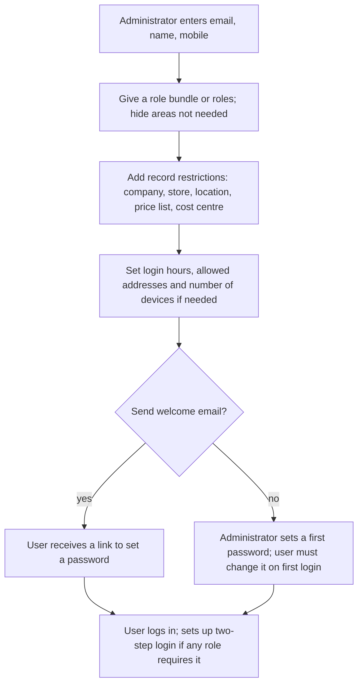
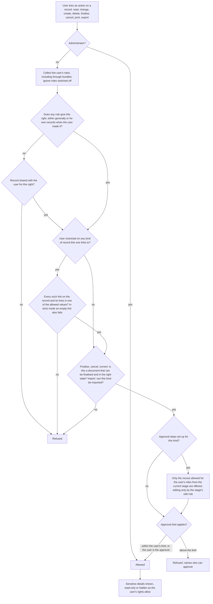
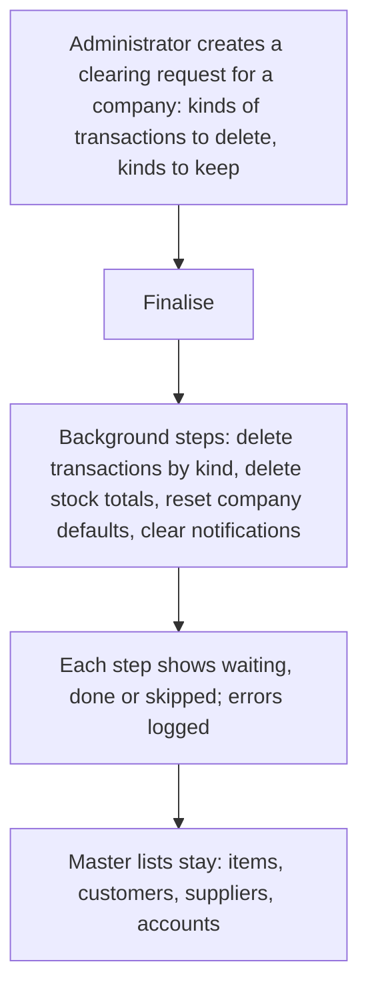

# Users, roles and permissions

## Purpose

Controls who can log in, what each person can see and do, which stores and records they are limited to, which transactions need someone else's approval, and keeps a permanent history of who did what. In a shop this is what stops a cashier from changing prices, a store manager from seeing another store's figures, and anyone from quietly deleting a sale.

## Who uses it

| Role | What they do here |
|------|-------------------|
| System administrator | Creates users, gives roles and store restrictions, sets up access rules, approvals and security settings. |
| Owner | Decides the roles and approval limits; reviews the history of changes. |
| Store manager | Approves within their limits; cannot change access rights. |
| Every user | Logs in, changes their password, sets up two-step login if required. |
| Auditor | Reads documents, ledgers and history only. |

## Main records

### Users

One per person, never shared. The shop needs to know:

- **Who they are:** name, email (used to log in), mobile number (may also be used to log in), language, photo.
- **Whether they may log in:** switched on or off. Switching off blocks login but keeps every bill and record they made.
- **What they may do:** their roles, usually given as a bundle (below), and which whole areas are hidden from them (for example accounts hidden from store staff).
- **Where they work:** which company, stores, locations, tills and price lists they are limited to (record restrictions, below).
- **Login safety:** password (stored scrambled, never readable), allowed login hours, allowed internet addresses, how many devices may be logged in at once, how often the password must change, and whether two-step login is set up.
- **Login history:** last login, from where, and the list of active sessions, which the user can end.
- **For integrations only:** a key and secret for another system to connect as this user. The secret is shown once.

### Roles

A role is a named set of rights, such as cashier or store manager. The business needs its name, whether it is in use, whether it can open the back office, and whether it requires two-step login. Switching a role off removes it from everyone. The product comes with standard roles, and the business can add its own.

**Suggested roles for a retailer:**

| Role | Typical person | Can |
|------|----------------|-----|
| Cashier | Till operator | Open and close their own shift; make and finalise till bills and returns within limits; add customers; look up items, prices and stock; print receipts. |
| Store supervisor | Shift lead | Everything a cashier can, plus approve price overrides and returns without a receipt, cancel same-day bills, view store reports. |
| Store manager | Store head | Transfers, counts, write-offs, internal requests and receipts for the store; store reports; approve within limits. Cannot change prices or tax setup. |
| Stock staff | Back-room staff | Receipts, transfers, counts (as drafts), picking and packing. |
| Inventory manager | Stock controller | Finalise counts and adjustments; locations; reorder levels; stock settings. |
| Buyer | Purchase staff or manager | Draft or finalise purchase orders; suppliers; buying prices. |
| Catalogue manager | Merchandiser | Items, variants, groups, brands, barcodes, selling prices, offers. |
| Wholesale sales | Business sales staff or manager | Quotations, orders, deliveries; customers; credit within limits. |
| Bookkeeper | Accounts staff | Invoices, payments, journals (draft or finalise, as decided), bank matching. |
| Chief accountant | Accounts manager | Chart of accounts, locked periods, locked accounts, tax setup, write-offs, closing. |
| Credit controller | Finance | Allow sales beyond credit limits and overdue bills. |
| Auditor | Outside auditor | Read and run reports on everything; change nothing. |
| System administrator | IT | Users, roles, settings, integrations, data import. |

### Role bundles

A named group of roles given together, such as cashier plus item lookup. Changing the bundle updates everyone who has it. A second kind of bundle hides whole areas of the system, for example accounts hidden from store staff.

### Access rules

For each kind of record (item, sales invoice, journal and so on) and each role, the rights that role has:

- **Basic rights:** read, change, create, delete.
- **Document rights:** finalise, cancel, and make a corrected copy of a cancelled document.
- **Output rights:** run reports, export, import, print, email, share with another user.
- **Pick only:** may choose the record in another document without opening it.
- **Own records only:** the right applies only to records the user created.
- **Sensitive details:** fields such as cost price or margin can be grouped and shown read-only or hidden from roles that should not see them.

The product comes with standard rules. When the business writes its own rules for a kind of record, they replace the standard ones for that kind.

### Record restrictions

Ties a user to particular stores, locations, companies, cost centres, customer groups or price lists. When a user is restricted on, for example, stores, they only see documents for their own stores, and those stores fill in automatically on new documents. One value per kind can be the default. For tree-shaped lists (locations, item groups) the restriction can include or leave out everything below.

### Sharing a single record

A one-off grant of read, change, finalise or share rights on one record to one user, with an optional email. For exceptions, not daily access.

### Approval steps

For a kind of document, a set of stages (for example draft, waiting for approval, approved, rejected) and the moves between them (approve, reject, send back). Each stage says whether the document is still a draft, finalised or cancelled, and which role may edit it. Each move says which role may make it, under what condition (for example only when the total is above a set amount), and whether the person who made the document may approve it. Optional emails tell the next person what is waiting.

### Approval limits

A simpler alternative to approval steps. For orders, deliveries, invoices and receipts, the business sets a ceiling on the bill total or on the discount (overall, for a customer, on an item or item group), who the ceiling applies to, and who may approve above it. Anyone else trying to finalise above the ceiling is refused.

### History records

- **Change history:** for every important record, each saved change: who, when, which details changed from what to what, and lines added or removed.
- **Login history:** logins, logouts, failed logins and when an administrator acted as another user, with the internet address and time.
- **Export and print history:** every export, print and report download: who, when, which record or report, filters and format.
- **Deleted records:** a full copy of every deleted record, with who and when, which can be restored.
- **Access changes:** changes to roles, access rules and record restrictions.
- **Document number changes** (Company and stores).

### Clearing trial data before go-live

A request per company to delete all transactions of chosen kinds, keeping listed kinds, and reset stock totals and company defaults, with each step's progress logged. Used only to clear a trial period.

Not needed by a small retailer: website or customer-portal users, custom landing pages per role, and email mailboxes linked to users.

## Processes

### 1. Creating a user

For tills, the user must also be listed on the till settings (Point of sale).

### 2. Deciding whether an action is allowed

Lists, reports, searches and pick lists follow the same rules: a user never sees a record in a list that they could not open.

### 3. Limiting a manager to one store

1. Restrict the store manager to their store's locations, cost centre and tills, each marked as the default.
2. Every new document fills in those defaults, and other stores' locations cannot be chosen.
3. Lists of invoices, transfers and counts show only documents for their locations or cost centre. A transfer between two stores is visible to both managers only if each is allowed both locations or the transfer is shared.
4. Reports are quietly limited to their stores (Reports and dashboards).
5. Company-wide lists such as items and customers stay visible unless also restricted, for example by customer group.

### 4. Approval steps (example: purchase orders above a value)

```mermaid
stateDiagram-v2
    [*] --> Draft
    Draft --> WaitingForApproval : Send for approval (buyer)
    WaitingForApproval --> Approved : Approve (purchase manager; not the buyer who made it unless allowed)
    WaitingForApproval --> Rejected : Reject (purchase manager)
    Rejected --> Draft : Revise (buyer)
    Approved --> Cancelled : Cancel (purchase manager)
```

The approved stage counts as finalised, so stock and accounting effects happen only on approval. Moves can carry conditions, such as only when the total is above 50,000, so small orders can skip approval.

### 5. Approval limits

When a covered document is finalised, the system works out the measure (bill total, average discount, or discount for the customer, item or item group). It finds the rules for that kind of document and company whose ceiling is at or below the measure. If the user is not the approver named on those rules and does not hold the approving role, the document is refused, and the message names who can approve.

### 6. Keeping history

Every save of an important record writes a change history entry. Every login and failed login writes a login entry. Every export and print writes an export entry. Every delete keeps a full copy. Every change to access is logged. No user, not even an administrator, can edit or delete history from inside the system.

### 7. Clearing trial data before go-live

## Business rules

Users and login

- Email is required and unique. First name is required. A switched-off user cannot log in. A user with no roles cannot reach the back office.
- When the password policy is on, passwords must meet a minimum strength. After a set number of failed logins, the account is locked for a set number of seconds. Password reset links expire and are limited in how often they can be sent. Resetting a password can log out all sessions.
- Logins outside allowed hours, from an address not allowed, or beyond the device limit are refused. Two-step login can be allowed to bypass the address restriction.
- Any user holding a role that requires two-step login must use it.
- Idle sessions log out after a set time. The business can allow only one session per user, with mobile sessions excepted.
- Integration secrets are shown once. They cannot be shown again, only replaced.

Roles and rules

- The built-in administrator account bypasses all rules, so it must never be used for daily work. The system manager is the highest normal role.
- A role switched off is removed from all users.
- Any right beyond read needs read. Finalise, cancel and correct apply only to documents that can be finalised. Import applies only to kinds that can be imported.
- Rights to sensitive details add to the basic rights: a role must be able to read the record before it can see the sensitive details.
- The business's own rules for a kind of record replace the standard rules for that kind entirely.

Record restrictions

- One restriction per user, kind and value. At most one default per user and kind.
- Restrictions apply to every kind of record that links to the restricted kind, including lines inside documents, unless limited to one kind.
- In strict mode, a record with an empty link to a restricted kind is hidden. Otherwise it is visible.
- Restrictions on a tree (locations, item groups, customer groups) include everything below unless set otherwise.
- Some links can be set to ignore restrictions, for example the supplier on a store transfer.

Approval steps and limits

- One active set of approval steps per kind of document. Switching one on switches the others off.
- Every stage names the role allowed to edit. Every move names the role allowed to make it. The maker may approve their own document only if that move allows it.
- Approval limits need an approving user or role, which cannot be the same as the one being limited. Discount limits are not allowed on documents without discounts. Discount values must be below 100. Customer discount limits need a customer. Duplicate rules are refused.

History and deletion

- Finalised documents cannot be deleted, only cancelled. Cancelled documents can be deleted only if no other document links to them, and a copy is kept.
- Ledger lines of deleted cancelled documents are kept unless the accounting setting to delete them is on, which is not recommended.
- Clearing trial data needs the system manager role and cannot be undone. It should be switched off after go-live.

## Calculations

- **Average discount on a document (for approval limits)** = 100 − (sum of line selling prices ÷ sum of line list prices × 100), after taking the bill discount off the total.
- **Password strength** = a score from 0 to 4 from a standard strength checker; must meet the chosen minimum.
- **Lockout** = after N failed logins in a row, blocked for M seconds.
- **Session end** = last activity time + idle time limit.

## Effects on other modules

- Every screen, list, report, import, export and print in every module passes through these checks.
- Record restrictions fill in defaults (company, store location, price list, till) on new documents in Sales, Purchasing, Inventory and Point of sale.
- Approval steps hold back stock and accounting effects until approval.
- Special roles used elsewhere are managed here: posting into locked periods and to locked accounts (Accounting), back-dated stock entries and stock authority (Inventory), credit controller (Customers), and receiving or billing beyond the order (Purchasing, Sales).
- Change history appears on every record.

## Reports

- **Users and their roles** — users with roles, bundles, restrictions, last login and whether they are switched on.
- **Role rights overview** — for each kind of record and role, the rights given (standard and the business's own).
- **Access checker** — for a user, a record and a right: allowed or not, and why (which rule, restriction or share).
- **Restrictions per user** — allowed stores, locations, price lists and defaults.
- **Change history** — for one record, or across records by user and date: what changed, old value and new value.
- **Login history** — successful and failed logins, address, time, and when an administrator acted as another user.
- **Export and print history** — who exported or printed what, when, with which filters.
- **Deleted records** — with a way to restore.
- **Waiting for approval** — documents waiting at a stage the viewer's roles can act on.

## Edge cases

- **A cashier leaves:** switch the user off, never delete. History and bills keep their name.
- **Shared till login:** discouraged. Each cashier needs their own user so bills, shift differences and history show who did what. Fast cashier switching is an open question.
- **A manager covers another store for a day:** add a temporary restriction for the other store and remove it afterwards. The change is logged.
- **The owner wants to see everything:** no restrictions plus all reporting roles.
- **An auditor needs to read everything, including cancelled documents:** the auditor role with read, report and export rights.
- **A document approved by mistake:** cancel it and make a corrected copy. History keeps both.
- **Approval needed but the approver is away:** a second approving role on the rule, or a temporary role given and logged.
- **Integration logins:** separate users with the fewest roles needed. Never reuse a person's login.
- **Several companies:** company restrictions per user, so other companies' documents are invisible.

## Settings

**Passwords and login**
- Password policy and minimum strength; how often passwords must change.
- How many failed logins before lockout, and for how long.
- Idle time before logout; whether only one session per user is allowed.
- Which login methods are allowed: email, username or mobile number, email link, or no password login.
- Two-step login: on or off, the method, and whether it can bypass address restrictions.
- How long reset links last, how often they can be sent, and whether resetting logs out all sessions.

**Access**
- Strict restrictions: whether records with an empty store or location link are hidden from restricted users.
- Whether single-record sharing is allowed at all.
- Role bundles and area-hiding bundles.

**Approvals**
- Approval steps for each kind of document: on or off, email alerts, and whether actions ask for confirmation.
- Approval limits on totals and discounts.

**History**
- Which kinds of records keep change history. It should be on for all transactions and master lists.
- How long login, export and error history is kept.
- Whether ledger lines are deleted with a deleted transaction. This should stay off.
