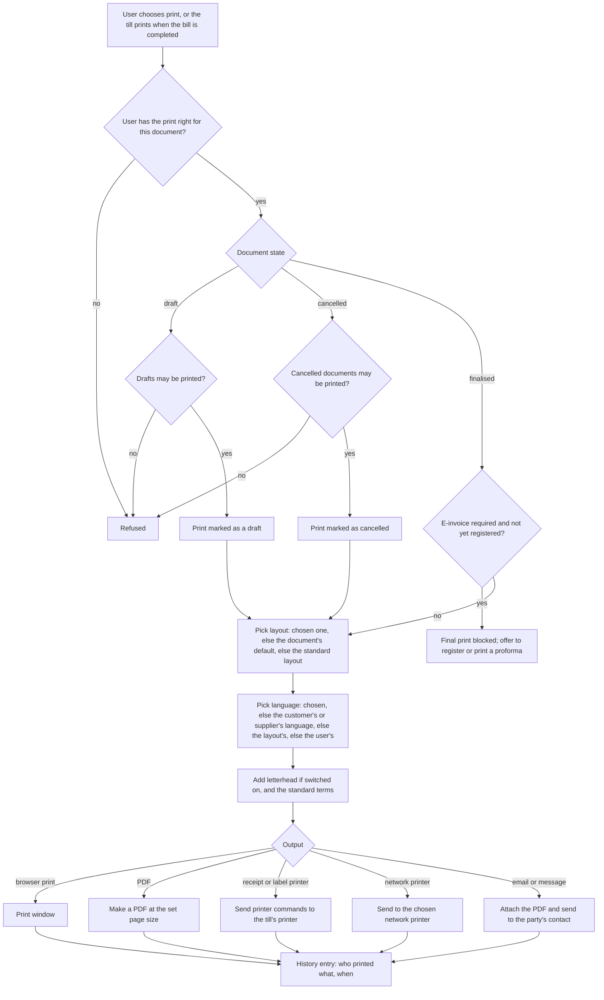

# Printing and documents

## Purpose

Produces the paper and PDF documents a retailer hands out or files: till receipts, GST tax invoices, credit notes, delivery challans, purchase orders, goods receipt notes, payment receipts, cheques, statements, labels and reports. It decides what each document shows, how it is laid out, which printer it goes to, how documents are numbered, and when a document may be printed at all.

## Who uses it

| Role | What they do here |
|------|-------------------|
| Cashier | Prints or reprints receipts; sends e-receipts by SMS, WhatsApp or email. |
| Store staff | Prints delivery challans, transfer slips, price and barcode labels. |
| Purchase manager | Prints or emails purchase orders. |
| Accountant | Prints invoices, credit notes, payment vouchers, cheques and statements. |
| Administrator | Designs layouts and letterheads, chooses default layouts and printers, sets document numbering. |

## Main records

### Layouts

A layout decides how one kind of document (or a report) looks on paper. The business needs:

- **Which document it is for,** and whether it is the default for that document. Each till can have its own receipt layout.
- **How it is made:** arranged on screen by dragging details and tables into place (enough for most shops), written by hand for full control, or as direct printer commands for thermal receipt and label printers.
- **Paper and look:** page size (A4, A5, 80 mm or 58 mm roll), margins, font and size, page numbers.
- **Print language:** the default language, which a customer's own language can override.
- **Returns:** whether minus quantities and amounts print as plain numbers marked as returned.
- **Switched on or off.**

### Letterheads

The shop's header and footer for A4 and A5 documents: a logo image or designed block, its size and position, and which one is the default. Receipts usually skip the letterhead. A business with several stores may want one per store.

### Document titles

The title on a document is decided by the document itself: tax invoice for a taxable sale, bill of supply for exempt sales or a composition dealer, credit note or debit note for corrections, delivery challan for goods moving without a sale. A reprint is marked as a duplicate copy. No separate list of titles is needed.

### Standard terms

Reusable text for the bottom of documents, such as the return policy or payment terms, marked for selling, buying or both, and pulled into documents automatically.

### Printing preferences

- **Output:** whether emailed prints go as PDF, the default page size, font and size.
- **Letterhead:** printed by default or not, and whether header and footer repeat on every page.
- **What may be printed:** drafts (always marked as drafts) and cancelled documents (always marked as cancelled).
- **Long documents:** whether tables may break across pages.
- **Printers:** whether direct printing to receipt, label and network printers is on.
- **Bulk printing:** how many documents can go into one combined PDF.

### Network printers

A printer on the shop's network (address and name), so documents can be sent straight to it, for example the store's A4 printer.

### Cheque layouts

Per bank: the cheque size and where each part prints, measured from the top and left edges: date, payee name, amount in words, amount in figures, account number, signatory and the crossing message. A scanned cheque image helps line it up.

### Document numbers

See Company and stores. Each kind of document has its own number series, which can include the year, month and store code, and a running counter. The printed document number is the record's number.

Not needed by a small retailer: a separate list of alternative document titles, choice of PDF engines, and custom styling code.

## What each document shows

Described as the information it carries, whatever the layout. GST content follows the Tax module, where the official rules are cited.

### Till receipt (consumer sale)

- **Header:** store name, company legal name, store address, GSTIN, phone; optional logo.
- **Document:** title (tax invoice, or bill of supply for exempt or composition sales), bill number, date and time, till and cashier, customer name and mobile if taken (and address and state when the value is 50,000 or more).
- **Lines:** short item name, quantity and unit, price, discount, line amount; serial or batch where relevant; HSN per line or in the tax summary (digits by turnover band); free items marked.
- **Totals:** number of items and total quantity, total before discount, discounts, taxable value, tax by head and rate (often a small table of rate, taxable value, CGST and SGST or IGST), rounding, amount to pay; amount in words (optional on receipts).
- **Payment:** each payment method and amount, amount handed over, change given, loyalty points used and their value, points earned and balance, coupon used.
- **Footer:** return and exchange policy, terms, a thank-you line, place of supply, and a QR code where required (payment QR for very large sellers; optional e-receipt link).
- **Return receipt:** marked as a return or credit note, original bill number and date, returned quantities shown as plain numbers marked as returned, and how the refund was paid.

### GST tax invoice (business sale, A4)

- **Seller:** legal name, trade name, address, GSTIN, state and state code, contact.
- **Buyer:** name, billing address, GSTIN, state and code; delivery address if different.
- **Document:** title, invoice number, date, place of supply (state), whether reverse charge applies, the customer's order number and date, delivery reference, transporter and vehicle when goods move, e-way bill number if any.
- **E-invoice details:** registration reference number, acknowledgement number and date, signed QR code (when e-invoicing applies).
- **Lines:** serial number, description, HSN or SAC, quantity, unit, price, discount, taxable value, tax rate and amount per head per line (or a separate HSN tax summary).
- **Totals:** taxable total, tax by head, other charges such as delivery, rounding, grand total, amount in words (Indian style: lakh, crore; currency and paise names from the currency setup).
- **Payment:** terms and due date, bank details for payment, optional instalments, advances used, balance due.
- **Footer:** terms, declaration, authorised signatory (digital signature when e-invoiced), and a note that the document is computer-made.

### Credit note and debit note

As the invoice, plus: what kind of note it is, the original invoice number and date, the reason, and the tax being reduced or added.

### Delivery challan (goods moving without a sale, or before invoicing)

Sender and receiver with GSTINs, challan number and date, purpose (transfer between stores, goods sent on approval), lines with HSN, quantity, value and tax if any, transporter, vehicle and e-way bill number.

### Purchase order

Buyer company and delivery address, supplier and address, order number and date, date needed, lines (item, supplier's item code, quantity, unit, price, amount), taxes, total, payment and delivery terms, authorised signatory.

### Goods receipt note

Supplier, supplier's delivery note number, receipt number and date, location, lines (ordered, received, accepted and rejected quantities, batch, expiry) and who received the goods.

### Transfer slip and count sheet

Sending and receiving location, items, quantities, batch. Count sheets list items with the system quantity hidden (for a blind count) and space for the counted quantity.

### Payment receipt and payment voucher

Party, amount, method, reference number and date, bills settled with amounts, amount in words, and who received or paid.

### Statement of account

Customer, period, opening balance, each invoice, payment and credit note with a running balance, closing balance, and a summary by age.

### Labels

Price and barcode labels per item or per received batch: item name, price (and MRP where printed), barcode, unit, packing or expiry date, batch. Printed on label printers using printer commands, or on A4 label sheets. The reference system can send printer commands but has no label designer (open question).

## Processes

### 1. Printing a document

### 2. Reprints and duplicates

A reprint of a finalised receipt or invoice is marked as a duplicate copy (this can be switched off), and every print is logged. Reprinting a till bill after the shift has closed is allowed, since it is still a finalised document.

### 3. Bulk printing

Choose many documents in a list and print them as one PDF, up to the set limit. It is made in the background and the user is told when it is ready.

### 4. Designing a layout

1. Copy a standard layout. Standard layouts cannot be changed directly.
2. Arrange header details, item table columns, totals, tax summary, terms and signature on screen, or write the whole layout by hand for full control.
3. Set the page size (A4, A5, 80 mm or 58 mm roll), margins, font and colours.
4. Make it the default for the document, or give it to a particular till (Point of sale) or customer.

### 5. Numbering

Numbers are given when a document is first saved, from its number series (Company and stores). The series can include the store code and year, so each store has its own sequence that restarts each financial year. Cancelled documents keep their numbers, because they must be reported as cancelled in the GST list of documents issued. A corrected copy of a cancelled document gets the same number with a revision suffix.

## Business rules

- Printing needs the print right for that kind of record. Emailing needs the email right.
- Drafts print only if allowed and are always marked as drafts. Cancelled documents print only if allowed and are always marked as cancelled.
- A business invoice of a company that must e-invoice must not print as final before registration (Tax).
- Standard layouts cannot be changed. Changes are made on a copy.
- A layout belongs to one kind of document (or one report). Only switched-on layouts can be chosen. There is one default per kind.
- There is one default letterhead. Letterheads switched off are not offered.
- Standard terms are offered only for selling or buying, as marked.
- Bulk prints are limited per job and per user at a time.
- Direct printing needs the direct-printing switch on and a layout written in printer commands.
- Amount in words uses the currency's names for rupees and paise and the company's number style (Indian grouping for rupees).
- Invoice numbers must be unique per financial year per series and may contain letters, digits, hyphens and slashes (Tax module citation). A series must not be shared between kinds of documents.
- Every print, PDF and export is recorded in the history.

## Calculations

- **Amount in words** = the rounded total written in words, with paise when not zero, using Indian grouping (thousand, lakh, crore) for rupees.
- **Tax summary table** = per tax rate (and per HSN when required): total taxable value and total tax per head across the lines.
- **Returns printed as plain numbers** = the value without its minus sign, marked as returned or credit, when the layout asks for it.
- **Page fitting** = rows per page from the page height less header, footer and margins; header and footer repeated when switched on.
- **Cheque positions** = millimetres from the top and left edges for each printed part.

## Effects on other modules

- Printing changes no stock or accounts.
- Print language and layout can be set per customer and supplier (Customers, Suppliers) and per till (Point of sale).
- E-invoice registration controls final printing (Tax).
- Prints and exports are written to the history (Users, roles and permissions).
- Number series feed the GST list of documents issued (Tax).

## Reports

- **Print and export history** — who printed or downloaded which document or report, and when.
- **Documents issued per series** — first and last number, how many issued and cancelled (Tax).
- **Layouts in use** (recommended) — which layout is the default for each kind of document and each till.

## Edge cases

- **Receipt roll width:** 80 mm and 58 mm need separate layouts. Long item names wrap or are cut short, and the tax summary is kept compact.
- **Till printer offline:** the bill is still saved. Reprint it later from past bills, or send an e-receipt instead.
- **Customer asks for a GST invoice after getting a receipt:** add the GSTIN and print the tax-invoice layout only if the bill is not yet finalised. Otherwise issue a credit note and a new business invoice (Tax).
- **Receipts in other languages:** print language per customer; item names need translations.
- **Price labels after a price change:** reprint labels for items whose selling price changed since a chosen date (recommended feature).
- **Auditor asks for a cancelled invoice:** printable only if allowed, and always marked as cancelled.
- **Several stores:** each store's address and GSTIN on its documents, and a letterhead per store if needed. The layout takes the store from the document's location or cost centre.

## Settings

**Defaults**
- The default layout for each kind of document, and the receipt layout for each till.
- The print language for each customer or supplier.
- Whether the till prints a receipt automatically when a bill is completed.

**Paper and look**
- Page size (including a custom width for receipt rolls), font and size.
- Whether to print with the letterhead and repeat header and footer on every page.
- Whether long tables may break across pages.

**What may be printed**
- Whether drafts and cancelled documents may be printed.
- Whether reprints are marked as duplicates.

**Totals and tax on prints**
- Whether to hide the currency symbol, the amount in words, or the rounded total.
- Whether tax-inclusive amounts are shown, and whether tax is shown as a table.
- Whether repeated items are combined into one line on the print.

**Printers and output**
- Whether direct printing to receipt, label and network printers is on, and the network printers themselves.
- Whether emailed prints go as PDF.
- Limits on bulk printing.

**Numbering**
- The number series for each kind of document (Company and stores).
