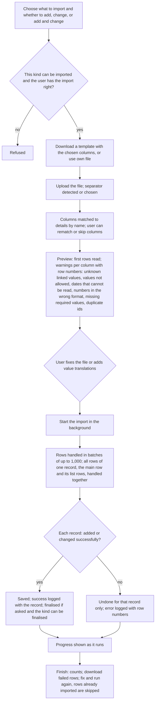
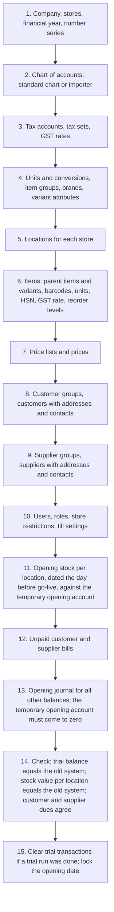
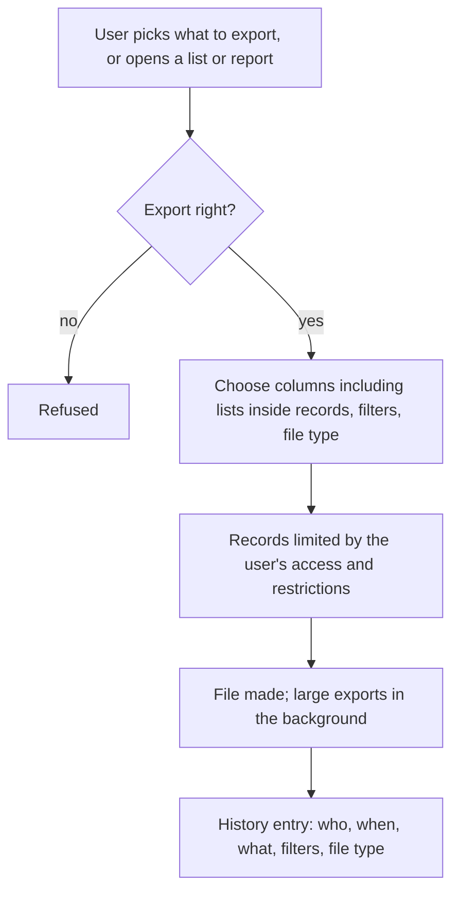

# Data import and export

## Purpose

Gets a retailer's existing data into the system at go-live, and makes bulk changes practical afterwards: thousands of items with barcodes and prices, customers and suppliers with addresses, opening stock per store, opening balances and unpaid bills, the chart of accounts, and bank statements. It also lets users take data out to spreadsheets for analysis, audit or moving to another system.

## Who uses it

| Role | What they do here |
|------|-------------------|
| Implementer or administrator | Prepares templates, runs the go-live imports, fixes errors, runs them again. |
| Catalogue manager | Adds and changes items, prices and barcodes in bulk. |
| Accountant | Imports the chart of accounts, opening balances, unpaid bills and bank statements. |
| Store manager | Imports opening stock and regular count sheets. |
| Anyone with the export right | Exports lists and reports. |

## Main records

### Import jobs

One job per file brought in. The business needs:

- **What is being imported** (items, customers, prices and so on) and **what to do:** add new records only, change existing ones only, or add new and change existing.
- **The file:** a spreadsheet or comma-separated text, or a link to an online sheet. The separator is detected automatically or chosen.
- **Which column holds what:** each file column matched to a detail, or skipped.
- **Translating values:** for example a unit written one way in the old system and another way in the new one.
- **For documents:** whether to finalise them after import or leave them as drafts.
- **Emails:** whether notifications are sent during the import. Off by default.
- **Result:** waiting, partly done, done or failed, with counts of records added, changed, skipped and failed.
- **Preview:** a look at the first rows with warnings, before anything is saved.

### Import log

One line per record or failed row: row numbers, whether it worked, the record that was created or changed, whether it was added or changed, and the error message. Failed rows can be downloaded as a file, corrected and imported again.

### Templates

A downloadable empty or pre-filled file for one kind of record, with the chosen columns: the required ones, any optional ones picked, and the columns for lists inside a record (for example an item's barcodes, units and supplier item codes) laid out the way the importer expects.

### Special importers

- **Chart of accounts:** a file listing each account's name, number, folder above it, whether it is a folder, family (asset, liability and so on), kind and currency, with a template and a preview of the tree before it is applied.
- **Unpaid bills at go-live:** for sales or purchases, one row per bill with the party, original bill number, date, due date and amount still owed, against the temporary opening account. It can create missing customers or suppliers (Accounting).
- **Bank statements:** the bank account and the statement file (spreadsheet, online sheet, or a standard bank statement file), with column matching and a log of failed rows (Accounting).
- **Opening stock:** a stock count marked as opening stock, whose lines can be pasted or imported (Inventory).

### Exports

What to export, the file type (spreadsheet or comma-separated), the columns (including lists inside records), and filters. Lists and reports can also be exported straight away with their current filters.

Not needed by a small retailer: technical error traces in the log, and importing into a group of linked companies.

## Processes

### 1. General import

How the modes behave:

- **Add:** an id may be given only for kinds whose ids the user chooses, such as item codes. Otherwise the number series gives the number.
- **Change:** the id column is required, and only the columns in the file are changed. A row with nothing to change is reported as such.
- **Add and change:** existing ids are changed, the rest added.
- **Tree-shaped lists** (item groups, accounts, locations, customer groups): folders may be defined earlier in the same file. The folder above must be a folder. Missing folders are reported before the run.
- **Running again:** rows already logged as successful are skipped automatically.
- **Emails and notifications** are off by default during imports.
- **Dates** are read by guessing the column's format from its values, or using the system date format. **Numbers** use the system number format.

### 2. Go-live data load (recommended order)

### 3. Importing items

- One row per item. Lists inside the item (barcodes, other units with their conversion factors, supplier item codes, per-company defaults, reorder levels, taxes) go on extra rows under the item's first row, with the item columns left blank on those rows.
- Import parent items with their variant attributes first, then the variants with the parent code and attribute values. Or create variants in bulk from the parent item.
- Barcodes are checked for uniqueness and check digits, just as when typed in (Items). The stock unit's conversion factor must be 1.
- For several stores, opening stock should come in through an opening stock count, not through the item.
- Prices are a separate import: price list, item, unit, price and validity dates.

### 4. Importing customers and suppliers

- Import customers and suppliers first. Addresses and contacts are imported separately, with a column naming the customer or supplier. One address or contact can belong to several parties.
- Group values must already exist, or be translated. The GSTIN goes on the address and the party (Tax).
- Credit limits and per-company accounts are list rows under the party.

### 5. Importing opening stock

1. Export the items and locations as a template for an opening stock count.
2. Fill in the counted quantity and the value per unit for each item at each location. Tracked items need batch and serial columns: one row per batch, and serial numbers as a list.
3. Import it as a draft count, check the totals, and finalise. The other side is the temporary opening account, a balance-sheet account, which the system insists on for opening counts.

### 6. Importing opening balances

- **Unpaid customer and supplier bills:** rows of party, original bill number, date, due date and amount still owed, so ageing and payment matching work.
- **All other balances:** one opening journal (account, debit, credit, and party where needed), marked as opening, dated the day before go-live, against the temporary opening account.
- **Check:** the temporary opening account must be at zero once stock, bills and the journal are all in.

### 7. Importing a chart of accounts

Upload the file. The importer builds the tree and checks it before applying: each of the five families (asset, liability, capital, income, expense) must have a top-level folder; every account must reach a valid family through its folders; folders must exist in the file; a folder cannot carry a kind that only bottom-level accounts may have. It is refused when the company already has ledger entries.

### 8. Exporting

An export can be used as an import template: export, edit in a spreadsheet, and import again in change mode.

## Business rules

- Only kinds of records marked as importable can be imported. Kinds critical to the system are blocked entirely.
- The user needs the import right for that kind, plus the rights to create or change what the rows do. Exports need the export right.
- Imports run in the background, so the background job runner must be working.
- Each record is saved or undone on its own. A failed row never leaves a half-made record.
- Required details, linked values, allowed values, and date and number formats are checked exactly as for typing in. Every business rule of that kind of record (Items, Customers, Inventory and so on) applies during import.
- Documents are imported as drafts unless the user chooses to finalise them. Finalising has the same stock and accounting effects as finalising by hand.
- In change mode the id column is required, and the record must exist.
- In add mode an id may be given only for kinds named by the user, such as item code. Kinds numbered by a series ignore or refuse given ids.
- List rows must follow their main row in the file.
- Folders in tree-shaped lists must be folders and must exist, either already or earlier in the file.
- Opening stock and unpaid opening bills must use the temporary opening account. Opening entries are refused once any year-end closing exists (Accounting).
- A chart of accounts cannot be imported for a company that already has ledger entries.
- Bank statement lines with a bank transaction id already brought in are skipped (Accounting).
- Exports include only records the user may read, and every export is logged.

## Calculations

- **Import progress** = rows done ÷ total rows; time left = average time per row × rows left.
- **Number of batches** = rows ÷ batch size, rounded up, with a batch size of 1,000 by default.
- **Date format guess** = the format that reads the most values in the column, with the system date format breaking ties.
- **Opening check** = total debits − total credits on the temporary opening account across opening stock, unpaid opening bills and the opening journal = 0.

## Effects on other modules

- Imported master records behave exactly like ones typed in.
- Imported and finalised transactions post stock and accounting entries (Inventory, Accounting). Opening stock and unpaid opening bills post against the temporary opening account.
- Imported prices apply at once in Pricing and Point of sale, but tills must refresh their stored copy.
- Imported users and restrictions apply at their next login.
- Exports change nothing but are logged (Users, roles and permissions).

## Reports

- **Import jobs** — what was imported, the mode, the result, the counts, who ran it and when.
- **Import log per job** — row numbers, success or error, records, messages; failed rows downloadable.
- **Export history** — from the print and export history.
- **Go-live check pack** (recommended) — trial balance, stock balance per location, and customer and supplier dues by age on the go-live date, side by side with the old system's figures.

## Edge cases

- **Spreadsheet dates and leading zeros:** barcodes and HSN codes must be text, not numbers, or leading zeros are lost. Templates should mark them as text.
- **Indian number style in files** (1,00,000.00): read using the system number format, with a warning on mismatches.
- **Duplicate customers in old data:** import in change mode matched on mobile number, or clean the data first (Customers open question).
- **Very large catalogues** (100,000 or more items): batches and background running; pause search indexing during the import if needed.
- **Partial failure:** fix only the failed-rows file and run again. Successful rows are not duplicated.
- **Re-importing prices for a price change:** add new price rows with a start date instead of overwriting, to keep history.
- **Stores going live on different dates:** opening stock per store dated for its own go-live; the opening journal on the company's date.
- **Tills working offline:** after a large item or price import, tills must refresh their stored catalogue (Point of sale).

## Settings

**Who may import and export**
- Which kinds of records can be imported at all.
- Which roles have the import and export rights.

**How files are read**
- The system date and number formats used to read files.
- Separators: detected automatically or chosen per job.
- How many rows go in each batch.

**Per import job**
- Whether emails and notifications are sent. Off by default.
- Whether documents are finalised after import or left as drafts.

**Opening balances**
- The temporary opening account used on the other side of every opening entry.
