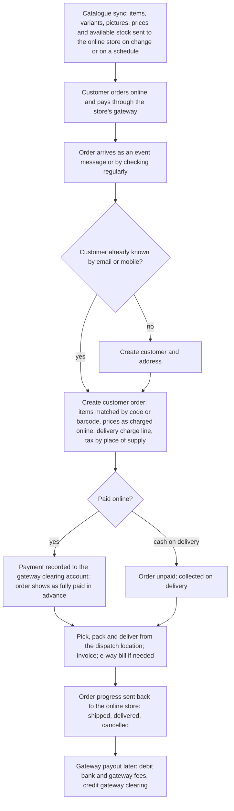
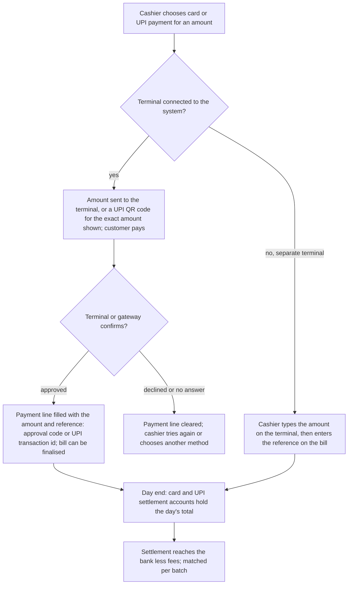
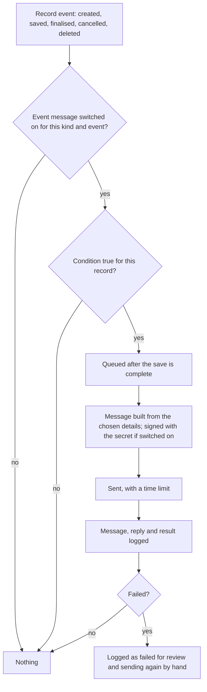

# Integrations

## Purpose

Connects the retail system to the outside world: online stores and marketplaces, payment gateways and card or UPI terminals, government tax portals, banks, messages (email, SMS, WhatsApp), printers and scanners, maps for deliveries, sign-in with another account, and any other system through a programming interface and event messages. This module describes what each connection does and what the core system must offer so connections can be built without changing core logic.

**Approach:** the online store (shopping cart and web catalogue), payment-gateway connectors (card, UPI and wallet providers) and most outside connectors are kept out of the core as separate add-ons. The core keeps only general building blocks: payment requests and gateway accounts, event messages to other systems, alerts, email and SMS, a programming interface with keys and sign-in tokens, direct and network printing, a bank-feed connector for one provider, and map routing for delivery trips. The descriptions below cover both the building blocks and the retail connections a product needs, in terms of behaviour.

## Who uses it

| Role | What they do here |
|------|-------------------|
| System administrator | Sets up connectors, keys, event messages, email accounts, SMS provider and printers. |
| Accountant | Chooses the accounts for gateway and card settlements; brings in bank feeds; matches payouts. |
| Store manager | Uses card and UPI terminals, receipt and label printers, scanners. |
| Online sales manager | Publishes items and prices online; receives online orders into stock and sales. |
| Partner developer | Uses the programming interface and event messages to connect other systems. |

## Main records

### Programming interface and keys

Other systems need to read and write the shop's records in a controlled way. Every kind of record can be listed with filters, read, created, changed, deleted, counted, finalised and cancelled through the normal steps. The business needs:

- **Who is calling:** each connection signs in as a named user, with a key and secret on that user (Users, roles and permissions), or with sign-in tokens given to a registered outside application (its id, secret, what it may access, and where it may return to).
- **What it may do:** every call runs with that user's roles and restrictions. There is no back door.
- **How often:** calls are limited per user so a faulty connection cannot overload the system.

### Event messages to other systems

When something happens to a record, the system can tell another system automatically. For each one the business needs:

- **When:** which kind of record and which event (created, saved, finalised, cancelled, deleted, any change), with an optional condition.
- **Where:** the address to send to, fixed or built from the record.
- **What:** the record details to send.
- **Safety:** a shared secret used to sign each message so the receiver can trust it, and a time limit.
- **On or off,** and a log of every message with the reply and result.

### Alerts and automatic messages

Messages the system sends by itself. For each the business needs:

- **When:** a record is created, saved, finalised or cancelled, a value changes, or a date is a set number of days or minutes away.
- **Condition:** for example only bills above a value.
- **How:** email, SMS, in-system notice, or a chat channel.
- **To whom:** fixed addresses, roles, a contact on the record such as the customer's email, the record's creator, or the person it is assigned to.
- **What it says:** subject and message filled with record details, and optionally the printed document attached.

Examples: an e-receipt to the customer when a till bill is finalised; an alert to the purchase manager when an automatic reorder request is made; a reminder to a customer three days before a bill is due.

### Email accounts

The mail server details for sending and receiving, which account sends by default, and a signature. Used by alerts, scheduled reports, summary emails, statements and emailed documents. Incoming mail can optionally create records, such as supplier bills sent by email.

### SMS provider

The provider's address, how the message and phone number are passed, fixed details such as the sender id and login, and which roles may send. It must work with Indian SMS providers. Registering message templates under Indian telecom rules is handled with the provider.

### Payment gateway accounts

Per company and gateway: the clearing account online payments land in, the currency, how the request reaches the customer (email link, UPI collect request on the phone, other), a default message, and which gateway is the default.

### Payment requests

A request asking a customer to pay (or a record of the shop paying out) an amount against an order or invoice. The business needs: the party, the document, the amount and currency, the gateway, how it is sent (email or phone), the message, the payment link, and how far it has got (draft, sent, payment started, paid, partly paid, failed, cancelled), with the amount still owed and which instalments it covers. When the gateway confirms payment, a payment is recorded automatically and the request becomes paid.

### Bank feeds

The connection details for a bank-data provider and whether it fetches every hour. Linked bank accounts pull transactions in as bank statement lines automatically (Accounting). Indian banks need a domestic provider (the Account Aggregator framework or bank interfaces).

### Printers and devices

- **Network printers** (address and name) for printing from the server.
- **Receipt and label printers** driven directly through a small print helper on the till computer.
- **Barcode scanners** act as keyboards and need no setup.
- **Cash drawer** opens through the receipt printer.
- **Customer display and weighing scale** need a small device helper on the till computer (needs a device helper).

### Maps

A maps service key used by delivery trips to estimate arrival times and put stops in the best order from the driver's start point (Sales), and to place addresses on a map.

### Signing in with another account

Sign-in with Google and similar accounts, matched to existing users. The system can also let other applications sign in through it.

### Government portals

E-invoice registration and e-way bills (Tax) go through a GST Suvidha Provider or the portals' own interfaces. The core must supply the data, keep the results (registration number, acknowledgement, QR code, e-way bill number and validity), and queue and retry when the portal fails.

Not needed by a small retailer: company directory sign-in for large offices, and custom server actions for outside systems.

## Processes

### 1. Online order to stock and accounts (online store or marketplace)

Rules: stock shown online is available quantity less reservations less a safety margin. A cancellation online cancels the order, or creates a return and credit note if already delivered. Marketplace commissions are booked as expenses when the payout arrives.

### 2. Card or UPI at the till

A phone payment method can send a UPI collect request and stops the bill from being finalised until exactly that amount is paid (Point of sale).

### 3. Payment link for an invoice or order

1. From an order or invoice, create a payment request. The amount starts as the amount still owed, or the next instalment.
2. The system gets a link from the gateway and emails or messages it to the customer.
3. When the customer pays, the gateway tells the system. The request is marked paid, a payment to the gateway account is recorded and finalised automatically, and the invoice's amount owed falls.
4. If payment fails or the link expires, the request is marked failed and can be sent again.

### 4. Event message to another system

### 5. Alerts and e-receipts

When the trigger happens, the system checks the condition, fills the subject and message with record details, attaches the printed document if set, and sends it by the chosen channel. For date-based alerts, a daily job finds records whose date is the set number of days away. Every message sent is logged on the record. Customers who have opted out of marketing messages are not sent them.

### 6. Government portals

When a business invoice of a company that must e-invoice is finalised, it is queued for registration. The connector sends it and stores the registration number, acknowledgement and signed QR code, or the error. It keeps retrying until it succeeds, with a warning as the 30-day limit nears (Tax). E-way bills are made on request from deliveries, transfers and invoices, and their number, validity and vehicle changes are stored and printed.

### 7. Bank feeds

The bank connection fetches statement lines every hour, or on request, for linked accounts. Matching rules sort them, and the bank matching screen links them to payments (Accounting).

## Business rules

- Every interface call, event message and connector acts as a named user and is bound by that user's rights and restrictions. Connection users should hold only the roles they need.
- Interface secrets and connector passwords are stored scrambled and never shown after saving.
- Event messages are sent only after the save is complete, so a save that fails never sends a message. A failing message never blocks the user's work.
- An event message needs a valid address. Its condition and contents are checked when saved. The same detail cannot be sent twice under one name. A secret is required when signing is on.
- A payment request cannot be more than the amount still owed on its document (or the instalment left), must be in the document's currency, and needs a gateway account when it goes through a gateway. A request linked to a completed payment cannot be cancelled.
- A payment confirmed by a gateway creates exactly one payment. Repeated confirmations are ignored.
- Alerts are not sent to switched-off users. SMS can be sent only by allowed roles.
- Stock published online must never be more than the available quantity less reservations.
- Every message in and out through a connector is logged with its result, for checking and sending again.
- Limits on the number of calls protect the system from faulty connections.

## Calculations

- **Stock shown online** = in stock − reserved (orders and till bills) − safety margin, per dispatch location or added across locations.
- **Gateway payout** = payments taken − refunds − gateway fees − GST on fees = amount reaching the bank.
- **Payment request amount** = amount still owed on the document, or the next instalment, or an amount typed by the user that is not more than what is owed.
- **Message signature** = a keyed code worked out from the exact message and the shared secret, sent with the message.
- **Delivery arrival estimate** = departure time + travel time to each stop (from the maps service) + time spent at each stop.

## Effects on other modules

- Payment requests and gateway confirmations record payments (Accounting) and update the advance paid on orders (Sales).
- Online orders create customers, orders, deliveries and invoices (Customers, Sales, Inventory, Tax).
- Bank feeds create bank statement lines (Accounting).
- E-invoice and e-way bill connectors update tax documents and control printing (Tax, Printing).
- Terminal payments fill the till's payment lines (Point of sale).
- Alerts and summary emails use the email and SMS connections (Reports and dashboards).

## Reports

- **Event message log** — event, record, address, result, reply, time.
- **Connector log** — messages in and out through connectors, with results and errors.
- **Payment requests** — by progress, amount, document, gateway and age.
- **Gateway payout matching** (recommended) — payments taken against payouts and fees, per payout.
- **E-invoice and e-way bill status** — see Tax.
- **Online order sync** (recommended) — orders received, items that could not be matched, stock sync errors.
- **Messages sent** — per channel and recipient.

## Edge cases

- **Item sold out in the store while listed online:** how often stock is synced and the safety margin decide. An oversold online order is held until stock arrives or cancelled with a refund.
- **Gateway confirmation lost:** the payment request stays at payment started. A scheduled check with the gateway settles it. Marking it paid by hand needs the gateway's reference.
- **Repeated confirmation:** ignored once the request is paid.
- **Terminal approved but the till crashed:** the money reached the bank but no bill shows it. Bank matching flags an unmatched settlement line, and the cashier bills again with the approval code.
- **Receiving system down:** failed event messages are logged and the business decides whether to send them again by hand.
- **Government portal down:** invoices queue for registration, and business invoices print only as proforma until registered (Tax).
- **Internet down at the store:** connected terminals and online payments fail. Separate terminals and cash carry on. Queued connections catch up when the internet returns (Point of sale offline question).
- **Several stores, one online store:** choose the dispatch location per order (nearest store or central store) and publish stock combined or per store.

## Settings

**Access for other systems**
- Keys per connection user, and the outside applications allowed to sign in with what they may access.
- Sign-in with Google and similar accounts.

**Messages**
- Event messages for each kind of record and event.
- Alerts for each trigger and channel, including e-receipts.
- Email accounts and the default sending account.
- SMS provider details and the roles allowed to send.

**Payments**
- Payment gateways and their clearing accounts per company.
- Whether payment requests start as drafts for checking before sending.
- Whether payment requests follow the invoice's instalments.

**Banks**
- The bank-feed connection and whether it fetches every hour.

**Printers and deliveries**
- Network printers and direct printing to receipt and label printers.
- The maps key, the time allowed at each delivery stop, and the message sent to customers when goods are dispatched.

**Government portals and online store (proposed)**
- Login details for the e-invoice and e-way bill connector.
- Online store connection: which items are published, the stock safety margin, the dispatch location, and how online orders are matched to items and customers.
